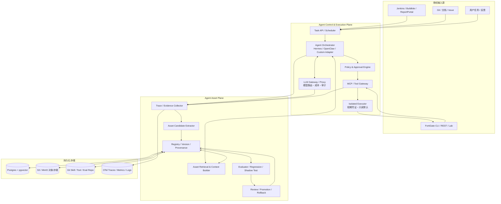
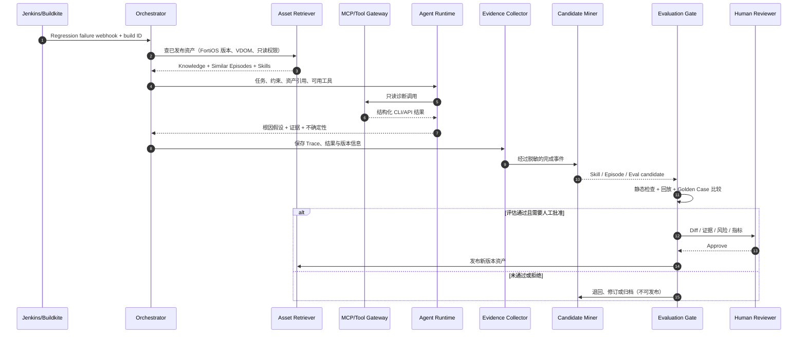
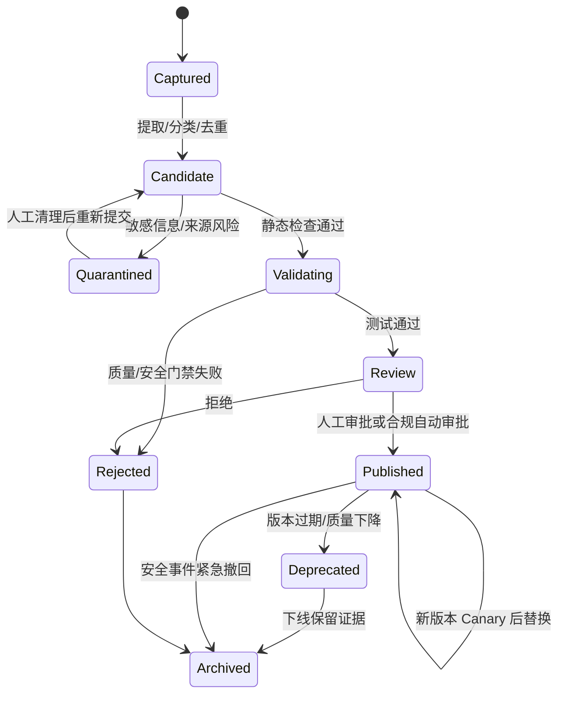

# Agent Persistent Asset & Continuous Learning Platform

> **中文名称：自我改进型 Agent 资产管理与持续学习平台**  
> **文档类型：架构设计（Architecture Design / RFC）**  
> **版本：v0.1 · 2026-10-22 · 状态：已被 v0.2 取代（superseded）→ [中文 v0.2](Agent_Asset_Learning_Platform_Architecture_v0.2.zh-CN.md) · [English v0.2](Agent_Asset_Learning_Platform_Architecture_v0.2.md)**  
> **首个应用场景：FortiGate / FortiOS 智能测试、故障诊断与 AI-native Quality Engineering**

---

## 0. Executive Summary（执行摘要）

设计一套独立于底层 LLM、Agent Framework 和 MCP 工具的 **Agent Asset Plane（资产层）**。Agent 每次执行任务时，不仅输出答案，还可从经过授权的执行轨迹中提炼并沉淀可复用资产；资产经过去重、脱敏、适用性校验、回归评估与审批后才进入生产检索路径。

**核心闭环：**

`Task → Observe → Capture Evidence → Extract Candidates → Validate → Approve → Publish → Retrieve/Reuse → Measure → Revise/Rollback`

与简单的聊天记忆或自动生成 `SKILL.md` 不同，本平台同时管理七类资产：Knowledge、Episodic Memory、Skills、Tools/Code、Environment Model、Evaluation Assets、Context & Preferences。重点是 **资产的版本化、可溯源、可测试、可回滚**，从而真正测量 Agent 是否随时间改进。

**定位：** 不重新发明 Hermes、OpenClaw 或 Claude Code 等 Agent Runtime，而是在它们上层/旁路建立可共享的资产治理、可观测性与质量评估能力。

**首版目标：** 让一个只读 FortiGate 诊断 Agent 能从 Jenkins/Buildkite 失败记录和授权的设备诊断数据中，复用知识与技能、给出有证据的结论，并把人工确认的案例转为回归评估资产。

---

## 1. 背景、问题与边界

### 1.1 当前问题

1. Agent 每次运行重新探索相似问题，浪费 Token、时间与工具调用。
2. 成功经验散落在 Chat、CI 日志、报告、脚本、Git 提交里，缺少统一的可复用表示。
3. 自动写入的记忆/Skill 可能包含错误、过期 CLI、敏感信息或恶意指令。
4. 仅观察最终答案无法判断错误来自模型、检索、工具、环境、权限还是过时资产。
5. Agent 自称“学会了”不代表成功率有提升；缺少基准集、反事实对照和回归验证。

### 1.2 设计目标

- **G1 可复用：** 从真实任务提炼知识、案例、技能和工具资产，而不是只保存完整对话。
- **G2 可解释：** 每项关键结论可追踪到来源、环境版本和执行证据。
- **G3 可验证：** 候选资产必须过质量门禁，可对比启用资产前后的表现。
- **G4 可治理：** 分级授权、人工审批、审计、版本控制、失效与回滚。
- **G5 低耦合：** 支持多模型/多 Agent（Hermes、OpenClaw、自研 Orchestrator），通过 Adapter 接入。
- **G6 渐进实现：** 优先单团队 MVP，避免第一版堆叠 Kubernetes、图数据库和复杂多 Agent 自治。

### 1.3 非目标（v0.1）

- 不自动训练或微调基础大模型权重；此处“学习”指 **externalized learning（外置资产学习）**。
- 不允许 Agent 无审批修改生产 Firewall Policy、重启设备或变更网络配置。
- 不宣称 Hermes 原生具备全部七类资产管理；其现有能力经 Adapter 使用。
- 不追求完全自主的跨公司、跨租户 Agent 市场或计费平台。

### 1.4 约束与假设

- 初期只接入具有明确授权的测试环境和 CI/CD 资源。
- Jenkins、Buildkite、ReportPortal、Git、FortiOS CLI/API 通过现有 API 或 MCP 工具连接，具体权限按组织政策执行。
- 原始设备配置、日志、客户数据、Token 和 Secrets 可能敏感，默认不可直接写入共享技能库。
- 评估集须独立于 Skill 生成样本，避免数据泄露导致虚假提升。

---

## 2. 七类持久化资产：数据分类与使用场景

| 资产（type） | 主要内容 | 典型存储 | 检索触发 | FortiGate 示例 |
|---|---|---|---|---|
| `knowledge` | 文档、CLI/API 语义、产品规则、版本差异 | Git/对象存储 + 全文/向量索引 | 按问题与产品版本 | FortiOS 7.x Policy Match 文档 |
| `episode` | 历史任务、行动、观察、结果、失败路径 | Postgres 元数据 + 对象存储 Trace | 症状、环境与相似案例 | 某次 Jenkins Fail 的完整证据链 |
| `skill` | 复用流程、前提、步骤、陷阱、核验方法 | Git 中 `SKILL.md` 与附件 | 任务意图 + 版本/权限匹配 | Firewall Policy 排障工作流 |
| `tool` | 可执行脚本、API/MCP 封装、解析器 | Git + 制品库 | 工具契约与能力查询 | FortiOS CLI 输出解析器 |
| `environment` | 拓扑、配置快照、版本、依赖和有效期 | Postgres / JSON / 对象存储 | 当前设备/VDOM/拓扑 ID | src/dst → route → policy → NAT 关联 |
| `evaluation` | Gold Cases、评分器、回归测试、负样本 | Git + DB + CI Artifacts | 验证新 Skill/Agent 版本 | 已确认的 Policy 顺序问题测试 |
| `context` | 项目规则、用户偏好、任务检查点 | KV/DB；短摘要 | 启动任务、恢复中断执行 | “只读模式、输出证据和 CLI 来源” |

**分类原则：**

- “是什么” → `knowledge`；“发生过什么” → `episode`；“如何做” → `skill`。
- 确定性、可自动执行且需准确重复的逻辑 → `tool`，不要全部写成自然语言 Skill。
- “当前系统处于什么状态” → `environment`，并附观察时间与 TTL。
- “如何证明好坏” → `evaluation`，不作为普通参考知识无差别注入。
- “这个用户/项目的固定约束” → `context`，保留最小必要信息，支持修改和删除。

**重要：** 资产之间允许有关联，但不互相替代。例如一个 `episode` 可生成 `skill` 候选和 `evaluation` 回归案例，发布后仍保留关联的证据 ID。

---

## 3. 逻辑架构



### 3.1 控制面职责

- **Task API / Scheduler：** 接收用户任务、CI Webhook、周期触发；分配 `run_id` 并管理幂等键。
- **Agent Orchestrator：** 分解任务、路由子 Agent、限制循环、处理断点恢复、关联资产与执行状态。
- **Runtime Adapter：** 抽象 `start/run/tool_call/result/checkpoint`，避免资产层绑定 Hermes 的内部对象。
- **LLM Gateway / Proxy：** 记录模型、Token、延迟、费用、错误、重试；按策略选择模型；不默认记录敏感 Prompt 明文。
- **MCP / Tool Gateway：** 工具发现、Schema 校验、权限验证、调用审计和结果归一化。
- **Policy Engine：** 按用户身份、目标环境、操作风险与资产信任等级强制授权；审批不由模型自行授予。
- **Isolated Executor：** 每次任务分配隔离执行环境，最小权限、限时、网络访问白名单；Secrets 使用短时凭据。

### 3.2 资产面职责

- **Evidence Collector：** 生成结构化轨迹；大型输出保存在对象存储，通过摘要和哈希关联。
- **Candidate Extractor：** 从完成任务或人工纠正中发现可复用候选；允许“无需生成资产”。
- **Asset Registry：** 统一标识、类型、版本、证据、依赖、权限、适用产品版本和生命周期状态。
- **Retriever：** 混合检索（关键词 + 向量 + 元数据过滤），根据环境/版本/授权判断是否适用。
- **Evaluator：** 运行离线回放、模拟环境和回归测试，与 Baseline 作成对比较。
- **Review & Promotion：** 审批变更、签名发布、Canary、废弃与回滚；不可仅凭 LLM 自评分发布高风险资产。

### 3.3 两条独立的数据流

**执行路径（低延迟）：** Query → 识别环境 → 查找已发布且适用的资产 → 构建最小上下文 → Agent 调用工具 → 输出有证据的结果。

**学习路径（异步）：** 任务完成 → 整理轨迹 → 识别候选 → 清理脱敏 → 生成/更新资产 → 测试与人工审查 → 发布/回滚。

将二者分离，避免每次任务都阻塞在资产生成和完整评估上。

---

## 4. 端到端运行时序



**避免反馈污染：** “分析报告称修复成功” ≠ 故障已解决。用于训练或评估的成功标签应由设备观测、回归测试或授权工程师独立确认。

---

## 5. 资产生命周期与治理状态机



**候选资产的必经校验：** 来源可信度 → 数据脱敏 → Prompt Injection 检查 → Schema 校验 → 环境/产品版本匹配 → 单元/回归测试 → 独立评价 → 风险分级审批。版本更新不能直接覆盖已发布资产，应采用不可变版本及 `active_version` 指针。

### 5.1 资产公共元数据（示意）

```json
{
  "asset_id": "skill.fortigate.policy-diagnosis",
  "type": "skill",
  "version": "1.2.0",
  "status": "candidate",
  "title": "FortiGate policy-match diagnosis (read only)",
  "scope": {
    "product": "FortiOS",
    "version_range": ">=7.2,<7.6",
    "environment": "lab",
    "permissions": ["fortigate.config.read", "fortigate.diag.read"]
  },
  "provenance": {
    "source_run_ids": ["run-20261022-0042"],
    "source_build_ids": ["jenkins-12345"],
    "human_verified": true
  },
  "artifact_uri": "git://agent-assets/skills/fortigate-policy-diagnosis/",
  "sha256": "<immutable-artifact-digest>",
  "owner": "qa-agent-platform",
  "review_due_at": "2026-12-22T00:00:00Z",
  "eval_suite_id": "eval.fortigate.policy.v1",
  "required_approval": "human",
  "created_at": "2026-10-22T16:00:00Z"
}
```

> `version_range`、`artifact_uri`、`sha256` 等仅为建议格式。项目实现时使用可机器校验的 schema，并对 artifact digest 实际计算；不要把 `<...>` 占位符当成真实值。

### 5.2 检索时的硬过滤顺序

1. 当前用户/Agent 是否有权读取；2. 资产是否 Published 且签名有效；3. 环境、平台、FortiOS 版本是否匹配；4. 是否过期/已撤回；5. 再进行词法/语义排序。**先权限过滤再进行内容召回，不依赖模型在生成后自行忽略未授权资产。**

---

## 6. “学习”触发器、资产候选生成与防退化

### 6.1 何时触发候选生成

- 新任务成功完成**且**有跨任务复用价值。
- 某任务失败，后来通过实验找到有证据的新解决办法。
- 用户/工程师纠正了 Agent 错误，或 CI 确认旧流程失效。
- 发现文档/CLI/接口有新版本差异，需要更新已有资产。
- 同类事件多次出现，可以合并成代表性案例或参数化 Skill。

不触发：单次偶然输出、无法验证的推测、未经授权的配置、包含秘密的原文、过度依赖单一机器临时状态的方法。

### 6.2 Asset Miner 算法（建议实现）

```text
on_run_completed(run):
    evidence = redact_and_normalize(run.trace)
    if not scope_authorized(evidence): return NO_WRITE
    signals = detect_success_corrections_novelty(evidence)
    candidates = classify_to_asset_types(signals)
    for candidate in candidates:
        candidate = attach_provenance_and_scope(candidate)
        if not reusable_or_verifiable(candidate): continue
        candidate = deduplicate_or_propose_revision(candidate)
        stage(candidate)                  # 不自动发布
        enqueue_eval(candidate)
```

**设计要点：** 除 LLM 归纳外，使用规则和确定性校验来防止幻觉写入；原始证据与提炼结果分离；每次建议保留“为什么生成此资产”的解释。

### 6.3 防止 Skill 漂移与劣化

- 每项 Skill 有 owner、适用版本、核验方法、测试集和 Review Date。
- 发布时保存 Baseline 指标与新版本指标；生产观测触发回滚。
- 新旧版本采用 Shadow Test 或 Canary，避免未验证资产立即全量影响任务。
- 禁止 Agent 自己修改它所面对的隐藏评估集；评估案例由独立角色维护。
- 高风险变更（执行权限、网络访问、生产写入）永远需要额外审批。

---

## 7. Evaluation as a First-class Asset（核心质量设计）

### 7.1 评估层次

| 层次 | 目的 | 样例 | 发布门禁 |
|---|---|---|---|
| L0 Static | 结构、安全、泄露检查 | YAML/Schema、危险命令、Secrets | 必须通过 |
| L1 Contract/Unit | 验证工具和解析器正确性 | CLI Parser Fixture、MCP JSON Schema | 必须通过 |
| L2 Offline Replay | 同题前后成对比较 | 历史 Jenkins Fail，旧/新 Skill 对比 | 必须通过 |
| L3 Lab / Simulation | 验证动作在环境中有效 | FortiOS Lab 合成故障 | 高影响 Skill 必须通过 |
| L4 Shadow | 在真实输入上只观察不干预 | 旧版处理，候选版并行出诊断 | 上线前建议 |
| L5 Canary / Production | 监控长期效果与退化 | 5%–10% 授权流量试运行 | 逐步放量 |

### 7.2 关键指标

- **Task Success Rate**：经独立证据确认正确完成的任务 / 可判定任务。
- **Root Cause Precision / Recall**：根因正确率与覆盖率；区分“没有证据”和“错误结论”。
- **Unnecessary Tool Calls**：冗余工具调用数量；衡量复用是否减少探索。
- **Time to Diagnosis（TTD）**：从触发到可核验结论的 P50/P95。
- **Token / API Cost per Solved Task**：按成功任务核算成本，不以总 Token 降低作为唯一目标。
- **Policy Violation Rate**：越权工具调用、意外网络出口、敏感数据暴露率。
- **Asset Hit Rate / Effective Reuse**：召回率不等于有效复用；还需测量调用后确实改善的比例。
- **Regression/Drift**：产品版本升级后原 Skill 的失败率变化。

### 7.3 建议 MVP 验收门槛（是项目目标，不是已有实测结果）

- 至少 **30–50 个**经过人工确认、去重且互相独立的回归案例；覆盖成功、失败、边界场景和不同配置版本。
- 高风险安全测试必须 **0 项阻断级越权**；任何此类事件阻止发布。
- 相比固定 Baseline，目标 **成功率提高 ≥5 个百分点**，且 **P95 诊断时延增加不超过20%**、**单次成功成本不增加超过20%**。若样本小或置信区间过宽，则判定“证据不足”，而非宣称有效。
- 全链路运行 Trace 覆盖率目标 **≥95%**；脱敏失败率必须为零才允许共享资产发布。
- 记录模型版本、提示词版本、工具版本、设备版本与资产版本，确保能复现比较。

**实验规范：** 对相同独立测试样本做 A/B 配对；固定权限和工具环境；必要时多次运行报告方差，标注未复现实验和置信不足的结论。

---

## 8. 首个业务场景：FortiGate Policy 失败分析

### 8.1 触发

Jenkins 某个网络访问回归用例失败，CI Webhook 携带 `build_id`、测试环境 ID、失败步骤、时间窗口和已经脱敏的日志引用。

### 8.2 Agent 工作步骤（只读）

1. 建立 `run_id`，绑定用户身份和授权 Lab；禁止未经批准的生产写操作。
2. 获取 FortiOS 版本、VDOM、相关接口、策略及路由上下文，并确定日志时间窗口。
3. 从 Asset Registry 加载 **已发布** 的同版本知识、诊断 Skill 和相似 Episode。
4. 经 MCP Gateway 调用只读设备工具；保留原始响应哈希、工具 ID、时间戳和敏感信息处理记录。
5. 形成候选根因与反证：Policy 匹配、路由、NAT、Session、相关组件状态等；明确“未验证”的地方。
6. 输出 Evidence-backed Diagnosis：可能根因、证据、置信度（仅参考）、建议下一步验证、无需执行的变更草案。
7. 由工程师或可重现的回归测试确认，才将案例标记为 `verified`。
8. 若发现可复用新模式，生成 Skill Revision 与 Gold Case 候选，进入独立评估门禁。

### 8.3 Skill 示例（存入 Git；缩略版）

```markdown
---
name: fortigate-policy-readonly-diagnosis
description: Investigate policy-related traffic failures using read-only FortiOS evidence.
version: 0.1.0
metadata:
  asset_id: skill.fortigate.policy-diagnosis
  supported_products: [FortiOS]
  write_permission: none
---

# Purpose
Investigate suspected firewall policy mismatch in an authorized test VDOM.

# Preconditions
- Confirm FortiOS version, VDOM, change window, and read-only tool authorization.
- Never infer successful remediation from an LLM narrative alone.

# Procedure
1. Collect relevant policy, address/service references, routing and session evidence.
2. Determine which rules and interfaces could match the test traffic.
3. Compare observed behavior to expected traffic tuple and test assertions.
4. List competing hypotheses; run only approved read-only diagnostics.
5. Return findings with timestamps and source IDs.

# Pitfalls
- Policy order, implicit deny, routing/NAT interactions, and version differences.
- Stale snapshots or incomplete traffic tuples can invalidate conclusions.

# Verification
- Require an independent observation or a reproducible test before marking resolved.
- Report unresolved uncertainties explicitly.
```

**提醒：** Hermes 支持 Markdown/YAML frontmatter 风格 `SKILL.md`，但上例自定义的 `metadata` 字段属于本平台设计，需要 Adapter 映射，不代表所有 Hermes 字段有原生执行语义。

### 8.4 一次任务留下的资产

- `episode`: 失败构建、探索路径、错误假设、最终核验结论。
- `knowledge`: 对特定 FortiOS 版本的已确认文档说明或技术限制。
- `skill`: 适用于一类症状的标准只读诊断流程。
- `tool`: 稳定的日志解析器与输出 Schema。
- `environment`: 授权设备当前时间点的拓扑/配置摘要（含 TTL）。
- `evaluation`: 重现该问题的 Fixture、期望根因和独立判分脚本。
- `context`: 项目“只读优先、报告证据、不能直接变更策略”的执行规则。

---

## 9. 数据模型与接口

### 9.1 核心关系实体

```text
Task 1 ── n Run 1 ── n Span/ToolCall
                     └── n Evidence (Object URI, digest)
Run n ── n AssetCandidate n ── 1 Asset
Asset 1 ── n AssetVersion ── n EvaluationResult
AssetVersion n ── n SourceEvidence
AssetVersion n ── n DependencyAssetVersion
AssetVersion 1 ── n Approval / Promotion / Rollback Events
```

**基础表：** `tasks`、`runs`、`tool_calls`、`evidence_refs`、`assets`、`asset_versions`、`asset_dependencies`、`eval_suites`、`eval_cases`、`eval_results`、`approvals`、`audit_events`。带租户/项目隔离字段 `tenant_id`、`project_id`，并设置权限约束。

**一致性策略：** 大文件与 Trace 存对象存储，数据库只存引用、摘要和元数据；Git 管理 Skill、Tool 和 Eval 的人工可审查版本。发布采用先写版本、校验 digest、再原子切换 active pointer 的过程。

### 9.2 REST API（草案）

| API | 作用 |
|---|---|
| `POST /v1/runs` | 创建任务运行并返回 `run_id` |
| `GET /v1/runs/{id}` | 获取状态、结果、资产引用、Trace 链接 |
| `POST /v1/assets/candidates` | 提交带证据的候选资产 |
| `GET /v1/assets/search?type=skill&product=FortiOS&version=7.4` | 按权限和版本检索已发布资产 |
| `POST /v1/assets/{id}/evaluations` | 在指定测试套件上触发新版本评估 |
| `POST /v1/assets/{id}/approvals` | 审批/拒绝；强制操作者身份 |
| `POST /v1/assets/{id}/promotions` | Canary/正式发布经审批的版本 |
| `POST /v1/assets/{id}/rollback` | 回滚 active version |
| `POST /v1/integrations/ci/webhook` | 接收已校验签名的 CI 事件 |

**API 必须要求：** 幂等键、分页、审计身份、访问控制、校验模式和明确的失败码。写操作实现签名或审计不可抵赖链路；异步操作返回 `job_id` 并允许查询状态。

### 9.3 Evidence Envelope 示例

```json
{
  "evidence_id": "ev-9876",
  "run_id": "run-20261022-0042",
  "source_type": "mcp.tool_result",
  "tool_name": "fortios.readonly.policy_query",
  "observed_at": "2026-10-22T16:01:10Z",
  "product_version": "FortiOS 7.4.x",
  "environment_id": "lab-fw-01",
  "redaction_status": "passed",
  "object_uri": "s3://agent-evidence/ev-9876.json",
  "sha256": "<content-digest>",
  "classification": "internal",
  "trust_level": "tool_observation"
}
```

---

## 10. 技术选型：自研什么，复用什么

| 组件 | MVP 建议 | 扩展阶段 | 决策理由 |
|---|---|---|---|
| Orchestrator | 现有自研 Agent + Adapter | 持久工作流引擎（Temporal 等） | 保护已有研发投入；逐步引入重试/恢复 |
| Agent Runtime | 先接一个（Hermes 或现有 Agent） | OpenClaw / Claude Code / 其他 Adapter | 保持资产层中立；首版不同时深度适配多个框架 |
| LLM Gateway | 现有 Proxy，统一审计与路由 | 策略路由、缓存、预算与质量反馈 | 与既有投资一致 |
| Metadata / Index | PostgreSQL + pgvector + FTS | 必要时专用向量库 | 降低运维负担；可混合检索 |
| Evidence Blob | S3 兼容对象存储（本地 MinIO） | 托管对象存储、生命周期规则 | 低成本保留大体积证据 |
| Skills/Tools/Evals | Git 仓库 + CI | 制品签名/专用 Registry | 审查、Diff、历史与回滚天然友好 |
| Async Jobs | 简单任务队列 / 现有 CI | durable workflow + event bus | MVP 不过度设计 |
| Observability | OpenTelemetry + 现有日志/看板 | 集中 Trace 与成本归因 | 链接 LLM、工具、评估的每一步 |
| Secret/Policy | Vault + 工具白名单 + 人工审批 | OPA/ABAC、短时动态凭证 | Secrets 不交给 Agent 长期保存 |
| UI | 轻量审批/资产浏览页面 | 多角色治理控制台 | 先解决审核和发布闭环 |

### 10.1 关于 Hermes 的实际能力边界

根据官方文档，Hermes 可使用 `skill_manage` 创建、更新与删除 Skills；Skill 通常存储于 `~/.hermes/skills/`，Memory 与 Skills 有不同作用；还提供 Skill 写入审批选项。上述能力可以作为一个 **Runtime Adapter** 的基础。**本方案中的跨 Agent Asset Registry、统一 Evaluation Gate、Environment Model、企业审批与版本发布，均为新增平台模块，不应误称为 Hermes 原生功能。**

### 10.2 为什么暂不引入图数据库

首版 FortiGate 环境关系可用 JSON 文档 + Postgres 关联表表示。只有在跨大量设备/依赖的复杂多跳查询被证实为瓶颈时，再引入 Neo4j 或图谱服务。

---

## 11. 安全、权限与多租户设计

| 风险 | 具体场景 | 强制控制 |
|---|---|---|
| Prompt Injection / Memory Poisoning | 日志或网页含恶意“更新 Skill”指令 | 外部内容视为数据，资产写入单独权限与审批 |
| Tool Misuse / Excessive Agency | Agent 尝试变更 Firewall Policy | Gateway 强制只读默认、操作级权限与批准 |
| Secret Exposure | CLI 输出包含凭证/用户信息 | 接入侧脱敏、Vault 动态凭证、禁止记录明文 |
| Cross-tenant Leakage | 不同项目资产被检索到 | DB/RBAC/检索前元数据 ACL 过滤 |
| Supply Chain | 新 Skill 附恶意脚本 | Git 审查、代码扫描、依赖锁定与沙箱执行 |
| Stale Knowledge | 新 FortiOS 用旧 CLI | 版本作用域、TTL、失效日期、定期回归 |
| Benchmark Contamination | Agent 看到了评估答案 | 评估集独立权限/独立仓库、评估时隔离 |
| Unauthorized Network Egress | 测试 Agent 扫描非目标系统 | 目标 allowlist、容器网络出口控制、审计 |

**信任边界：** `LLM output ≠ authority`、`retrieved document ≠ trusted instruction`、`successful tool call ≠ authorized business change`。高风险动作的授权必须在模型外部执行。

参照 OWASP 2026 LLM/Agentic 风险资料；它们提供威胁建模框架，但本系统安全性需另外通过红队测试和权限验证确认。

---

## 12. MVP 交付计划（建议 8–12 周，可按团队能力调整）

| 阶段 | 工作项 | 可验收交付 |
|---|---|---|
| **P0：第1–2周** | 整理 FortiGate 只读诊断用例；接入 CI Webhook、Run ID、基础 Trace、Proxy 指标 | 任务可追踪、可定位输入/工具/输出；明确权限边界 |
| **P1：第3–4周** | Asset Schema、Episode/Knowledge 入库、版本/权限检索；首批脱敏 | 能查询相似案例和对应原始证据；无敏感信息泄露 |
| **P2：第5–6周** | Skill Candidate 生成、Git PR、人工审批、已发布 Skill 检索 | 完整 Candidate → Review → Publish 流程；新资产不可直达生产 |
| **P3：第7–8周** | 30–50 条 Golden Cases、离线重放、Baseline 比较、报告 | 可量化成功率、时延、成本、安全回归 |
| **P4：第9–10周** | Shadow/Canary、Rollback、过期/版本检测 | 能按资产版本回溯并回滚；有退化报警 |
| **P5：第11–12周** | Dashboard、Owner/审批流、操作手册、MVP 评审 | 可演示完整学习闭环；形成下一版本设计决策 |

### 12.1 推荐首版具体切片

**唯一场景：** Jenkins 回归失败 → Agent 在授权 Lab 中执行只读 FortiOS 排障 → 人工确认根因 → 生成 Episode 和 Skill/Gold Case 候选 → 回放验证 → PR 审批 → 发布 → 下一次运行复用。

**第一版只实现四类必需资产：** `knowledge`、`episode`、`skill`、`evaluation`；`environment` 先以 Snapshot 实现；`tool`、`context` 先复用现有工具和配置体系。七类 Schema 预留，但不一次性铺开全套复杂服务。

### 12.2 定义完成（Definition of Done）

- 任意诊断结论可定位到 `run_id`、工具调用和证据引用。
- 至少有 1 个真实改进 Skill 经过 PR、审批、回放测试后发布。
- 能重跑完整 Gold Suite，对比“未启用资产 / 启用资产”的结果。
- 可以模拟过期 Skill 导致性能下降，并成功回滚。
- 未经批准的生产写入操作被 Gateway 拒绝且记录审计。
- 成本、质量、安全和版本适用性在同一份发布报告可见。

---

## 13. 决策记录（ADRs）与未来演进

**ADR-001：资产层独立于 Agent Runtime。** 保留可替换性，避免被单一 Hermes/OpenClaw 内部存储格式锁定。

**ADR-002：采用 Git + Registry 双层机制。** Git 管理可审查资产正文和脚本，Registry 管理检索、治理状态、实验指标及运行关联。

**ADR-003：Experience ≠ Truth。** Episode 可记录错误探索，但 Knowledge/Skill 的权威度由可核验来源、测试和审批决定。

**ADR-004：先做评估闭环，后追求自动学习程度。** 没有 Gold Cases、质量指标和回滚，自动生成更多 Skill 可能增加系统风险。

**ADR-005：权限策略始终位于模型外部。** 只读默认；高风险动作单独审批。

**后续可选扩展：** A2A 多 Agent 协作；跨团队 Skills Marketplace；资产冲突检测；自动适用版本迁移；因果/反事实评估；基于成果的模型路由；经过合规脱敏的数据集导出及受控 Fine-tuning。

### 13.1 开工前需决策的三个问题

1. **首个 Runtime：** 在现有自研 Agent 与 Hermes 之间选择一个作为 MVP Adapter，以降低集成范围。
2. **数据治理：** 明确哪些 FortiGate 配置、测试日志可以落盘，哪些必须脱敏、加密或仅保存短期引用。
3. **评估真值：** 谁负责确认根因，哪些 Lab Case 可以可靠复现，如何避免与用于生成 Skill 的样本重叠。

---

## 14. 参考资料与事实边界（截至 2026-10-22）

- [Hermes Agent — Skills System](https://hermes-agent.nousresearch.com/docs/user-guide/features/skills/)：官方说明 `skill_manage`、Skill 文件、渐进加载及写入审批。
- [Hermes Agent — Working with Skills](https://hermes-agent.nousresearch.com/docs/guides/work-with-skills)：`SKILL.md` 样例、Memory 与 Skills 的区别。
- [Hermes Agent — Configuration](https://hermes-agent.nousresearch.com/docs/user-guide/configuration/)：Skill/Memory 写入审批配置。
- [Hermes Agent — Creating Skills](https://hermes-agent.nousresearch.com/docs/developer-guide/creating-skills)：Skill 与 Tool 的适用边界。
- [OpenTelemetry — Semantic Conventions](https://opentelemetry.io/docs/specs/semconv/general/)：Trace、Metrics、Events 命名与元数据的通用设计参考。
- [OWASP GenAI Security Project — 2026 Risk Update](https://genai.owasp.org/2026/09/01/owasp-genai-security-project-unveils-2026-top-10-for-llm-applications-new-agent-control-standard-and-sponsors-as-community-tops-30000-members/)：LLM/Agentic 安全风险和控制参考。

**事实边界：** 本文第 3–13 节是针对用户场景提出的工程设计与建议，不是 Hermes、OpenClaw 或任何公司已经交付的功能声明。任何性能目标、验收阈值和实施周数都是规划值，须通过真实环境基线与实验验证。

---

**一句话架构主张：让 Agent 的每次执行都成为可审计的经验来源，但只有被验证的经验才能成为下一次执行的可信资产。**
