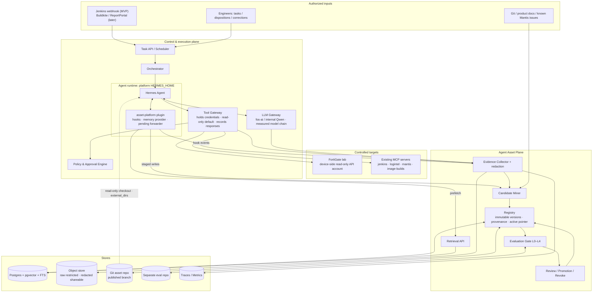
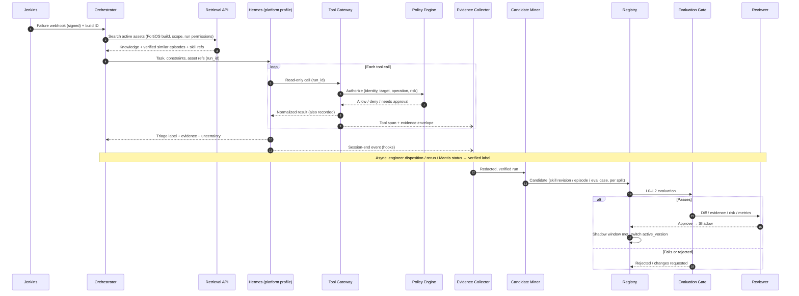
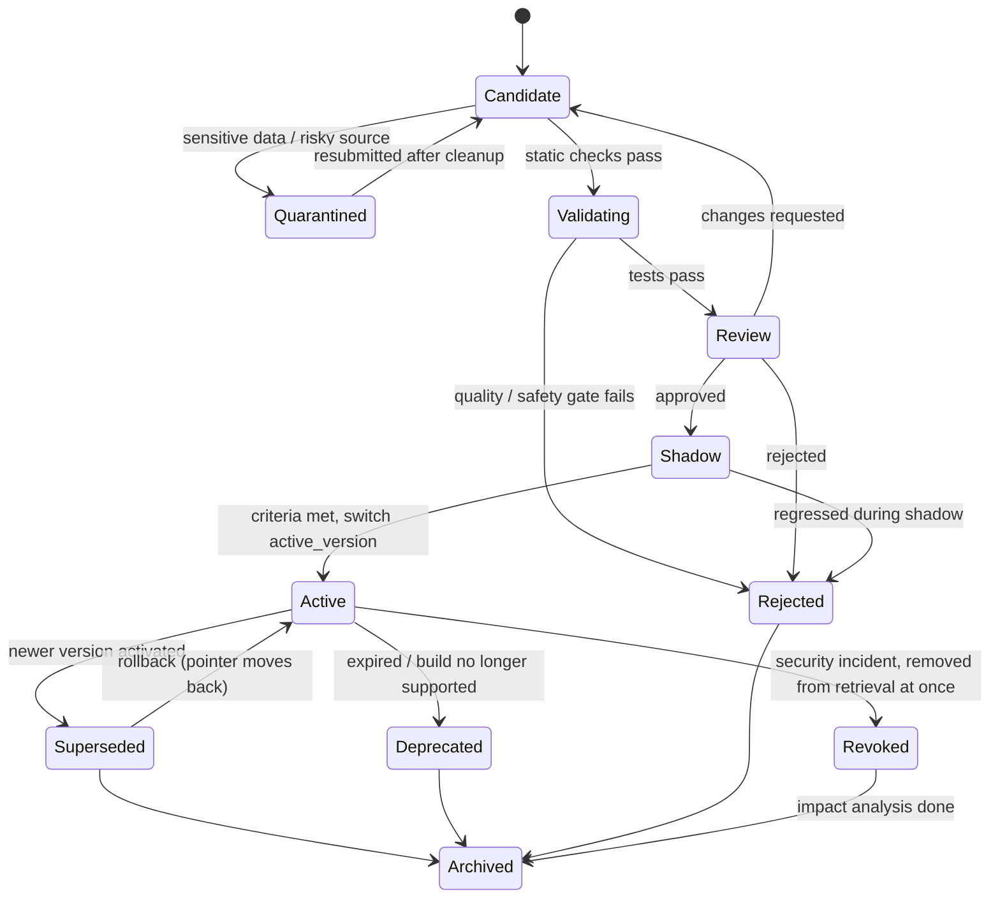

# Agent Persistent Asset & Continuous Learning Platform

> **Document type: Architecture Design / RFC**
> **Version: v0.2 · 2026-10-22 · Status: proposal (draft), pending technical validation**
> **First use case: FortiOS regression-failure triage and read-only diagnosis, AI-native Quality Engineering**
> **Chinese version:** [Agent_Asset_Learning_Platform_Architecture_v0.2.zh-CN.md](Agent_Asset_Learning_Platform_Architecture_v0.2.zh-CN.md)

---

## 0. Executive summary

We design an **Agent Asset Plane** that is independent of the underlying LLM, agent framework and MCP tools. After an agent runs a task, reusable assets can be extracted from its authorized execution trace. An asset reaches the production retrieval path only after redaction, deduplication, applicability checks, regression evaluation and approval.

**Core loop:**

`Task → Observe → Capture Evidence → Verify Outcome → Extract Candidates → Validate → Approve → Shadow → Activate → Retrieve/Reuse → Measure → Revise / Rollback / Revoke`

The platform manages seven asset types: Knowledge, Episodic Memory, Skills, Tools/Code, Environment Model, Evaluation Assets, and Context & Preferences. The point is that assets are **versioned, traceable, testable, reversible and revocable**, so we can actually measure whether the agent improves over time.

**Positioning:** We do not rebuild agent runtimes such as Hermes, OpenClaw or Claude Code. Hermes already ships its own learning loop (a background review that writes skills and memory, a curator that tidies skills, a write-approval staging area, and skill usage counters). This platform **governs that loop from outside**: every write the runtime makes becomes a platform candidate, and published assets reach the runtime read-only.

**First-release goal:** A read-only FortiOS regression-triage agent reuses assets drawn from Jenkins failures, Log Intelligence and read-only data from authorized lab devices. It produces an evidence-backed triage verdict, and cases that an engineer has confirmed become independent regression evaluation assets.

### 0.1 What changed from v0.1

| # | Change | Where |
|---|---|---|
| 1 | Documented Hermes' native learning features from the v0.16.0 source and official docs, and required platform runs to switch them off or route them through the platform, so there are not two learning loops unaware of each other | §2, §4, ADR-006 |
| 2 | Concrete runtime adapter design (Hermes hooks, memory provider, `external_dirs`, `write_approval` staging) with a platform-run config | §4 |
| 3 | Credentials move out of the agent's environment into the Tool Gateway; FortiGate read-only is enforced on the device with a read-only API account, and the gateway becomes the second line of defence | §3, §12 |
| 4 | Lifecycle is now a **per-version** state machine with Shadow, Superseded and Revoked, plus blast-radius analysis on revoke | §6 |
| 5 | Outcomes are verified before skill or eval candidates are mined; train/eval split is deterministic by failure-signature hash to prevent benchmark contamination | §7 |
| 6 | Defined offline replay (recorded tool responses), k repeated runs and model pinning; rewrote acceptance gates around statistical power (30–50 cases only detect gains of 10–15 percentage points or more) | §8 |
| 7 | First scenario widened from "policy troubleshooting" to **regression-failure triage** with a label set (product defect / test script / environment / flaky / config ...), using the existing jenkins, logintel and mantis MCP servers | §9 |
| 8 | Metadata gains build-level version ranges, risk tier and origin; custom SKILL.md fields move to their own namespace | §6.2, §9.5 |
| 9 | New roles and responsibilities, risk tiers, and eight open decisions | §13, §16 |
| 10 | Corrected references: OTel GenAI semantic conventions moved to their own repository; the security table is mapped to the OWASP Agentic Top 10 (ASI01–ASI10) | §12, §17 |

The full review is in [Appendix A](#appendix-a-review-of-v01).

---

## 1. Background, problems and scope

### 1.1 Problems today

1. Each run re-explores similar problems, wasting tokens, time and tool calls.
2. What worked is scattered across chats, CI logs, reports, scripts and Git commits, with no common reusable form.
3. Automatically written memory and skills can carry wrong conclusions, outdated CLI, sensitive data or injected instructions. Hermes defaults to `write_approval: false`, so its background review writes straight into the skill store.
4. Looking only at the final answer cannot tell whether an error came from the model, retrieval, a tool, the environment, permissions or a stale asset.
5. An agent saying "I learned this" is not a higher success rate; there is no independent benchmark, paired comparison or regression check.
6. On the current QA VMs, MCP credentials live in `~/.hermes/.env` and in the agent's shell environment. Tool curation is not a sandbox: on 2026-09-23 an opencode session bypassed MCP and called Mantis directly with the key file.

### 1.2 Design goals

- **G1 Reusable:** extract knowledge, cases, skills and tools from real tasks, not just whole transcripts.
- **G2 Explainable:** every key conclusion traces back to its source, product version/build and execution evidence.
- **G3 Verifiable:** candidates pass quality gates, and with/without comparisons come with confidence intervals.
- **G4 Governed:** tiered authorization, human approval, audit, immutable versions, revoke and rollback.
- **G5 Loosely coupled:** adapters for several runtimes (Hermes, opencode, OpenClaw, an in-house orchestrator); the asset format is not tied to any runtime's internal storage.
- **G6 Incremental:** single-team MVP first; no Kubernetes, graph database or complex multi-agent autonomy in the first release.
- **G7 Reuse what exists (new):** build on components `hermes_installer` already deploys (MCP curation, the `mcp-ask-first` approval plugin, the measured model chain, Log Intelligence) instead of duplicating them.

### 1.3 Non-goals (v0.2)

- No training or fine-tuning of base-model weights; "learning" here means **externalized learning**.
- The agent may not change firewall policy, reboot devices or alter network configuration without approval; the MVP contains no write-capable assets (tier T3, see §6.4).
- We do not replace Hermes' memory and skill engine; the platform governs it rather than rewriting it.
- No cross-company or cross-tenant agent marketplace or billing.
- Buildkite and ReportPortal are out of the MVP (only a Jenkins MCP server exists today; see §16 Q5).

### 1.4 Constraints and assumptions

- Initially only explicitly authorized test environments and CI/CD resources are connected.
- Jenkins, Log Intelligence, Mantis and image-builds are reached through the existing MCP servers (see `config/config.yaml`); FortiOS devices through a new read-only MCP server or REST wrapper.
- Device configs, logs, tokens, secrets and customer-related data may be sensitive and are not written to the shared asset store by default.
- Evaluation sets must be independent of the samples that produce skills (split rule in §7.3).
- Model availability changes: the fos-ai gateway changes which models each key may call without notice, and the model chain is re-measured every 15 minutes. Evaluations pin and record the model actually used (§8.4).

---

## 2. The seven asset types and their Hermes counterparts

| Asset (type) | Content | Platform storage | Hermes counterpart | FortiOS QA example |
|---|---|---|---|---|
| `knowledge` | Docs, CLI/API semantics, product rules, version differences | Git/object store + FTS/vector index | None (can be injected through an external memory provider) | FortiOS 7.4 policy-match rules, summaries of known Mantis issues |
| `episode` | Past tasks, actions, observations, outcomes, wrong paths, dispositions | Postgres metadata + object-store traces | `session_search` (SQLite FTS5, this machine's sessions only), `~/.hermes/logs/session_*.json` | Full evidence chain and final disposition of one Jenkins failure |
| `skill` | Reusable procedure, preconditions, steps, pitfalls, verification | `SKILL.md` plus attachments in Git | `skill_manage`, `~/.hermes/skills/`, `skills.external_dirs`, curator | Read-only regression-triage procedure |
| `tool` | Executable scripts, API/MCP wrappers, parsers | Git + artifact store | MCP servers, plugin tools, a skill's `scripts/` | FortiOS CLI output parser |
| `environment` | Topology, config snapshots, version/build, dependencies, validity | Postgres / JSON / object store | None | A lab device's current build, VDOM, interfaces and routes (with TTL) |
| `evaluation` | Gold cases, graders, regression tests, negative samples, tool-response recordings | Separate Git repo + DB + CI artifacts | None | A past failure with a confirmed root cause and its recorded tool responses |
| `context` | Project rules, user preferences, task checkpoints | KV/DB; short summaries | `MEMORY.md` (2200 chars) / `USER.md` (1375 chars), frozen into the prompt at session start | "Read-only mode; give evidence and the CLI source" |

**Classification rules (unchanged from v0.1):**

- "What it is" → `knowledge`; "what happened" → `episode`; "how to do it" → `skill`.
- Deterministic logic that must repeat exactly → `tool`; do not write everything as natural-language skills.
- "What state the system is in now" → `environment`, with observation time and `expires_at`.
- "How we prove good or bad" → `evaluation`; never injected as ordinary reference material and not readable by the agent at run time.
- "Fixed constraints of this user or project" → `context`; keep the minimum, allow edits and deletion.

Assets can link to each other but do not replace each other. An `episode` may produce a `skill` revision **or** an `evaluation` case (one or the other, decided by the split in §7.3), and the evidence IDs stay attached after publication.

**What Hermes does natively (checked against the v0.16.0 source and the official docs on 2026-10-22):** Hermes skills and memory are file stores on **one machine, one `HERMES_HOME`**. The curator manages lifecycle only by days since last use. Skills Guard is regex-based heuristics (its own source calls it "useful — not boundaries"). A cross-agent registry, evaluation gates, an environment model, enterprise approval, version activation and revocation are all new platform modules.

---

## 3. Logical architecture



### 3.1 Control plane

- **Task API / Scheduler:** accepts engineer tasks, CI webhooks (signature checked) and scheduled triggers; assigns `run_id` and manages idempotency keys.
- **Orchestrator:** splits tasks, caps loops and budgets, checkpoints and resumes, and links each run to the asset versions it used (`asset_usages`).
- **Runtime adapter:** see §4. The asset plane depends only on the adapter contract, not on Hermes internals.
- **LLM Gateway:** reuses the existing fos-ai / internal Qwen gateways and the measured model chain from `install.sh --adapt`. Each call records the model **actually** used, tokens, latency, cost, errors and retries; sensitive prompt text is not stored by default.
- **Tool Gateway:** **the only component that holds tool credentials.** Tool discovery, schema validation, calls to the Policy Engine, audit, result normalization, and response recording for offline replay. No long-lived credentials inside the agent process.
- **Policy Engine:** authorizes by identity, target environment, operation risk and asset risk tier; approval is never granted by the model. Hermes' `pre_tool_call` hook (the existing `mcp-ask-first` pattern) is only a second line of defence inside the runtime.
- **Isolated execution:** platform runs use Hermes' `terminal.backend: docker` (or disable the terminal and code-execution toolsets). The container holds no credentials, and an egress allowlist is enforced outside the agent process.

### 3.2 Asset plane

- **Evidence Collector:** builds structured traces; large outputs go to the object store, linked by digest. Two tiers: `raw` (restricted, encrypted, short retention) and `redacted` (shareable).
- **Candidate Miner:** finds candidates in runs with a **verified outcome**, in engineer corrections, and in writes forwarded from Hermes' staging area. "Nothing worth saving" is a valid result.
- **Registry:** identity, type, immutable versions, evidence, dependencies, permissions, applicable build range, risk tier and state; the `active_version` pointer switches atomically.
- **Retrieval API:** hard filters first, then hybrid retrieval (keyword + vector + metadata), within a context budget.
- **Evaluation Gate:** static checks, contract tests, recorded replay, lab validation and shadow runs, all paired against a baseline.
- **Review / Promotion / Revoke:** approval, publication to the `published` branch, shadow observation, activation, revocation and rollback. The author cannot approve their own candidate, and high-risk assets are never published on an LLM self-score alone.

### 3.3 Two separate flows

**Execution path (low latency):** task → identify environment and build → retrieve active, applicable assets → build a minimal context → agent calls tools through the Tool Gateway → evidence-backed verdict.

**Learning path (asynchronous):** run ends → trace tidied and redacted → **wait for the disposition** (engineer confirmation / rerun result / Mantis status) → find candidates → train/eval split → create or revise assets → evaluation and human review → shadow → activate / roll back.

Keeping them apart means the execution path never blocks on asset generation or a full evaluation.

---

## 4. Runtime adapter: Hermes integration (new)

### 4.1 Why Hermes' own learning loop has to be taken over

Hermes v0.16.0 "learns" on its own by default:

| Hermes mechanism | Default behaviour | Consequence if left alone |
|---|---|---|
| Background review (`agent/background_review.py`) | After each turn, forks an agent that decides whether to save memory or skills, and **writes them directly** | Unevaluated skills enter the retrieval path, bypassing the platform's gates |
| Creation nudges | Reminds the agent to save a skill every 15 tool iterations (`skills.creation_nudge_interval`) and memory every 10 turns (`memory.nudge_interval`) | Many low-quality candidates |
| `write_approval` | `false` for both skills and memory | As above |
| Curator | On by default; runs when idle, every 7 days; marks skills unused for 30 days stale and archives after 90; consolidates and patches agent-created skills; keeps 5 backups, `hermes curator rollback` | Platform-managed versions rewritten or archived inside the runtime |
| Skill precedence | Project skills → local `~/.hermes/skills/` → `skills.create_dir` → `external_dirs` | A local skill with the same name **shadows** the reviewed version the platform published |
| Writes to `external_dirs` | Per the official docs, the agent can modify skills in external directories if the Hermes process can write there | The published directory gets rewritten by the agent |
| `skills.guard_agent_created` | `false`: skills the agent creates are not scanned | Injected content goes unnoticed |
| Session trajectory logs | Always written to `~/.hermes/logs/session_*.json`, including tool inputs and outputs; no config switch | Sensitive data lands on disk unredacted |

### 4.2 Integration points

| Platform capability | Hermes integration point | Design notes |
|---|---|---|
| Skill delivery | `skills.external_dirs` pointing at a read-only checkout of the asset repo's `published` branch | Read-only enforced by the file system (different owner or read-only mount); platform skills use the `ap-` prefix; at session start the plugin checks for a local skill with the same name and refuses to run if one exists |
| Knowledge / episode delivery | External memory provider plugin: `prefetch(query)` calls the Retrieval API | Hermes allows only one external provider at a time; returns only filtered, active results, labelled by trust level |
| Context | `MEMORY.md` / `USER.md` (`memory.write_approval: true`) | Project-level fixed constraints only; new entries also go through the candidate flow |
| Evidence capture | Plugin hooks `pre_tool_call` / `post_tool_call`, `pre_llm_call` / `post_llm_call`, `post_api_request`, `on_session_end` → Evidence Collector | Model it on Hermes' bundled `observability/langfuse` plugin; `post_api_request` records the actual model |
| In-run approval | `pre_tool_call` returns `approve` / `block` (same as the existing `mcp-ask-first`) | Second line of defence; real enforcement is in the Tool Gateway and on the device |
| Candidate intake | `skills.write_approval: true`, `memory.write_approval: true` → writes staged under `~/.hermes/pending/` → plugin forwards them to `POST /v1/adapters/hermes/pending` | Platform runs **do not** use local `/skills approve`; approval happens only in the platform |
| Lifecycle | `curator.enabled: false` in the platform profile | Lifecycle is owned by the Registry |
| Usage counts | `~/.hermes/skills/.usage.json` (skill_view / skill_manage counters) | A secondary signal for `asset_usages`; the platform's own hook records are authoritative |

### 4.3 Platform-run configuration (sketch)

Platform runs use a **dedicated `HERMES_HOME`**, separate from the `~/.hermes` engineers use interactively, so learning from interactive sessions does not mix with governed runs:

```yaml
# The platform-managed part of $HERMES_HOME/config.yaml (sketch)
skills:
  write_approval: true          # every skill_manage write is staged; the plugin forwards it as a candidate
  guard_agent_created: true     # scan agent-created content with Skills Guard too
  creation_nudge_interval: 0    # candidates come from the platform miner, not nudges
  external_dirs:
    - /srv/agent-assets/published/skills   # read-only checkout
memory:
  write_approval: true
  provider: asset-platform      # external memory provider plugin
curator:
  enabled: false
terminal:
  backend: docker               # no credentials inside the container
plugins:
  enabled:
    - mcp-ask-first
    - chain-adapt
    - asset-platform
```

> The key names were checked against the Hermes v0.16.0 source (`hermes_cli/config.py`). The fosqa VM runs v0.21.4; check them again on that version with `./install.sh --check` or a throwaway `HERMES_HOME` before rollout. The `asset-platform` plugin does not exist yet; it is a deliverable of this design. Hermes registers external memory providers from `plugins/memory/<name>/`, which loads differently from ordinary plugins (`plugins.enabled`). Confirm that a provider placed under `HERMES_HOME` is picked up; otherwise split it into two plugins or inject context through a hook instead.

### 4.4 Adapter contract (runtime-neutral)

| Method | Purpose |
|---|---|
| `start_run(run_id, task, constraints, asset_refs)` | Start a run with constraints and asset references |
| `emit(event)` | Report LLM calls, tool calls, approvals, session end, etc. (OTel GenAI conventions) |
| `stage_write(origin, payload)` | Turn a runtime memory/skill write into a candidate |
| `fetch_context(query, scope)` | Retrieve active assets during a run |
| `checkpoint()` / `resume()` | Checkpoint and resume |

Adapters for opencode, OpenClaw and Claude Code implement the same contract; the MVP builds only the Hermes one.

---

## 5. End-to-end sequence



**Avoiding feedback contamination:** "the report says the fix worked" is not the same as the failure being resolved. Success labels come only from device observation, a regression rerun or independent confirmation by an authorized engineer. Until the disposition arrives, a run can produce only an `unverified` episode, never a skill or eval candidate.

---

## 6. Asset lifecycle and governance

### 6.1 Per-version state machine

State belongs to an **AssetVersion**; the Asset itself only holds the `active_version` pointer. Version content is immutable, and every change creates a new version.



- **Rollback** moves `active_version` back to the previous `Superseded` version; no content is republished.
- **Revoke** is not archiving: the version leaves retrieval immediately and a blast-radius analysis starts. `asset_usages` lists the runs that used the version and the episodes, eval cases and skill candidates derived from those runs, and all of them are flagged for review.
- `environment` assets expire through `expires_at` at retrieval time; they do not need a separate state.

**Mandatory checks for a candidate (unchanged from v0.1, same order):** source trust → redaction → prompt-injection check → schema validation → environment/build match → unit/regression tests → independent review → approval by risk tier.

### 6.2 Common asset metadata (sketch)

```json
{
  "asset_id": "skill.fortios.regression-triage",
  "type": "skill",
  "version": "1.2.0",
  "state": "candidate",
  "risk_tier": "T1",
  "title": "FortiOS regression failure triage (read only)",
  "scope": {
    "tenant_id": "fos-qa",
    "project_id": "fortigate-regression",
    "product": "FortiOS",
    "version_range": ">=7.2.0,<7.6.0",
    "build_range": null,
    "environment_class": "lab",
    "required_tools": ["jenkins.get_build_log", "logintel.search", "fortios_ro.policy_query"],
    "permissions": ["fortigate.config.read", "fortigate.diag.read", "jenkins.read"]
  },
  "provenance": {
    "origin": "platform_miner",
    "source_run_ids": ["run-20261022-0042"],
    "source_episode_ids": ["ep-20261022-0042"],
    "derived_from": "skill.fortios.regression-triage@1.1.0",
    "rationale": "Three verified runs found policy-order failures that 1.1.0 missed"
  },
  "artifact": {
    "uri": "git://agent-assets/skills/ap-fortios-regression-triage/",
    "commit": "<git-commit-sha>",
    "sha256": "<artifact-digest>"
  },
  "owner": "qa-agent-platform",
  "eval": { "suite_id": "eval.fortios.triage.v1" },
  "review_due_at": "2026-12-22T00:00:00Z",
  "expires_at": null,
  "created_at": "2026-10-22T16:00:00Z"
}
```

| Field | Values / notes |
|---|---|
| `state` | `candidate` / `quarantined` / `validating` / `review` / `shadow` / `active` / `superseded` / `deprecated` / `revoked` / `rejected` / `archived` |
| `risk_tier` | `T0`–`T3`, see §6.4 |
| `provenance.origin` | `platform_miner` / `hermes_background_review` / `hermes_foreground` / `human_authored` |
| `build_range` | QA tests interim builds; scope by build number when needed (for example, an issue fixed in build N) |
| `required_tools` | Not retrieved when the run lacks these tools (also mapped to Hermes `requires_tools`) |

> Compared with v0.1: `human_verified` moves to the episode (it describes one run's outcome, not the skill); new fields `risk_tier`, `origin`, `derived_from`, `build_range`, `required_tools` and tenant/project. `<...>` values are placeholders, not real values; the implementation uses a machine-checkable JSON Schema and computes real digests.

### 6.3 Hard filters at retrieval, in order

1. The caller may read this tenant/project;
2. The version is `active` (or `shadow` during shadow evaluation) and its digest matches the Registry record;
3. Product, version/build range and environment class match, and the `required_tools` are available in this run;
4. Not expired, not revoked;
5. The asset's risk tier is no higher than the run allows;
6. Only then lexical/semantic ranking, truncated to a context budget (for example at most 3 skills and 5 episodes, with a token cap).

**Filter first, then retrieve.** We never rely on the model to ignore unauthorized assets after the fact. Episodes are labelled `verified` / `unverified` when injected, and only `verified` ones are injected by default.

> v0.1 required a "valid signature" but designed no signing. The MVP uses "digest match + approval record in the Registry + signed Git tag"; Sigstore-style artifact signing comes later.

### 6.4 Risk tiers

| Tier | Scope | Approval | Evaluation |
|---|---|---|---|
| T0 | Text knowledge, episodes, context | 1 reviewer | L0 |
| T1 | Read-only skills / procedures | 1 domain reviewer (not the author) | L0–L2 |
| T2 | Tools / scripts run in a sandbox | Code review + domain review | L0–L2 + sandbox run |
| T3 | Anything with write access or network change | Security review + human approval on every run | L0–L3; **not in the MVP** |

---

## 7. Learning triggers, candidate mining and drift control

### 7.1 When to mine candidates

- A run has a **verified disposition** and the result is reusable across tasks;
- A failure was later solved by experiment with evidence;
- An engineer corrected the agent, or CI showed an old procedure no longer works;
- Product docs, CLI or interfaces changed in a new build and an existing asset needs updating;
- The same failure signature recurs and can be merged into a representative case or a parameterized skill;
- A write forwarded from the Hermes staging area (`origin = hermes_background_review` / `hermes_foreground`).

Not triggered by: one-off lucky output, unverifiable guesses, unauthorized configuration, raw text containing secrets, methods that depend on one machine's transient state.

### 7.2 Candidate miner (suggested implementation)

```text
on_run_completed(run):
    evidence = redact_and_normalize(run.trace)
    if not scope_authorized(evidence): return NO_WRITE
    store_episode(evidence, label="unverified")

on_disposition(run, disposition):          # engineer confirmation / rerun / Mantis status
    episode = mark_verified(run.episode, disposition)
    sig = failure_signature(run)           # see 7.3
    split = assign_split(sig)              # train | held_out, deterministic
    signals = detect_success_corrections_novelty(episode)
    for candidate in classify_to_asset_types(signals, split):
        candidate = attach_provenance_and_scope(candidate)
        if not reusable_or_verifiable(candidate): continue
        candidate = deduplicate_or_propose_revision(candidate)
        stage(candidate)                   # never auto-published
        enqueue_eval(candidate)

on_hermes_pending(item):                   # from the asset-platform plugin
    stage(as_candidate(item, origin=item.origin))
    enqueue_eval(...)
```

Design points: rules and deterministic checks back up LLM summarization so hallucinations are not written; raw evidence and the distilled result stay separate; every candidate records why it was generated (`provenance.rationale`).

### 7.3 Failure signature and train/eval split (new)

**Failure signature** `failure_signature = hash(test_case_id, failing_step, normalized_error, product_line, major.minor)`, where `normalized_error` strips volatile fields such as timestamps, IPs, serial numbers and session IDs. It is used for:

- Episode deduplication and merging;
- **Train/eval split:** the signature hash deterministically assigns a case to `train` (may produce skills) or `held_out` (may produce eval cases only). The same failure family never lands on both sides.
- A time split on top: an eval case should be newer than the source runs of the skill it evaluates.

### 7.4 Preventing skill drift and decay

- Every skill has an owner, an applicable build range, a verification method, an eval suite and a review date.
- Baseline and new-version metrics are stored at publication; regressions seen in production trigger rollback.
- New versions run in shadow before activation (§8.1 L4).
- The agent cannot read or modify the held-out set at run time; it lives in a separate repo maintained by an independent role (§13).
- When a new FortiOS build arrives, affected skills get an automatic regression run (drift detection).

---

## 8. Evaluation as a first-class asset

### 8.1 Evaluation levels

| Level | Purpose | Example | Release gate |
|---|---|---|---|
| L0 Static | Structure, safety, leak checks | Schema, dangerous commands, secrets, Skills Guard scan | Must pass |
| L1 Contract / unit | Tool and parser correctness | CLI parser fixtures, MCP JSON Schema | Must pass |
| L2 Offline replay | Paired before/after comparison | Past Jenkins failures, old vs new skill, tool responses from recordings | Must pass |
| L3 Lab | The action works in a real environment | Synthetic faults in a FortiOS lab | Required for T2 and above |
| L4 Shadow | Observe on real input without acting | Current version gives the verdict, candidate diagnoses in parallel, logged only | Required before activation |
| L5 Production monitoring | Long-term effect and decay | Success rate, drift, violations | Continuous |

> v0.1's L5 was a "5–10% traffic canary". Whether that works depends on how many in-scope failures arrive per day (§16 Q4). At low volume a percentage canary means nothing statistically; use full shadow instead and activate after "at least N shadow runs with no regression".

### 8.2 What offline replay means (new)

LLM agents are non-deterministic and device state changes, so "replay" needs a precise definition:

1. **Record:** the Tool Gateway stores each call `(tool, normalized_args) → response` as the run's recording (cassette), with its digest in the database.
2. **Replay:** rerun the agent with the candidate assets, answering tool calls from the recording.
3. **Miss:** when the candidate calls a tool or uses arguments not in the recording, the case is `partial_replay` and counted separately, neither pass nor fail. Skills with a high miss rate go to L3 lab testing.
4. **Repeat:** run each case k times (k = 3 suggested); it passes on a majority, and the variance is reported.

### 8.3 Key metrics

- **Task success rate:** tasks confirmed correct by independent evidence / decidable tasks.
- **Triage accuracy (new):** share of triage labels matching the verified label, with a per-class confusion matrix; "insufficient evidence" is counted apart from "wrong verdict".
- **Unnecessary tool calls:** redundant calls, showing whether reuse cuts exploration.
- **Time to diagnosis (TTD):** P50/P95 from trigger to a verifiable verdict.
- **Cost per solved task:** token / API cost divided by successful tasks.
- **Policy violation rate:** unauthorized calls, unexpected egress, sensitive-data exposure.
- **Effective reuse:** share of loaded assets (`asset_usages`) that improve the result in a paired evaluation. Measurable only in evaluation, which has the counterfactual; production only counts hits.
- **Regression / drift:** change in a skill's failure rate after a new build.
- **Trace coverage:** platform runs with a complete `run_id → tool_call → evidence` chain / all platform runs.

### 8.4 Experiment rules

- Paired A/B on the same held-out cases (no assets vs assets, or old version vs new).
- Fixed permissions, tools and recordings.
- **Pin the model:** evaluation runs name a model ID and gateway, and the `post_api_request` hook records the actual model of every call. If the model chain switches mid-run (fos-ai can refuse a model without notice), that evaluation round is discarded and rerun. Schedule evaluations inside the gateway's budget hours.
- Record model, prompt, tool, device build and asset versions so results can be reproduced.

### 8.5 MVP acceptance gates (project targets, not measured results)

**Sample size in practice:** cases needed to detect a success-rate gain with a paired binary outcome (McNemar test, two-sided α = 0.05, 80% power):

| Share of cases where the two arms disagree | +5 points | +10 points | +15 points |
|---|---|---|---|
| 10% | ~312 | ~76 | ~32 |
| 15% | ~469 | ~115 | ~50 |
| 20% | ~626 | ~155 | ~67 |

v0.1 aimed to show "≥5 points better" on 30–50 cases, which would almost always end in "insufficient evidence". v0.2 therefore splits the gates into two kinds:

**Hard gates (every release):**

- L0/L1 all pass; the safety suite has **zero blocking privilege violations**.
- The redaction suite (samples seeded with known secrets, IPs and serial numbers) catches 100%, or no shared asset may be published.
- **No regression:** of the held-out cases the baseline passes on a majority of k runs, the candidate may fail on a majority in at most 1, each with a written explanation.
- P95 time to diagnosis grows ≤ 20% and cost per solved task grows ≤ 20% (kept from v0.1).

**Effect claims (reported, not blocking):**

- Report the success-rate difference with a 95% confidence interval; claim an improvement only if the lower bound is above 0.
- Continuous metrics such as tool-call count and TTD use paired tests, which have more power than the binary outcome, and serve as early improvement signals.
- Sample targets: ≥ 100 held-out cases by the end of P3 and ≥ 150 by the end of P5 (enough for roughly 10 points). Cases come mainly from past Jenkins failures and their dispositions (§9.3).
- Trace coverage ≥ 95%.

---

## 9. First scenario: FortiOS regression-failure triage

### 9.1 Why "triage" instead of "policy troubleshooting"

In a QA environment, a good share of regression failures are not device configuration problems: they are product defects, test-script problems, lab environment problems or flaky runs. An agent that only diagnoses policy will misread these as configuration issues. Triage answers "which kind is it" first; policy diagnosis stays as one sub-procedure (`config_or_policy`).

### 9.2 Triage labels (proposal, to be confirmed with the QA team)

| Label | Meaning | Typical confirmation |
|---|---|---|
| `product_defect` | FortiOS bug | New or linked Mantis issue |
| `known_issue` | Matches an existing Mantis issue | Mantis ID |
| `config_or_policy` | Test-bed config: policy order, implicit deny, routing, NAT, address/service objects | Rerun passes after the fix |
| `test_script` | Test case/script bug or outdated expectation | Script fix commit |
| `environment_infra` | Lab, topology, unreachable device, licence, image deploy, Jenkins node | Rerun passes after the environment fix |
| `flaky_timing` | Intermittent; rerun passes with nothing changed | Rerun record |
| `insufficient_evidence` | Not enough evidence; no verdict | — |

### 9.3 Ground truth

Past Jenkins failures plus what engineers did about them at the time (a Mantis issue, a script fix commit, a rerun) are a ready-made source of ground truth. If those dispositions can be reliably tied to builds, the MVP can mine hundreds of historical cases within weeks, which solves the sample-size problem in §8.5. That depends on confirming where dispositions are recorded and how complete they are (§16 Q3).

### 9.4 Agent steps (read only)

1. Create a `run_id` bound to the identity and the authorized lab; any write is refused by the Tool Gateway and by the device.
2. Get the build, failing step and logs through the jenkins MCP server; search related log patterns through the logintel MCP server.
3. Get the FortiOS build, VDOM, relevant interfaces, policies and routing context (read-only API account) and fix the time window.
4. Retrieve active knowledge, triage skills and verified similar episodes for this build range; look up known issues through the mantis MCP server (read-only tools).
5. List competing hypotheses (triage label + specific root cause) and counter-evidence; mark what is unverified.
6. Output: triage label, evidence (tool-call IDs, timestamps, recording digests), confidence (indicative only) and the suggested next check; no changes are made.
7. The run is marked `verified` only after an engineer disposition or a reproducible rerun.
8. If a reusable new pattern appears, a skill revision or eval candidate is created according to the split and enters the evaluation gate.

### 9.5 Skill example (stored in Git; abridged)

```markdown
---
name: ap-fortios-regression-triage
description: Triage a FortiOS regression failure using read-only Jenkins, log and device evidence.
version: 0.2.0
platforms: [linux]
metadata:
  hermes:
    tags: [fortios, regression, triage, read-only]
    category: fortios-qa
    related_skills: [ap-fortigate-policy-readonly-diagnosis]
    requires_tools: [<name Hermes registers for the jenkins build-log tool>]
  asset_platform:
    asset_id: skill.fortios.regression-triage
    risk_tier: T1
    version_range: ">=7.2.0,<7.6.0"
    write_permission: none
    eval_suite_id: eval.fortios.triage.v1
---

# Purpose
Classify a failed regression run into one triage label and back it with evidence.

# Preconditions
- Confirm FortiOS build, test bed, failing step and read-only tool authorization.
- Never infer a fix or a root cause from an LLM narrative alone.

# Procedure
1. Read the failing step and its log; extract the normalized error.
2. Check known issues for the same signature before investigating further.
3. Rule environment and flakiness in or out (device reachability, rerun history).
4. If configuration is suspected, follow ap-fortigate-policy-readonly-diagnosis.
5. Return the label, the evidence IDs and what is still unverified.

# Pitfalls
- A test-bed config problem can look like a product defect, and the reverse.
- Stale snapshots or an incomplete traffic tuple invalidate policy conclusions.

# Verification
- A label is final only after an engineer disposition or a reproducible rerun.
```

**Note:** Hermes recognizes `name`, `description`, `version`, `platforms` and `metadata.hermes.*` (`tags`, `category`, `related_skills`, `requires_tools` and others). `requires_tools` hides the skill when the tool is unavailable, which matches the platform's `required_tools` filter. `metadata.asset_platform.*` is this platform's namespace; Hermes does not interpret it and the adapter reads it. Replace `<...>` with the MCP tool name Hermes actually registers; the repo's `tests/list_registered_mcp_tools.py` lists them.

### 9.6 Assets one task leaves behind

- `episode`: the failed build, the exploration path, wrong hypotheses, the disposition (with a `verified` flag).
- `knowledge`: confirmed behaviour or a known-issue summary for a specific FortiOS build.
- `skill`: the standard read-only triage procedure for a class of symptoms (only if the signature is in `train`).
- `tool`: a stable log parser and output schema.
- `environment`: topology/config summary of an authorized device at a point in time (with `expires_at`).
- `evaluation`: the recording, expected label and root cause, and an independent grading script (only if the signature is in `held_out`).
- `context`: the project rule "read-only first, give evidence, never change policy directly".

---

## 10. Data model and interfaces

### 10.1 Core entities

```text
Task 1 ── n Run 1 ── n Span/ToolCall 1 ── 0..1 ToolRecording
                 ├── n Evidence (object URI, digest, tier=raw|redacted)
                 ├── 0..1 Disposition (label, source, verifier, verified_at)
                 └── n AssetUsage (asset_version, how=injected|loaded|cited)
Run n ── 1 FailureSignature (split=train|held_out)
Run n ── n AssetCandidate n ── 1 Asset
Asset 1 ── n AssetVersion ── n EvaluationResult
Asset 1 ── 1 active_version pointer
AssetVersion n ── n SourceEvidence
AssetVersion n ── n DependencyAssetVersion
AssetVersion 1 ── n Approval / Promotion / Rollback / Revocation events
```

**Tables:** `tasks`, `runs`, `tool_calls`, `tool_recordings`, `evidence_refs`, `dispositions`, `failure_signatures`, `asset_usages`, `assets`, `asset_versions`, `asset_dependencies`, `eval_suites`, `eval_cases`, `eval_results`, `approvals`, `revocations`, `audit_events`. Every table carries `tenant_id` and `project_id` with row-level access control.

**Consistency:** large files and traces go to the object store, and the database keeps only references, digests and metadata; Git holds the human-reviewable versions of skills, tools and evals. Publication: write the new version → verify the digest → merge to the `published` branch with a signed tag → switch `active_version` atomically.

### 10.2 REST API (draft)

| API | Purpose |
|---|---|
| `POST /v1/runs` | Create a run and return `run_id` |
| `GET /v1/runs/{id}` | Status, result, asset references, trace link |
| `POST /v1/runs/{id}/disposition` | Record the verified disposition (new) |
| `POST /v1/assets/candidates` | Submit a candidate with evidence |
| `POST /v1/adapters/hermes/pending` | Forward writes from the Hermes staging area (new) |
| `GET /v1/assets/search?type=skill&product=FortiOS&build=7.4.5-2702` | Search active assets by permission and build |
| `POST /v1/assets/{id}/versions/{v}/evaluations` | Evaluate one version on a given suite |
| `POST /v1/assets/{id}/versions/{v}/approvals` | Approve/reject; operator identity required, no self-approval |
| `POST /v1/assets/{id}/versions/{v}/promotions` | Move to shadow or activate |
| `POST /v1/assets/{id}/rollback` | Move `active_version` back to the previous version |
| `POST /v1/assets/{id}/versions/{v}/revoke` | Revoke and start the impact analysis (new) |
| `GET /v1/assets/{id}/versions/{v}/usages` | Runs and derived assets that used this version (new) |
| `POST /v1/integrations/ci/webhook` | Receive signature-checked CI events |

**API requirements:** idempotency keys, pagination, audit identity, access control, schema validation, explicit error codes. Writes have a non-repudiable audit trail; asynchronous operations return a `job_id` that can be polled.

### 10.3 Evidence envelope example

```json
{
  "evidence_id": "ev-9876",
  "run_id": "run-20261022-0042",
  "source_type": "mcp.tool_result",
  "tool_name": "fortios_ro.policy_query",
  "tool_call_id": "tc-0042-07",
  "observed_at": "2026-10-22T16:01:10Z",
  "product_version": "FortiOS 7.4.5",
  "product_build": "2702",
  "environment_id": "lab-fw-01",
  "redaction": { "status": "passed", "ruleset": "redact-v3" },
  "tier": "redacted",
  "object_uri": "s3://agent-evidence/redacted/ev-9876.json",
  "sha256": "<content-digest>",
  "recording_ref": "rec-0042-07",
  "classification": "internal",
  "trust_level": "tool_observation",
  "retain_until": "2027-04-22T00:00:00Z"
}
```

---

## 11. Technology choices: build vs reuse

| Component | MVP | Later | Rationale |
|---|---|---|---|
| Orchestrator | Existing agent + adapter; triggered by Jenkins webhook | Durable workflow engine (Temporal etc.) | Protects existing work; retries/resume added gradually |
| Agent runtime | **Hermes** (dedicated platform `HERMES_HOME`) | opencode / OpenClaw / Claude Code adapters | Hermes hooks, memory provider, `external_dirs` and `write_approval` cover every integration point without a fork; the team already deploys it through `hermes_installer` |
| LLM gateway | fos-ai + internal Qwen, measured model chain (`chain-adapt`) | Policy routing, budgets, quality feedback | Exists and is verified |
| Policy (in runtime) | `pre_tool_call` hook in the `mcp-ask-first` pattern | — | Verified on the ACP, `-z` and cron paths |
| Policy (outside runtime) | Tool Gateway + tool allowlist + human approval | OPA/ABAC, short-lived dynamic credentials | Credentials never enter the agent process |
| Metadata / index | PostgreSQL + pgvector + FTS | Dedicated vector store if needed | Low ops burden, hybrid retrieval |
| Evidence blobs | S3-compatible object store (local MinIO), separate raw and redacted buckets | Managed storage, lifecycle rules | Cheap storage for large evidence |
| Skills / tools | Git asset repo + CI; `published` branch delivered read-only | Artifact signing, dedicated registry | Review, diff, history and rollback come for free |
| Evals | **Separate** Git repo; the agent's run identity cannot read it | — | Prevents benchmark contamination |
| Async jobs | Simple job queue / existing CI | Durable workflow + event bus | Don't over-engineer the MVP |
| Observability | Hermes hooks → OTel (GenAI semantic conventions); or the bundled Langfuse plugin first | Central traces and cost attribution | Ties every LLM, tool and evaluation step together |
| Secrets | Vault (or the existing solution), readable only by the Tool Gateway | Short-lived dynamic credentials | Fixes item 6 in §1.1 |
| UI | Lightweight approval / asset browser page | Multi-role governance console | Close the review-and-publish loop first |

### 11.1 Hermes capability boundary (checked)

Checked against the Hermes v0.16.0 source (this workstation, upstream `c6e99ab3`) and the official docs on 2026-10-22: `skill_manage` (create / edit / patch / delete / write_file / remove_file), skills stored in `~/.hermes/skills/`, `skills.external_dirs`, `skills.write_approval` (staging under `~/.hermes/pending/skills/`, `/skills pending|diff|approve|reject`), background review, curator, Skills Guard (builtin / trusted / community trust levels and a quarantine area), `.usage.json` usage counters, write-origin marking (background_review vs foreground), `session_search` (FTS5), external memory provider plugins, plugin hooks, the Langfuse and NeMo Relay observability plugins, and `terminal.backend` (local / ssh / docker and others).

The cross-agent registry, unified evaluation gate, environment model, enterprise approval, version activation and revocation in this design are new modules, not Hermes features.

### 11.2 Why no graph database yet

The first release represents environment relationships as JSON documents plus Postgres join tables. Neo4j or a graph service comes in only if multi-hop queries across many devices and dependencies prove to be a bottleneck.

---

## 12. Security, permissions and multi-tenancy

| Risk | OWASP Agentic (our mapping) | Scenario | Required control |
|---|---|---|---|
| Prompt injection / memory poisoning | ASI01, ASI06 | A log or Mantis note contains an "update the skill" instruction, and the background review writes it into a skill | External content is data only; every runtime write is staged as a candidate; `guard_agent_created: true`; asset writes need their own authorization |
| Tool misuse / excessive agency | ASI02 | The agent tries to change firewall policy or trigger a build | Device-side read-only API account (read-only admin profile + trusted hosts); Tool Gateway read-only by default; `pre_tool_call` as second line |
| Credential exposure / identity abuse | ASI03 | The agent reads a token from the environment or a key file and calls a service directly, bypassing MCP (happened on 2026-09-23) | Credentials only in the Tool Gateway; container execution without credentials; agent identity separate from tool identity |
| Secret / data leakage | ASI03 | CLI output contains credentials, IPs or customer data; Hermes session logs land on disk unredacted | Redact at ingestion (do not rely on Hermes' regex `redact.py`, which only masks key-like strings); restricted raw tier with short retention; the platform `HERMES_HOME` log directory falls under the retention policy |
| Cross-tenant leakage | ASI03 | Another project's assets show up in retrieval | Row-level access control + metadata filtering before retrieval |
| Supply chain | ASI04 | A new skill ships a malicious script | Git review, code scanning, pinned dependencies, sandboxed execution; T2 needs code review |
| Unexpected code execution | ASI05 | A skill's `scripts/` runs on the agent host | `terminal.backend: docker` with an egress allowlist |
| Cascading failure / stale knowledge | ASI08 | Old CLI used on a new build; one wrong skill spawns more wrong assets | Build ranges, `expires_at`, drift regression; revoke + impact analysis |
| Over-trust in the agent | ASI09 | A reviewer sees "high confidence" and approves without reading | Confidence is indicative only; the review screen shows evidence first; author ≠ approver; monitor approval rate and review time |
| Rogue agent / unauthorized egress | ASI02, ASI10 | A test agent scans systems outside its target | Target allowlist, container egress control, audit |
| Benchmark contamination | — | The agent sees eval answers | Separate repo, no read access for the agent identity, signature split (§7.3) |

**Trust boundaries:** `LLM output ≠ authority`, `retrieved document ≠ trusted instruction`, `successful tool call ≠ authorized business change`, `tool curation ≠ sandbox`. Authorization for high-risk actions is enforced outside the model.

> The ASI mapping is this document's own, not an official OWASP mapping. OWASP material is a threat-modelling framework; the security of this system still has to be confirmed by red-team testing and permission verification.

---

## 13. Roles and responsibilities (new)

| Role | Responsibility | Constraint |
|---|---|---|
| Asset owner | Maintains a skill/tool and re-reviews it by `review_due_at` | Every `active` asset has an owner |
| Domain reviewer (QA engineer) | Approves candidates, records dispositions | Cannot approve a candidate they authored |
| Eval maintainer | Maintains the held-out set and graders | Independent of skill authors; the agent identity has no access |
| Platform operator | Registry, Tool Gateway, credentials, retention policy | Does not approve content |
| Security reviewer | T2/T3 approvals, red-team testing | — |

---

## 14. MVP delivery plan (8–12 weeks suggested; adjust to the team)

| Phase | Work | Acceptance |
|---|---|---|
| **P0: weeks 1–2** | Platform `HERMES_HOME` config (§4.3); evidence hook plugin; `run_id`; Jenkins webhook; jenkins/logintel credentials moved into the Tool Gateway; draft triage labels; measure failure volume and find where dispositions live (Q3/Q4) | Any run can be traced to its inputs, tools and outputs; every background-review write lands in staging, none directly |
| **P1: weeks 3–4** | Asset schema, Registry tables, episode/knowledge ingestion, Retrieval API + memory provider; redaction suite; start mining historical cases | Similar cases and their raw evidence are queryable; the redaction suite catches 100% of seeded samples; held-out ≥ 50 |
| **P2: weeks 5–6** | Miner + Hermes pending forwarder → Git PR → approval → publish to the read-only directory; same-name shadowing check | Full Candidate → Review → Shadow → Active flow; a same-name local skill is detected and refused |
| **P3: weeks 7–8** | Tool-response recording, offline replay, k = 3, baseline comparison, report with confidence intervals | Success rate, triage accuracy, latency, cost and safety regressions are quantified; held-out ≥ 100 |
| **P4: weeks 9–10** | Shadow mode, revoke and impact analysis, rollback drill, drift detection on new builds | A revoked version disappears from retrieval at once and `usages` lists the affected runs; rollback drill succeeds |
| **P5: weeks 11–12** | Dashboard, approval flow, runbook, MVP review | The full learning loop can be demonstrated; held-out ≥ 150; design decisions for v0.3 |

### 14.1 Recommended first slice

**One scenario only:** Jenkins regression failure → agent triages read-only in an authorized lab → engineer confirms the disposition → episode plus a skill or eval candidate (per split) → replay validation → PR approval → shadow → activate → reused on the next run.

**Only four asset types in the first release:** `knowledge`, `episode`, `skill`, `evaluation`. `environment` starts as snapshots; `tool` and `context` reuse the existing MCP servers and Hermes memory. Schemas for all seven are reserved, but not all services are built at once.

### 14.2 Definition of done

- Any triage verdict traces to its `run_id`, tool calls, recordings and evidence references.
- At least one genuinely improved skill went through PR, approval, replay testing and shadow, and is active.
- The full held-out suite can be rerun comparing "without assets / with assets", with confidence intervals.
- A stale skill causing a regression can be simulated and rolled back; the revoke drill passes.
- An unapproved write is refused and audited by the Tool Gateway **and** by the device.
- In the platform profile, every autonomous Hermes write shows up in the platform as a candidate, and none lands directly in the skills directory.
- Cost, quality, safety and version applicability appear in one release report.

---

## 15. Architecture decision records and future work

**ADR-001: The asset plane is independent of the agent runtime.** Keeps runtimes replaceable and avoids lock-in to Hermes or OpenClaw storage formats.

**ADR-002: Git + Registry, two layers.** Git holds reviewable asset text and scripts; the Registry holds retrieval, state, experiment metrics and links to runs.

**ADR-003: Experience ≠ truth.** Episodes may record wrong explorations; the authority of knowledge and skills comes from verifiable sources, tests and approval.

**ADR-004: Build the evaluation loop before automating learning.** Without gold cases, metrics and rollback, generating more skills only adds risk.

**ADR-005: Permission policy lives outside the model.** Read-only by default; separate approval for high-risk actions; least privilege on the device.

**ADR-006 (new): Govern the runtime's own learning loop instead of replacing it.** In platform runs every Hermes memory/skill write is staged and forwarded as a candidate, and the curator is off; interactive `~/.hermes` homes are unaffected.

**ADR-007 (new): Published assets are delivered read-only.** Through `skills.external_dirs` pointing at a read-only checkout, with file-system permissions enforcing it and same-name shadowing detected.

**ADR-008 (new): Effect claims need confidence intervals.** Release gates are "no regression + safety"; "improved" goes into a report only when the lower bound of the confidence interval is above 0.

**Possible later work:** A2A multi-agent collaboration; a cross-team skills marketplace; asset conflict detection; automatic build-applicability migration; causal/counterfactual evaluation; outcome-based model routing; compliant, redacted dataset export and controlled fine-tuning.

---

## 16. Decisions needed before starting

| # | Question | Recommendation |
|---|---|---|
| Q1 | First runtime: the existing in-house agent or Hermes? | Hermes (reasons in §11); if the in-house agent orchestrates better, use it as the orchestrator and Hermes as the execution runtime |
| Q2 | Data governance: which device configs and test logs may be stored, and how long is the raw tier kept? | Proposed: raw 30 days, redacted follows the asset lifecycle; needs security/compliance sign-off |
| Q3 | Ground truth: where are dispositions recorded (Jenkins description, Mantis, a spreadsheet)? Who confirms them? | Sample 50 past failures first and check what share have a traceable disposition |
| Q4 | How many in-scope regression failures arrive per day? | Decides canary vs full shadow, and whether 150+ historical cases are reachable |
| Q5 | Are Buildkite and ReportPortal in scope? | Jenkins only for the MVP |
| Q6 | Who creates a read-only API account on each lab device and maintains its trusted hosts? | Platform operator + lab administrators |
| Q7 | Who is the independent eval maintainer? | Not a skill author |
| Q8 | Target Hermes version (workstation v0.16.0, fosqa VM v0.21.4)? | Use the VM version and re-check the config keys in §4.3 |

---

## 17. References and fact boundary (as of 2026-10-22)

- [Hermes Agent — Skills System](https://hermes-agent.nousresearch.com/docs/user-guide/features/skills/): `skill_manage`, `external_dirs` and precedence, `write_approval` staging, background review.
- [Hermes Agent — Working with Skills](https://hermes-agent.nousresearch.com/docs/guides/work-with-skills): `SKILL.md` example, memory vs skills.
- [Hermes Agent — Creating Skills](https://hermes-agent.nousresearch.com/docs/developer-guide/creating-skills): when to write a skill vs a tool; recognized frontmatter fields (including `requires_tools`).
- [Hermes Agent — Configuration](https://hermes-agent.nousresearch.com/docs/user-guide/configuration/): skill/memory write-approval settings.
- Hermes v0.16.0 source (this workstation's `~/.hermes/hermes-agent`, upstream `c6e99ab3`): `agent/background_review.py`, `agent/curator.py`, `tools/write_approval.py`, `tools/skill_usage.py`, `tools/skills_guard.py`, `agent/memory_provider.py`, `hermes_cli/plugins.py` (`VALID_HOOKS`), `hermes_cli/config.py`, `plugins/observability/langfuse/`.
- This repo: `config/config.yaml` (MCP servers and curation), `config/plugins/mcp-ask-first/`, `config/plugins/chain-adapt/`, `docs/guides/fosqa-vm-llm-chain.md` §7 (credentials, and the "curation is not a sandbox" observation).
- [OpenTelemetry GenAI Semantic Conventions](https://github.com/open-telemetry/semantic-conventions-genai): GenAI spans, agent spans, metrics, events and MCP conventions (moved out of the main opentelemetry.io specification).
- [OWASP GenAI Security Project — 2026 risk update (2026-09-01)](https://genai.owasp.org/2026/09/01/owasp-genai-security-project-unveils-2026-top-10-for-llm-applications-new-agent-control-standard-and-sponsors-as-community-tops-30000-members/): LLM Top 10 2026 and the Agent Control Standard.
- OWASP Top 10 for Agentic Applications (2026 edition, published December 2025): ASI01–ASI10.

**Fact boundary:** sections 3–16 are an engineering design and recommendations for this scenario, not features that Hermes, OpenClaw or any company has shipped. Performance targets, acceptance thresholds, sample-size estimates and week counts are planning values to be validated against real baselines and experiments. The sample sizes in §8.5 rest on an assumed disagreement rate; the real value has to be estimated from the first replay results.

---

## Appendix A: review of v0.1

Severity: **High** = the design goals fail unless fixed; **Medium** = will cause problems during implementation; **Low** = wording or document quality.

| ID | Severity | v0.1 section | Issue | v0.2 resolution |
|---|---|---|---|---|
| R-01 | High | §1.3, §10.1 | Underestimates Hermes: background review, `write_approval`, curator, Skills Guard, usage counters, memory providers and hooks already exist | §2, §4, §11.1 |
| R-02 | High | §3, §5 | Hermes defaults to `write_approval: false`, its background review writes skills directly, and the curator rewrites/archives them; the promise that candidates never reach production directly is broken inside the runtime | §4.1, §4.3, ADR-006 |
| R-03 | High | §3.1, §11 | "The gateway enforces read-only" does not hold while the agent has credentials and a terminal; this repo observed a direct call bypassing MCP on 2026-09-23 | Credentials in the Tool Gateway, container execution, device-side read-only accounts (§3.1, §12) |
| R-04 | High | §7.3 | 30–50 cases cannot detect +5 points (roughly 300–600 are needed), so the gate would almost always say "insufficient evidence" | Sample-size table and two kinds of gates (§8.5) |
| R-05 | High | §6.2, §4 | Mining starts as soon as a run ends, before its conclusion is confirmed, so wrong conclusions get learned into skills | Verify the disposition before mining skills/evals (§5, §7.2) |
| R-06 | Medium | §5 | The same run can produce both a skill and an eval case, contaminating the benchmark | Deterministic failure-signature split (§7.3) |
| R-07 | Medium | §7.1 | "Offline replay" is undefined; the agent is non-deterministic and device state changes | Tool-response recording, miss handling, k repeats (§8.2) |
| R-08 | Medium | §7.3 | The model chain changes without notice, confounding A/B | Pin and record the actual model (§8.4) |
| R-09 | Medium | §5 | The state machine mixes asset and version (`Published → Published`); lacks shadow, changes-requested and revoke; rollback semantics unclear | Per-version state machine + `active_version` pointer + revoke impact analysis (§6.1) |
| R-10 | Medium | §8.3, §10.1 | A same-name local skill takes precedence over `external_dirs`, and external dirs are writable | Prefix, same-name check, file-system read-only (§4.2, ADR-007) |
| R-11 | Medium | §8 | The scenario covers only policy; many QA failures are product defects, scripts, environment or flakiness | Triage label set (§9.1–9.2) |
| R-12 | Medium | §8.3 | Custom SKILL.md fields sit directly under `metadata`, ignoring Hermes' `metadata.hermes.*` and `requires_tools` | Separate namespace + `requires_tools` (§9.5) |
| R-13 | Medium | §5.1 | Version range stops at minor while QA tests interim builds; `human_verified` is at the wrong level; no risk tier or origin | `build_range`, `risk_tier`, `origin` (§6.2) |
| R-14 | Medium | §5.2 | Retrieval requires a "valid signature" but there is no signing design | MVP uses digest + approval record + signed tag (§6.3) |
| R-15 | Medium | §2, §4 | Similar episodes are injected whether verified or not | Labelled on injection, only `verified` by default (§6.3) |
| R-16 | Medium | §11 | No mention that Hermes session logs are always written to disk, or that `redact.py` only masks keys | §12 data-leakage row, §16 Q2 |
| R-17 | Medium | §12 | No roles; "an independent role maintains the eval set" has no owner | §13 |
| R-18 | Medium | §7.1 | A 5–10% canary ignores failure volume; meaningless at low volume | Decided by Q4, full shadow by default (§8.1) |
| R-19 | Low | §1.4, §10 | Does not use the existing jenkins / logintel / mantis / image-builds MCP servers, `mcp-ask-first` or `chain-adapt` | G7, §9.4, §11 |
| R-20 | Low | §12 | The acceptance item "no sensitive data leaked" cannot be verified | Redaction suite with seeded samples (§8.5, §14) |
| R-21 | Low | §3 | `\n` in Mermaid labels shows literally in most renderers | Replaced with `<br/>` |
| R-22 | Low | §4 | In the sequence diagram the evaluation gate publishes to the retriever, and there is no policy check | Publication goes through the Registry; tool calls go through the Policy Engine (§5) |
| R-23 | Low | §14 | The OTel link points to the general conventions while the GenAI ones moved to their own repo; OWASP is not tied to specific risk IDs | §17, §12 |
| R-24 | Low | Whole doc | Missing the frontmatter and History the docs standard requires | Added |

---

## History

| Date | Version | Change |
|---|---|---|
| 2026-10-22 | v0.1 | Initial proposal (Chinese). |
| 2026-10-22 | v0.2 | Reviewed v0.1 (Appendix A, 24 items); documented Hermes native features from the v0.16.0 source and official docs and added the adapter design (§4); per-version state machine and revoke; verify before mining; signature split; replay definition, model pinning, sample sizes and rewritten gates; scenario changed to regression-failure triage; roles, risk tiers and open decisions expanded; references corrected; English and Chinese versions. |
