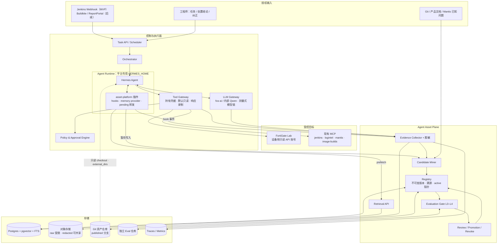
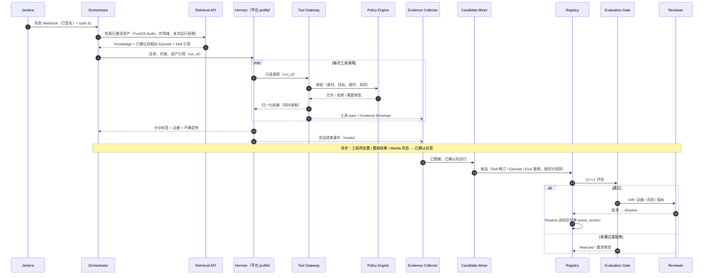
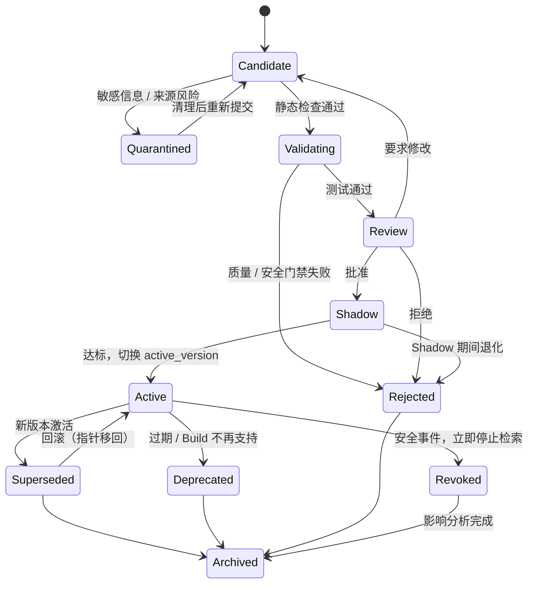

# Agent Persistent Asset & Continuous Learning Platform

> **中文名称：自我改进型 Agent 资产管理与持续学习平台**
> **文档类型：架构设计（Architecture Design / RFC）**
> **版本：v0.2 · 2026-10-22 · 状态：提案（draft），待技术验证**
> **首个应用场景：FortiOS 回归测试失败分诊（Triage）与只读故障诊断，AI-native Quality Engineering**
> **英文版：** [Agent_Asset_Learning_Platform_Architecture_v0.2.md](Agent_Asset_Learning_Platform_Architecture_v0.2.md)

---

## 0. 执行摘要

设计一套独立于底层 LLM、Agent Framework 和 MCP 工具的 **Agent Asset Plane（资产层）**。Agent 执行任务后，可以从经过授权的执行轨迹中提炼可复用资产；资产只有经过脱敏、去重、适用性校验、回归评估和审批，才能进入生产检索路径。

**核心闭环：**

`Task → Observe → Capture Evidence → Verify Outcome → Extract Candidates → Validate → Approve → Shadow → Activate → Retrieve/Reuse → Measure → Revise / Rollback / Revoke`

平台管理七类资产：Knowledge、Episodic Memory、Skills、Tools/Code、Environment Model、Evaluation Assets、Context & Preferences。重点是资产 **版本化、可溯源、可测试、可回滚、可撤回**，从而能实际测量 Agent 是否随时间改进。

**定位：** 不重新发明 Hermes、OpenClaw、Claude Code 等 Agent Runtime。Hermes 已经自带一套学习循环（后台复盘写 Skill/Memory、Curator 自整理、写入审批暂存区、Skill 使用统计）。本平台 **在其外部接管这套循环的治理**：Runtime 内产生的写入一律变成平台的候选资产；已发布资产以只读方式下发给 Runtime。

**首版目标：** 让一个只读的 FortiOS 回归失败分诊 Agent 从 Jenkins 失败记录、Log Intelligence 和授权 Lab 设备的只读数据中复用资产，给出带证据的分诊结论；把工程师确认过的案例转为独立的回归评估资产。

### 0.1 v0.2 相对 v0.1 的主要变化

| # | 变化 | 位置 |
|---|---|---|
| 1 | 依据 Hermes v0.16.0 源码与官方文档，补齐 Hermes 原生学习能力，并规定平台运行时必须关闭或接管它们，避免出现两套互不知情的学习循环 | §2、§4、ADR-006 |
| 2 | 新增 Runtime Adapter 具体设计（Hermes 的 hooks、memory provider、`external_dirs`、`write_approval` 暂存区），给出平台专用配置 | §4 |
| 3 | 凭据从 Agent 环境移到 Tool Gateway；FortiGate 只读在设备侧用只读 API 账号强制，Gateway 只做第二道防线 | §3、§12 |
| 4 | 生命周期改为 **按版本** 的状态机，加入 Shadow、Superseded、Revoked 和撤回影响分析（blast radius） | §6 |
| 5 | 先确认结果，再生成 Skill/Eval 候选；训练/评估用失败签名哈希做确定性切分，防止评估集污染 | §7 |
| 6 | 定义 Offline Replay（工具响应录制回放）、k 次重复运行、模型版本锁定；按统计功效重写验收门槛（30–50 例只能检出 ≥10–15 个百分点的提升） | §8 |
| 7 | 首个场景从“Policy 排障”扩展为 **回归失败分诊**，加入分诊标签体系（产品缺陷 / 测试脚本 / 环境 / 偶发 / 配置等），利用现有 jenkins、logintel、mantis MCP | §9 |
| 8 | 元数据加入 build 级版本范围、风险等级、来源类型；SKILL.md 自定义字段放进独立命名空间 | §6.2、§9.4 |
| 9 | 新增角色与职责、风险等级、待决策问题扩展到 8 个 | §13、§16 |
| 10 | 修正引用：OTel GenAI 语义约定已迁到独立仓库；安全表映射到 OWASP Agentic Top 10（ASI01–ASI10） | §12、§17 |

完整评审意见见 [附录 A](#附录-av01-评审意见)。

---

## 1. 背景、问题与边界

### 1.1 当前问题

1. Agent 每次运行都要重新探索相似问题，浪费 Token、时间和工具调用。
2. 成功经验散落在 Chat、CI 日志、报告、脚本、Git 提交里，缺少统一的可复用表示。
3. 自动写入的 Memory/Skill 可能含错误结论、过期 CLI、敏感信息或注入指令。Hermes 默认 `write_approval: false`，后台复盘会直接写入 Skill 库。
4. 只看最终答案，无法判断错误来自模型、检索、工具、环境、权限，还是过期资产。
5. Agent 自称“学会了”不等于成功率提高；缺少独立基准集、配对对照和回归验证。
6. 现有 QA VM 上的 MCP 凭据位于 `~/.hermes/.env` 和 Agent 的 Shell 环境中。工具筛选（curation）不是沙箱：2026-09-23 曾有 opencode 会话绕过 MCP，直接用密钥文件调用 Mantis。

### 1.2 设计目标

- **G1 可复用：** 从真实任务提炼知识、案例、技能和工具资产，不只保存完整对话。
- **G2 可解释：** 每个关键结论都能追溯到来源、产品版本/Build 和执行证据。
- **G3 可验证：** 候选资产必须通过质量门禁，能对比启用资产前后的表现，并给出置信区间。
- **G4 可治理：** 分级授权、人工审批、审计、不可变版本、撤回与回滚。
- **G5 低耦合：** 通过 Adapter 支持多种 Runtime（Hermes、opencode、OpenClaw、自研 Orchestrator）；资产格式不绑定任何一家的内部存储。
- **G6 渐进实现：** 单团队 MVP 优先，第一版不堆 Kubernetes、图数据库和复杂的多 Agent 自治。
- **G7 复用现有投入（新增）：** 优先复用 `hermes_installer` 已部署的组件（MCP 筛选、`mcp-ask-first` 审批插件、测量式模型链、Log Intelligence），不重复建设。

### 1.3 非目标（v0.2）

- 不训练或微调基础模型权重；这里的“学习”指 **外置资产学习（externalized learning）**。
- 不允许 Agent 无审批修改 Firewall Policy、重启设备或变更网络配置；MVP 不包含任何写操作资产（风险等级 T3，见 §6.4）。
- 不替换 Hermes 的 Memory/Skill 引擎；平台治理它，而不是重写它。
- 不追求跨公司、跨租户的 Agent 市场或计费平台。
- MVP 不接入 Buildkite 和 ReportPortal（现有环境只有 Jenkins MCP，见 §16 Q5）。

### 1.4 约束与假设

- 初期只接入有明确授权的测试环境和 CI/CD 资源。
- Jenkins、Log Intelligence、Mantis、image-builds 通过现有 MCP 服务接入（见 `config/config.yaml`）；FortiOS 设备通过新增的只读 MCP 或 REST 封装接入。
- 设备配置、日志、Token、Secrets 和客户相关数据可能敏感，默认不得写入共享资产库。
- 评估集必须独立于生成 Skill 的样本（§7.3 的切分规则）。
- 模型可用性会变：fos-ai 网关会在不通知的情况下改变各个 Key 可调用的模型，模型链每 15 分钟重新测量一次。评估必须锁定并记录实际使用的模型（§8.4）。

---

## 2. 七类持久化资产与 Hermes 原生对应

| 资产（type） | 主要内容 | 平台存储 | Hermes 原生对应 | FortiOS QA 示例 |
|---|---|---|---|---|
| `knowledge` | 文档、CLI/API 语义、产品规则、版本差异 | Git/对象存储 + FTS/向量索引 | 无（可用外部 memory provider 注入） | FortiOS 7.4 Policy 匹配规则、已知 Mantis 问题摘要 |
| `episode` | 历史任务、行动、观察、结果、错误路径、处置结论 | Postgres 元数据 + 对象存储 Trace | `session_search`（SQLite FTS5，仅限本机会话）、`~/.hermes/logs/session_*.json` | 某次 Jenkins 失败的完整证据链与最终处置 |
| `skill` | 可复用流程、前提、步骤、陷阱、核验方法 | Git 中的 `SKILL.md` 与附件 | `skill_manage`、`~/.hermes/skills/`、`skills.external_dirs`、Curator | 回归失败只读分诊流程 |
| `tool` | 可执行脚本、API/MCP 封装、解析器 | Git + 制品库 | MCP 服务、插件工具、Skill 附带的 `scripts/` | FortiOS CLI 输出解析器 |
| `environment` | 拓扑、配置快照、版本/Build、依赖和有效期 | Postgres / JSON / 对象存储 | 无 | Lab 设备当前 Build、VDOM、接口、路由摘要（带 TTL） |
| `evaluation` | Gold Case、评分器、回归测试、负样本、工具响应录制 | 独立 Git 仓库 + DB + CI Artifacts | 无 | 已确认根因的历史失败，附录制的工具响应 |
| `context` | 项目规则、用户偏好、任务检查点 | KV/DB；短摘要 | `MEMORY.md`（2200 字符）/ `USER.md`（1375 字符），会话开始时冻结注入 | “只读模式、给出证据和 CLI 来源” |

**分类原则（沿用 v0.1）：**

- “是什么” → `knowledge`；“发生过什么” → `episode`；“怎么做” → `skill`。
- 确定性、需要精确重复的逻辑 → `tool`，不要都写成自然语言 Skill。
- “系统当前处于什么状态” → `environment`，附观察时间与 `expires_at`。
- “怎么证明好坏” → `evaluation`，不作为普通参考知识注入，Agent 运行时不可读。
- “这个用户/项目的固定约束” → `context`，只保留最小必要信息，可修改、可删除。

资产之间可以关联，但不互相替代。一个 `episode` 可以派生 `skill` 修订 **或** `evaluation` 案例（二选一，由 §7.3 的切分决定），发布后仍保留证据 ID。

**Hermes 原生能力边界（已核对 v0.16.0 源码与 2026-10-22 官方文档）：** Hermes 的 Skill/Memory 都是 **单机、单 `HERMES_HOME`** 的文件存储；Curator 只按“未使用天数”管理生命周期；Skills Guard 是基于正则的启发式扫描（源码自述“useful — not boundaries”）。跨 Agent 的 Registry、评估门禁、Environment Model、企业审批、版本发布与撤回，都是本平台新增的模块。

---

## 3. 逻辑架构



### 3.1 控制面职责

- **Task API / Scheduler：** 接收工程师任务、CI Webhook（校验签名）、周期触发；分配 `run_id`，管理幂等键。
- **Orchestrator：** 分解任务、限制循环与预算、断点恢复、把运行与资产版本关联起来（`asset_usages`）。
- **Runtime Adapter：** 见 §4。资产层只依赖 Adapter 契约，不依赖 Hermes 内部对象。
- **LLM Gateway：** 复用现有 fos-ai / 内部 Qwen 网关和 `install.sh --adapt` 测量式模型链。每次调用记录 **实际** 模型、Token、延迟、费用、错误、重试；默认不保存敏感 Prompt 明文。
- **Tool Gateway：** **唯一持有工具凭据的组件。** 负责工具发现、Schema 校验、调用 Policy Engine、审计、结果归一化，以及为 Offline Replay 录制响应。Agent 进程内不放长期凭据。
- **Policy Engine：** 按身份、目标环境、操作风险和资产风险等级授权；审批不能由模型自行授予。Hermes 的 `pre_tool_call` hook（现有 `mcp-ask-first` 模式）只是 Runtime 内的第二道防线。
- **隔离执行：** 平台运行使用 Hermes 的 `terminal.backend: docker`（或禁用 terminal/execute_code 工具集），容器内没有凭据，网络出口白名单在 Agent 进程之外强制执行。

### 3.2 资产面职责

- **Evidence Collector：** 生成结构化轨迹；大输出存对象存储，通过摘要和哈希关联。分两层：`raw`（受限访问、加密、短保留期）与 `redacted`（可共享）。
- **Candidate Miner：** 从 **已确认结果** 的运行、工程师纠正，以及 Hermes 暂存区转发来的写入中发现候选；允许“无需生成资产”。
- **Registry：** 统一标识、类型、不可变版本、证据、依赖、权限、适用 Build 范围、风险等级和状态；`active_version` 指针原子切换。
- **Retrieval API：** 先硬过滤、再混合检索（关键词 + 向量 + 元数据），控制注入上下文的预算。
- **Evaluation Gate：** 静态检查、契约测试、录制回放、Lab 验证、Shadow，与 Baseline 做配对比较。
- **Review / Promotion / Revoke：** 审批、发布到 `published` 分支、Shadow 观察、激活、撤回与回滚；作者与审批人不能是同一人；高风险资产不能只凭 LLM 自评分发布。

### 3.3 两条分离的数据流

**执行路径（低延迟）：** 任务 → 识别环境与 Build → 检索已激活且适用的资产 → 构建最小上下文 → Agent 通过 Tool Gateway 调用工具 → 输出带证据的结论。

**学习路径（异步）：** 运行结束 → 整理并脱敏轨迹 → **等待处置结论**（工程师确认 / 重跑结果 / Mantis 状态）→ 识别候选 → 切分训练/评估 → 生成或修订资产 → 评估与人工审查 → Shadow → 激活 / 回滚。

二者分离，执行路径不会阻塞在资产生成和完整评估上。

---

## 4. Runtime Adapter：Hermes 接入设计（新增）

### 4.1 为什么必须接管 Hermes 自带的学习循环

Hermes v0.16.0 默认就会自己“学习”：

| Hermes 机制 | 默认行为 | 不处理的后果 |
|---|---|---|
| 后台复盘（`agent/background_review.py`） | 每轮结束后 fork 一个 Agent，判断是否保存 Memory/Skill，**直接写入** | 未经评估的 Skill 进入检索路径，绕过平台门禁 |
| 创建提醒 | 每 15 次工具迭代提醒保存 Skill（`skills.creation_nudge_interval`），每 10 轮提醒保存 Memory（`memory.nudge_interval`） | 生成大量低质量候选 |
| `write_approval` | Skill 与 Memory 都默认 `false` | 同上 |
| Curator | 默认开启，每 7 天在空闲时运行；30 天未用标记 stale，90 天归档；会合并和修补 Agent 创建的 Skill，备份保留 5 份，可 `hermes curator rollback` | 平台管理的版本被 Runtime 内部改写或归档 |
| Skill 优先级 | 项目 Skill → 本地 `~/.hermes/skills/` → `skills.create_dir` → `external_dirs` | 本地同名 Skill **覆盖** 平台发布的已审查版本 |
| `external_dirs` 写权限 | 官方文档：Hermes 进程能写的话，Agent 可以修改外部目录里的 Skill | 发布目录被 Agent 改写 |
| `skills.guard_agent_created` | 默认 `false`，Agent 自己创建的 Skill 不扫描 | 注入内容不被发现 |
| 会话轨迹日志 | 始终写入 `~/.hermes/logs/session_*.json`，含工具输入输出；没有配置开关 | 敏感数据未脱敏落盘 |

### 4.2 接入点

| 平台能力 | Hermes 接入点 | 设计要点 |
|---|---|---|
| Skill 下发 | `skills.external_dirs` 指向 Git 资产仓库 `published` 分支的只读 checkout | 用文件系统权限保证只读（不同属主或只读挂载）；平台 Skill 统一前缀 `ap-`；会话开始时插件检查本地是否有同名 Skill，有则告警并拒绝运行 |
| Knowledge / Episode 下发 | 外部 memory provider 插件：`prefetch(query)` 调用 Retrieval API | Hermes 同时只允许一个外部 provider；只返回已过滤、已激活的结果，并标注信任级别 |
| Context | `MEMORY.md` / `USER.md`（`memory.write_approval: true`） | 只放项目级固定约束；新增条目同样走候选流程 |
| 证据采集 | 插件 hooks：`pre_tool_call` / `post_tool_call`、`pre_llm_call` / `post_llm_call`、`post_api_request`、`on_session_end` → Evidence Collector | 参考 Hermes 自带的 `observability/langfuse` 插件；`post_api_request` 记录实际模型 |
| 运行内审批 | `pre_tool_call` 返回 `approve` / `block`（与现有 `mcp-ask-first` 相同） | 第二道防线；真正的强制在 Tool Gateway 和设备侧 |
| 候选入口 | `skills.write_approval: true`、`memory.write_approval: true` → 写入暂存到 `~/.hermes/pending/` → 插件转发到 `POST /v1/adapters/hermes/pending` | 平台运行中 **不使用** 本地 `/skills approve`；审批只在平台进行 |
| 生命周期 | 平台运行 profile 中 `curator.enabled: false` | 生命周期只由 Registry 管理 |
| 使用统计 | `~/.hermes/skills/.usage.json`（skill_view / skill_manage 计数） | 作为 `asset_usages` 的辅助信号，以平台自己的 hook 记录为准 |

### 4.3 平台运行专用配置（示意）

平台运行使用 **独立的 `HERMES_HOME`**，与工程师日常交互用的 `~/.hermes` 分开，避免交互会话中的学习混进受治理的运行：

```yaml
# $HERMES_HOME/config.yaml 中由平台管理的部分（示意）
skills:
  write_approval: true          # 所有 skill_manage 写入暂存，由插件转发为候选
  guard_agent_created: true     # Agent 创建的内容也过 Skills Guard
  creation_nudge_interval: 0    # 候选由平台 Miner 产生，不靠提醒
  external_dirs:
    - /srv/agent-assets/published/skills   # 只读 checkout
memory:
  write_approval: true
  provider: asset-platform      # 外部 memory provider 插件
curator:
  enabled: false
terminal:
  backend: docker               # 容器内无凭据
plugins:
  enabled:
    - mcp-ask-first
    - chain-adapt
    - asset-platform
```

> 以上键名已对照 Hermes v0.16.0 源码（`hermes_cli/config.py`）。fosqa VM 运行 v0.21.4，落地前需在该版本上用 `./install.sh --check` 或临时 `HERMES_HOME` 再核对一次。`asset-platform` 插件尚不存在，是本方案的交付物。外部 memory provider 在 Hermes 中通过 `plugins/memory/<name>/` 注册，与普通插件（`plugins.enabled`）加载方式不同；需确认放在 `HERMES_HOME` 下的 provider 能被识别，否则拆成两个插件或改为 hook 注入。

### 4.4 Adapter 契约（与 Runtime 无关）

| 方法 | 说明 |
|---|---|
| `start_run(run_id, task, constraints, asset_refs)` | 启动运行，注入约束和资产引用 |
| `emit(event)` | 上报 LLM 调用、工具调用、审批、会话结束等事件（OTel GenAI 语义） |
| `stage_write(origin, payload)` | Runtime 内的 Memory/Skill 写入转为候选 |
| `fetch_context(query, scope)` | 运行中检索已激活资产 |
| `checkpoint()` / `resume()` | 断点与恢复 |

opencode、OpenClaw、Claude Code 的 Adapter 按同一契约实现，MVP 只做 Hermes。

---

## 5. 端到端运行时序



**避免反馈污染：** “分析报告称修复成功”不等于故障已解决。成功标签只能来自设备观测、回归重跑或授权工程师的独立确认。处置结论到达之前，运行只能生成 `unverified` 的 Episode，不能生成 Skill 或 Eval 候选。

---

## 6. 资产生命周期与治理

### 6.1 按版本的状态机

状态属于 **AssetVersion**；Asset 本身只持有 `active_version` 指针。版本内容不可变，任何修改都产生新版本。



- **回滚** = 把 `active_version` 指针移回上一个 `Superseded` 版本，不重新发布内容。
- **撤回（Revoke）** 与归档不同：撤回立即从检索中移除，并触发影响分析（blast radius）：通过 `asset_usages` 找出使用过该版本的运行、由这些运行派生的 Episode/Eval/Skill 候选，全部标记为待复核。
- `environment` 资产的过期由 `expires_at` 在检索时过滤，不单独设状态。

**候选资产必经校验（沿用 v0.1，顺序不变）：** 来源可信度 → 脱敏 → Prompt Injection 检查 → Schema 校验 → 环境/Build 匹配 → 单元/回归测试 → 独立评审 → 按风险等级审批。

### 6.2 资产公共元数据（示意）

```json
{
  "asset_id": "skill.fortios.regression-triage",
  "type": "skill",
  "version": "1.2.0",
  "state": "candidate",
  "risk_tier": "T1",
  "title": "FortiOS regression failure triage (read only)",
  "scope": {
    "tenant_id": "fos-qa",
    "project_id": "fortigate-regression",
    "product": "FortiOS",
    "version_range": ">=7.2.0,<7.6.0",
    "build_range": null,
    "environment_class": "lab",
    "required_tools": ["jenkins.get_build_log", "logintel.search", "fortios_ro.policy_query"],
    "permissions": ["fortigate.config.read", "fortigate.diag.read", "jenkins.read"]
  },
  "provenance": {
    "origin": "platform_miner",
    "source_run_ids": ["run-20261022-0042"],
    "source_episode_ids": ["ep-20261022-0042"],
    "derived_from": "skill.fortios.regression-triage@1.1.0",
    "rationale": "Three verified runs found policy-order failures that 1.1.0 missed"
  },
  "artifact": {
    "uri": "git://agent-assets/skills/ap-fortios-regression-triage/",
    "commit": "<git-commit-sha>",
    "sha256": "<artifact-digest>"
  },
  "owner": "qa-agent-platform",
  "eval": { "suite_id": "eval.fortios.triage.v1" },
  "review_due_at": "2026-12-22T00:00:00Z",
  "expires_at": null,
  "created_at": "2026-10-22T16:00:00Z"
}
```

| 字段 | 取值 / 说明 |
|---|---|
| `state` | `candidate` / `quarantined` / `validating` / `review` / `shadow` / `active` / `superseded` / `deprecated` / `revoked` / `rejected` / `archived` |
| `risk_tier` | `T0`–`T3`，见 §6.4 |
| `provenance.origin` | `platform_miner` / `hermes_background_review` / `hermes_foreground` / `human_authored` |
| `build_range` | QA 测的是中间 Build；需要时按 Build 号限定（例如某问题在 build N 修复） |
| `required_tools` | 运行环境缺这些工具时不检索该资产（同时映射到 Hermes `requires_tools`） |

> 相比 v0.1：`human_verified` 移到 Episode（它描述的是一次运行的结果，不是 Skill 本身）；增加了 `risk_tier`、`origin`、`derived_from`、`build_range`、`required_tools`、租户/项目字段。`<...>` 是占位符，不是真实值；实现时用可机器校验的 JSON Schema，并实际计算 digest。

### 6.3 检索时的硬过滤顺序

1. 调用者对该租户/项目有读权限；
2. 版本状态是 `active`（Shadow 评估时可包括 `shadow`），digest 与 Registry 记录一致；
3. 产品、版本/Build 范围、环境类别匹配；`required_tools` 在本次运行中可用；
4. 未过期、未撤回；
5. 资产风险等级不高于本次运行允许的等级；
6. 然后才做词法/语义排序，并按上下文预算截断（例如最多 3 个 Skill、5 个 Episode，总量限定 Token）。

**先过滤，再召回。** 不依赖模型在生成后自行忽略未授权资产。Episode 注入时标注 `verified` / `unverified`，默认只注入 `verified`。

> v0.1 写的是“签名有效”，但没有设计签名机制。MVP 用“digest 匹配 + Registry 中的审批记录 + Git 签名 tag”实现；Sigstore 类制品签名放到扩展阶段。

### 6.4 风险等级

| 等级 | 范围 | 审批要求 | 评估要求 |
|---|---|---|---|
| T0 | 文本类知识、Episode、Context | 1 名审查人 | L0 |
| T1 | 只读 Skill / 流程 | 1 名领域审查人（非作者） | L0–L2 |
| T2 | 在沙箱内执行的 Tool / 脚本 | 代码审查 + 领域审查 | L0–L2 + 沙箱运行 |
| T3 | 任何写权限或网络变更 | 安全审查 + 每次运行的人工批准 | L0–L3；**不在 MVP 范围** |

---

## 7. 学习触发、候选生成与防退化

### 7.1 何时触发候选生成

- 运行有了 **已确认的处置结论**，且有跨任务复用价值；
- 某失败后来通过实验找到有证据的新解法；
- 工程师纠正了 Agent 的错误，或 CI 证明旧流程失效；
- 产品文档/CLI/接口在新 Build 中有差异，需要更新已有资产；
- 同一失败签名多次出现，可合并成代表性案例或参数化 Skill；
- Hermes 暂存区转发来的写入（`origin = hermes_background_review` / `hermes_foreground`）。

不触发：单次偶然输出、无法验证的推测、未经授权的配置、含秘密的原文、过度依赖某台机器临时状态的方法。

### 7.2 Candidate Miner（建议实现）

```text
on_run_completed(run):
    evidence = redact_and_normalize(run.trace)
    if not scope_authorized(evidence): return NO_WRITE
    store_episode(evidence, label="unverified")

on_disposition(run, disposition):          # 工程师确认 / 重跑 / Mantis 状态
    episode = mark_verified(run.episode, disposition)
    sig = failure_signature(run)           # 见 7.3
    split = assign_split(sig)              # train | held_out，确定性
    signals = detect_success_corrections_novelty(episode)
    for candidate in classify_to_asset_types(signals, split):
        candidate = attach_provenance_and_scope(candidate)
        if not reusable_or_verifiable(candidate): continue
        candidate = deduplicate_or_propose_revision(candidate)
        stage(candidate)                   # 不自动发布
        enqueue_eval(candidate)

on_hermes_pending(item):                   # 来自 asset-platform 插件
    stage(as_candidate(item, origin=item.origin))
    enqueue_eval(...)
```

设计要点：除 LLM 归纳外，用规则和确定性校验防止幻觉写入；原始证据与提炼结果分离；每个候选都保留“为什么生成”的说明（`provenance.rationale`）。

### 7.3 失败签名与训练/评估切分（新增）

**失败签名** `failure_signature = hash(test_case_id, failing_step, normalized_error, product_line, major.minor)`，其中 `normalized_error` 去掉时间戳、IP、序列号、会话 ID 等易变字段。它同时用于：

- Episode 去重与合并；
- **训练/评估切分：** 按签名哈希确定性分到 `train`（可派生 Skill）或 `held_out`（只能派生 Eval 案例）。同一失败家族不会同时出现在两边。
- 时间切分作为补充：Eval 案例的发生时间应晚于它所评估 Skill 的来源运行。

### 7.4 防止 Skill 漂移与劣化

- 每个 Skill 有 owner、适用 Build 范围、核验方法、Eval 套件和复审日期。
- 发布时保存 Baseline 指标与新版本指标；生产观测发现退化时回滚。
- 新版本先 Shadow 再激活（§8.1 L4）。
- Agent 运行时不能读取或修改 held-out 评估集；评估集放在独立仓库，由独立角色维护（§13）。
- 新 FortiOS Build 上线时，对受影响的 Skill 自动跑一次回归（漂移检测）。

---

## 8. 评估是一等资产

### 8.1 评估层次

| 层次 | 目的 | 样例 | 发布门禁 |
|---|---|---|---|
| L0 Static | 结构、安全、泄露检查 | Schema、危险命令、Secrets、Skills Guard 扫描 | 必须通过 |
| L1 Contract / Unit | 工具和解析器正确性 | CLI Parser Fixture、MCP JSON Schema | 必须通过 |
| L2 Offline Replay | 同题前后配对比较 | 历史 Jenkins 失败，旧/新 Skill 对比，工具响应来自录制 | 必须通过 |
| L3 Lab | 动作在真实环境中有效 | FortiOS Lab 合成故障 | T2 及以上必须通过 |
| L4 Shadow | 真实输入上只观察不干预 | 当前版本出结论，候选版本并行出诊断，只记录 | 激活前必须 |
| L5 Production 监控 | 长期效果与退化 | 成功率、漂移、违规 | 持续 |

> v0.1 的 L5 是“5%–10% 流量 Canary”。是否可行取决于每天进入范围的失败数量（§16 Q4）。量小时百分比 Canary 没有统计意义，改为全量 Shadow，按“Shadow 期运行数 ≥ N 且无退化”激活。

### 8.2 Offline Replay 的定义（新增）

LLM Agent 不确定，设备状态也会变，所以“回放”必须明确定义：

1. **录制：** Tool Gateway 记录每次调用 `(tool, normalized_args) → response`，存为该运行的录制文件（cassette），哈希入库。
2. **回放：** 用候选资产重新运行 Agent，工具调用由录制文件应答。
3. **未命中：** 候选版本调用了录制中没有的工具或参数时，该案例记为 `partial_replay`，单独统计，不算通过也不算失败；未命中率高的 Skill 需要走 L3 Lab。
4. **重复：** 每个案例跑 k 次（建议 k = 3），多数正确才算通过，同时报告方差。

### 8.3 关键指标

- **Task Success Rate：** 经独立证据确认正确的任务 / 可判定任务。
- **Triage Accuracy（新增）：** 分诊标签与已确认标签一致的比例，按类别给出混淆矩阵；区分“证据不足”和“错误结论”。
- **Unnecessary Tool Calls：** 冗余工具调用数，衡量复用是否减少探索。
- **Time to Diagnosis（TTD）：** 从触发到可核验结论的 P50/P95。
- **Cost per Solved Task：** 按成功任务核算 Token / API 成本。
- **Policy Violation Rate：** 越权调用、意外网络出口、敏感数据暴露。
- **Effective Reuse：** 资产被加载（`asset_usages`）且在配对评估中改善结果的比例。只能在评估中测量（需要反事实对照），生产中只统计命中率。
- **Regression / Drift：** 新 Build 上线后原 Skill 的失败率变化。
- **Trace Coverage：** 有完整 `run_id → tool_call → evidence` 链的运行 / 全部平台运行。

### 8.4 实验规范

- 对同一组 held-out 案例做配对 A/B（无资产 vs 有资产，或旧版本 vs 新版本）。
- 固定权限、工具、录制文件。
- **锁定模型：** 评估运行指定模型 ID 与网关；`post_api_request` hook 记录每次调用的实际模型。若模型链在评估中途切换（fos-ai 会不通知地拒绝模型），该轮评估作废重跑。评估安排在网关预算时段内。
- 记录模型、提示词、工具、设备 Build、资产版本，保证可复现。

### 8.5 MVP 验收门槛（是项目目标，不是实测结果）

**样本量现实：** 配对二分类结果（McNemar 检验，双侧 α = 0.05，功效 80%）检出成功率提升所需的案例数：

| 结果不一致的案例比例 | 检出 +5 个百分点 | +10 个百分点 | +15 个百分点 |
|---|---|---|---|
| 10% | ~312 | ~76 | ~32 |
| 15% | ~469 | ~115 | ~50 |
| 20% | ~626 | ~155 | ~67 |

v0.1 用 30–50 个案例验证“提高 ≥5 个百分点”，几乎必然得到“证据不足”。v0.2 的门槛因此分两类：

**硬门禁（每次发布）：**

- L0/L1 全部通过；安全套件 **0 项阻断级越权**。
- 脱敏测试套件（预埋已知 Secrets、IP、序列号的样本）检出率 100%，否则不允许共享资产发布。
- **不退化：** baseline 在 k 次中多数通过的 held-out 案例，候选版本多数失败的不超过 1 个，且每个都有书面解释。
- P95 诊断时延增加 ≤ 20%，单次成功成本增加 ≤ 20%（沿用 v0.1）。

**效果声明（报告用，不阻断发布）：**

- 报告成功率差值与 95% 置信区间；只有区间下限 > 0 才能声称“有效提升”。
- 工具调用数、TTD 等连续指标用配对检验，功效比二分类高，可以作为早期改进信号。
- 样本目标：P3 结束时 held-out ≥ 100 例，P5 结束时 ≥ 150 例（约可检出 10 个百分点）。案例主要从历史 Jenkins 失败及其处置结论中挖掘（§9.3）。
- Trace Coverage ≥ 95%。

---

## 9. 首个业务场景：FortiOS 回归失败分诊

### 9.1 为什么从“Policy 排障”改为“分诊”

QA 环境中的回归失败，相当一部分不是设备配置问题，而是产品缺陷、测试脚本问题、Lab 环境问题或偶发失败。只做 Policy 诊断的 Agent 会把这些误判为配置问题。分诊先回答“属于哪一类”，Policy 诊断作为其中一个子流程（`config_or_policy`）保留。

### 9.2 分诊标签体系（提案，需 QA 团队确认）

| 标签 | 含义 | 典型确认来源 |
|---|---|---|
| `product_defect` | FortiOS 缺陷 | 新建或关联的 Mantis 问题 |
| `known_issue` | 匹配已有 Mantis 问题 | Mantis ID |
| `config_or_policy` | 测试床配置：Policy 顺序、隐式拒绝、路由、NAT、地址/服务对象 | 修正后重跑通过 |
| `test_script` | 测试用例/脚本错误或期望值过时 | 脚本修复提交 |
| `environment_infra` | Lab、拓扑、设备不可达、License、镜像部署、Jenkins 节点 | 环境修复后重跑通过 |
| `flaky_timing` | 偶发；不改任何东西重跑通过 | 重跑记录 |
| `insufficient_evidence` | 证据不足，不下结论 | — |

### 9.3 评估真值来源

历史 Jenkins 失败加上工程师当时的处置（Mantis 问题、脚本修复提交、重跑结果）是现成的真值来源。如果这些处置能可靠关联到构建，MVP 可以在几周内挖出数百个历史案例，解决 §8.5 的样本量问题。前提是确认处置记录在哪里、是否完整（§16 Q3）。

### 9.4 Agent 工作步骤（只读）

1. 建立 `run_id`，绑定身份与授权 Lab；任何写操作在 Tool Gateway 和设备侧都被拒绝。
2. 通过 jenkins MCP 获取构建、失败步骤、日志；通过 logintel MCP 检索相关日志模式。
3. 获取 FortiOS Build、VDOM、相关接口、Policy 和路由上下文（只读 API 账号），确定时间窗口。
4. 检索已激活的同 Build 范围知识、分诊 Skill 和已确认的相似 Episode；通过 mantis MCP 查已知问题（只读工具）。
5. 列出相互竞争的假设（分诊标签 + 具体根因）与反证；明确标出未验证的部分。
6. 输出：分诊标签、证据（工具调用 ID、时间戳、录制哈希）、置信度（仅供参考）、建议的下一步验证；不执行任何变更。
7. 工程师处置或可重现的重跑确认后，运行才标记为 `verified`。
8. 若发现可复用新模式，按切分规则生成 Skill 修订或 Eval 候选，进入评估门禁。

### 9.5 Skill 示例（存入 Git；缩略版）

```markdown
---
name: ap-fortios-regression-triage
description: Triage a FortiOS regression failure using read-only Jenkins, log and device evidence.
version: 0.2.0
platforms: [linux]
metadata:
  hermes:
    tags: [fortios, regression, triage, read-only]
    category: fortios-qa
    related_skills: [ap-fortigate-policy-readonly-diagnosis]
    requires_tools: [<jenkins 构建日志工具在 Hermes 中注册的名称>]
  asset_platform:
    asset_id: skill.fortios.regression-triage
    risk_tier: T1
    version_range: ">=7.2.0,<7.6.0"
    write_permission: none
    eval_suite_id: eval.fortios.triage.v1
---

# Purpose
Classify a failed regression run into one triage label and back it with evidence.

# Preconditions
- Confirm FortiOS build, test bed, failing step and read-only tool authorization.
- Never infer a fix or a root cause from an LLM narrative alone.

# Procedure
1. Read the failing step and its log; extract the normalized error.
2. Check known issues for the same signature before investigating further.
3. Rule environment and flakiness in or out (device reachability, rerun history).
4. If configuration is suspected, follow ap-fortigate-policy-readonly-diagnosis.
5. Return the label, the evidence IDs and what is still unverified.

# Pitfalls
- A test-bed config problem can look like a product defect, and the reverse.
- Stale snapshots or an incomplete traffic tuple invalidate policy conclusions.

# Verification
- A label is final only after an engineer disposition or a reproducible rerun.
```

**说明：** Hermes 识别 `name`、`description`、`version`、`platforms` 和 `metadata.hermes.*`（`tags`、`category`、`related_skills`、`requires_tools` 等）。`requires_tools` 会在工具不可用时隐藏该 Skill，这正好对应平台的 `required_tools` 过滤。`metadata.asset_platform.*` 是本平台的命名空间，Hermes 不解释它，由 Adapter 读取。`<...>` 处填 Hermes 实际注册的 MCP 工具名，可用仓库中的 `tests/list_registered_mcp_tools.py` 列出。

### 9.6 一次任务留下的资产

- `episode`：失败构建、探索路径、错误假设、处置结论（带 `verified` 标记）。
- `knowledge`：特定 FortiOS Build 的已确认行为或已知问题摘要。
- `skill`：一类症状的标准只读分诊流程（仅当签名属于 `train`）。
- `tool`：稳定的日志解析器与输出 Schema。
- `environment`：授权设备在某时刻的拓扑/配置摘要（带 `expires_at`）。
- `evaluation`：录制文件、期望标签与根因、独立评分脚本（仅当签名属于 `held_out`）。
- `context`：项目“只读优先、给出证据、不直接变更策略”的执行规则。

---

## 10. 数据模型与接口

### 10.1 核心关系实体

```text
Task 1 ── n Run 1 ── n Span/ToolCall 1 ── 0..1 ToolRecording
                 ├── n Evidence (object URI, digest, tier=raw|redacted)
                 ├── 0..1 Disposition (label, source, verifier, verified_at)
                 └── n AssetUsage (asset_version, how=injected|loaded|cited)
Run n ── 1 FailureSignature (split=train|held_out)
Run n ── n AssetCandidate n ── 1 Asset
Asset 1 ── n AssetVersion ── n EvaluationResult
Asset 1 ── 1 active_version pointer
AssetVersion n ── n SourceEvidence
AssetVersion n ── n DependencyAssetVersion
AssetVersion 1 ── n Approval / Promotion / Rollback / Revocation events
```

**基础表：** `tasks`、`runs`、`tool_calls`、`tool_recordings`、`evidence_refs`、`dispositions`、`failure_signatures`、`asset_usages`、`assets`、`asset_versions`、`asset_dependencies`、`eval_suites`、`eval_cases`、`eval_results`、`approvals`、`revocations`、`audit_events`。所有表带 `tenant_id`、`project_id` 并做行级权限约束。

**一致性策略：** 大文件与 Trace 存对象存储，数据库只存引用、摘要和元数据；Git 管理 Skill、Tool、Eval 的人工可审查版本。发布流程：写入新版本 → 校验 digest → 合并到 `published` 分支并打签名 tag → 原子切换 `active_version`。

### 10.2 REST API（草案）

| API | 作用 |
|---|---|
| `POST /v1/runs` | 创建运行并返回 `run_id` |
| `GET /v1/runs/{id}` | 状态、结果、资产引用、Trace 链接 |
| `POST /v1/runs/{id}/disposition` | 记录已确认的处置结论（新增） |
| `POST /v1/assets/candidates` | 提交带证据的候选资产 |
| `POST /v1/adapters/hermes/pending` | 转发 Hermes 暂存区中的写入（新增） |
| `GET /v1/assets/search?type=skill&product=FortiOS&build=7.4.5-2702` | 按权限和 Build 检索已激活资产 |
| `POST /v1/assets/{id}/versions/{v}/evaluations` | 在指定套件上评估某个版本 |
| `POST /v1/assets/{id}/versions/{v}/approvals` | 审批/拒绝；强制操作者身份，作者不能自批 |
| `POST /v1/assets/{id}/versions/{v}/promotions` | 进入 Shadow 或激活 |
| `POST /v1/assets/{id}/rollback` | 把 `active_version` 移回上一版本 |
| `POST /v1/assets/{id}/versions/{v}/revoke` | 撤回并启动影响分析（新增） |
| `GET /v1/assets/{id}/versions/{v}/usages` | 使用过该版本的运行与派生资产（新增） |
| `POST /v1/integrations/ci/webhook` | 接收已校验签名的 CI 事件 |

**API 要求：** 幂等键、分页、审计身份、访问控制、Schema 校验、明确的错误码。写操作有不可抵赖的审计链；异步操作返回 `job_id` 并可查询状态。

### 10.3 Evidence Envelope 示例

```json
{
  "evidence_id": "ev-9876",
  "run_id": "run-20261022-0042",
  "source_type": "mcp.tool_result",
  "tool_name": "fortios_ro.policy_query",
  "tool_call_id": "tc-0042-07",
  "observed_at": "2026-10-22T16:01:10Z",
  "product_version": "FortiOS 7.4.5",
  "product_build": "2702",
  "environment_id": "lab-fw-01",
  "redaction": { "status": "passed", "ruleset": "redact-v3" },
  "tier": "redacted",
  "object_uri": "s3://agent-evidence/redacted/ev-9876.json",
  "sha256": "<content-digest>",
  "recording_ref": "rec-0042-07",
  "classification": "internal",
  "trust_level": "tool_observation",
  "retain_until": "2027-04-22T00:00:00Z"
}
```

---

## 11. 技术选型：自研什么，复用什么

| 组件 | MVP 建议 | 扩展阶段 | 决策理由 |
|---|---|---|---|
| Orchestrator | 现有 Agent + Adapter；Jenkins Webhook 触发 | 持久工作流引擎（Temporal 等） | 保护已有投入，逐步引入重试/恢复 |
| Agent Runtime | **Hermes**（平台专用 `HERMES_HOME`） | opencode / OpenClaw / Claude Code Adapter | Hermes 的 hooks、memory provider、`external_dirs`、`write_approval` 提供全部接入点，无需 fork；团队已通过 `hermes_installer` 部署 |
| LLM Gateway | fos-ai + 内部 Qwen，测量式模型链（`chain-adapt`） | 策略路由、预算、质量反馈 | 已有，已验证 |
| Policy（Runtime 内） | `mcp-ask-first` 模式的 `pre_tool_call` hook | — | 已在 ACP、`-z`、cron 路径上验证 |
| Policy（Runtime 外） | Tool Gateway + 工具白名单 + 人工审批 | OPA/ABAC、动态短时凭据 | 凭据不进 Agent 进程 |
| Metadata / Index | PostgreSQL + pgvector + FTS | 必要时专用向量库 | 运维负担低，支持混合检索 |
| Evidence Blob | S3 兼容对象存储（本地 MinIO），raw / redacted 分桶 | 托管存储、生命周期规则 | 低成本保存大体积证据 |
| Skills / Tools | Git 资产仓库 + CI，`published` 分支只读下发 | 制品签名、专用 Registry | 审查、Diff、历史与回滚天然友好 |
| Evals | **独立** Git 仓库，Agent 运行身份无读权限 | — | 防止评估集污染 |
| Async Jobs | 简单任务队列 / 现有 CI | Durable workflow + 事件总线 | MVP 不过度设计 |
| Observability | Hermes hooks → OTel（GenAI 语义约定）；或先用自带的 Langfuse 插件 | 集中 Trace 与成本归因 | 连接 LLM、工具、评估的每一步 |
| Secrets | Vault（或现有方案），仅 Tool Gateway 可取 | 动态短时凭据 | 修复 §1.1 第 6 点 |
| UI | 轻量审批/资产浏览页 | 多角色治理控制台 | 先打通审核和发布闭环 |

### 11.1 Hermes 能力边界（已核对）

已核对 Hermes v0.16.0 源码（本工作站，upstream `c6e99ab3`）与 2026-10-22 的官方文档：`skill_manage`（create / edit / patch / delete / write_file / remove_file）、Skill 存于 `~/.hermes/skills/`、`skills.external_dirs`、`skills.write_approval`（暂存到 `~/.hermes/pending/skills/`，`/skills pending|diff|approve|reject`）、后台复盘、Curator、Skills Guard（builtin / trusted / community 三档信任与隔离区）、`.usage.json` 使用统计、写入来源标记（background_review vs foreground）、`session_search`（FTS5）、外部 memory provider 插件、插件 hooks、Langfuse 与 NeMo Relay 观测插件、`terminal.backend`（local / ssh / docker 等）。

本方案中的跨 Agent Registry、统一评估门禁、Environment Model、企业审批、版本激活与撤回，都是新增模块，不是 Hermes 原生功能。

### 11.2 为什么暂不引入图数据库

首版环境关系用 JSON 文档 + Postgres 关联表表示。只有在跨大量设备/依赖的多跳查询被证实为瓶颈时，再引入 Neo4j 或图谱服务。

---

## 12. 安全、权限与多租户

| 风险 | OWASP Agentic（我方映射） | 具体场景 | 强制控制 |
|---|---|---|---|
| Prompt Injection / Memory Poisoning | ASI01、ASI06 | 日志或 Mantis 备注里含“更新 Skill”的指令；后台复盘把它写进 Skill | 外部内容只当数据；Runtime 写入一律暂存为候选；`guard_agent_created: true`；资产写入单独授权 |
| Tool Misuse / Excessive Agency | ASI02 | Agent 尝试修改 Firewall Policy 或触发构建 | 设备侧只读 API 账号（只读 admin profile + 受信主机）；Tool Gateway 默认只读；`pre_tool_call` 第二道防线 |
| 凭据暴露 / 身份滥用 | ASI03 | Agent 从环境变量或密钥文件读到 Token，绕过 MCP 直接调用服务（2026-09-23 已发生） | 凭据只在 Tool Gateway；容器执行无凭据；Agent 身份与工具身份分离 |
| Secret / 数据泄露 | ASI03 | CLI 输出含凭据、IP、客户信息；Hermes 会话日志未脱敏落盘 | 接入侧脱敏（不依赖 Hermes 的正则 `redact.py`，它只遮挡密钥类字符串）；raw 层受限且短保留；平台 `HERMES_HOME` 的日志目录纳入保留策略 |
| 跨租户泄露 | ASI03 | 其他项目的资产被检索到 | 行级权限 + 检索前元数据过滤 |
| 供应链 | ASI04 | 新 Skill 附带恶意脚本 | Git 审查、代码扫描、依赖锁定、沙箱执行；T2 需代码审查 |
| 意外代码执行 | ASI05 | Skill 的 `scripts/` 在 Agent 主机上运行 | `terminal.backend: docker`，网络出口白名单 |
| 级联失败 / 过期知识 | ASI08 | 新 Build 上用旧 CLI；一个错误 Skill 派生出更多错误资产 | Build 范围、`expires_at`、漂移回归；撤回 + 影响分析 |
| 人对 Agent 的过度信任 | ASI09 | 审查人看到“高置信度”直接批准 | 置信度只作参考；审查界面先展示证据；作者 ≠ 审批人；监控审批通过率与审查时长 |
| 失控 Agent / 未授权出口 | ASI02、ASI10 | 测试 Agent 扫描非目标系统 | 目标白名单、容器出口控制、审计 |
| 评估集污染 | — | Agent 看到评估答案 | 独立仓库、Agent 身份无读权限、签名切分（§7.3） |

**信任边界：** `LLM output ≠ authority`、`retrieved document ≠ trusted instruction`、`successful tool call ≠ authorized business change`、`tool curation ≠ sandbox`。高风险动作的授权必须在模型外部执行。

> ASI 编号映射是本文作者的对应，不是 OWASP 的官方映射。OWASP 资料提供威胁建模框架；本系统的安全性仍需通过红队测试和权限验证确认。

---

## 13. 角色与职责（新增）

| 角色 | 职责 | 约束 |
|---|---|---|
| Asset Owner | 维护某个 Skill/Tool，按 `review_due_at` 复审 | 每个 `active` 资产必须有 owner |
| Domain Reviewer（QA 工程师） | 审批候选、录入处置结论 | 不能审批自己作为作者的候选 |
| Eval Maintainer | 维护 held-out 集与评分器 | 独立于 Skill 作者；Agent 身份无权访问 |
| Platform Operator | Registry、Tool Gateway、凭据、保留策略 | 不参与内容审批 |
| Security Reviewer | T2/T3 审批、红队测试 | — |

---

## 14. MVP 交付计划（建议 8–12 周，可按团队能力调整）

| 阶段 | 工作项 | 可验收交付 |
|---|---|---|
| **P0：第 1–2 周** | 平台专用 `HERMES_HOME` 配置（§4.3）；证据 hook 插件；`run_id`；Jenkins Webhook；jenkins/logintel 凭据移入 Tool Gateway；分诊标签草案；摸清失败量与处置记录来源（Q3/Q4） | 任一运行可定位输入/工具/输出；后台复盘的写入全部进入暂存区，没有直接落地 |
| **P1：第 3–4 周** | 资产 Schema、Registry 表、Episode/Knowledge 入库、Retrieval API + memory provider；脱敏测试套件；开始挖掘历史案例 | 能查询相似案例及原始证据；脱敏套件预埋样本检出率 100%；held-out ≥ 50 |
| **P2：第 5–6 周** | Miner + Hermes 暂存转发 → Git PR → 审批 → 发布到只读目录；同名覆盖检查 | 完整 Candidate → Review → Shadow → Active 流程；本地同名 Skill 被检测并拒绝 |
| **P3：第 7–8 周** | 工具响应录制、Offline Replay、k = 3、Baseline 对比、带置信区间的报告 | 可量化成功率、分诊准确率、时延、成本、安全回归；held-out ≥ 100 |
| **P4：第 9–10 周** | Shadow 模式、撤回与影响分析、回滚演练、新 Build 漂移检测 | 撤回后检索立即不再返回该版本，`usages` 列出受影响运行；回滚演练成功 |
| **P5：第 11–12 周** | 看板、审批流、运维手册、MVP 评审 | 可演示完整学习闭环；held-out ≥ 150；形成 v0.3 设计决策 |

### 14.1 推荐首版切片

**唯一场景：** Jenkins 回归失败 → Agent 在授权 Lab 中只读分诊 → 工程师确认处置 → 生成 Episode 与 Skill 或 Eval 候选（按切分）→ 回放验证 → PR 审批 → Shadow → 激活 → 下一次运行复用。

**首版只实现四类必需资产：** `knowledge`、`episode`、`skill`、`evaluation`；`environment` 先以快照实现；`tool`、`context` 先复用现有 MCP 和 Hermes Memory。七类 Schema 预留，不一次性铺开。

### 14.2 定义完成（Definition of Done）

- 任一分诊结论可定位到 `run_id`、工具调用、录制和证据引用。
- 至少 1 个真实改进的 Skill 经过 PR、审批、回放测试和 Shadow 后激活。
- 能重跑完整 held-out 套件，对比“未启用资产 / 启用资产”，结果带置信区间。
- 模拟过期 Skill 导致退化，并成功回滚；撤回演练通过。
- 未经批准的写操作在 Tool Gateway **和** 设备侧都被拒绝并审计。
- 平台 profile 中 Hermes 的所有自主写入都以候选形式出现在平台，没有一个直接落入 Skill 目录。
- 成本、质量、安全和版本适用性在同一份发布报告中可见。

---

## 15. 决策记录（ADR）与未来演进

**ADR-001：资产层独立于 Agent Runtime。** 保留可替换性，不被 Hermes/OpenClaw 的内部存储格式锁定。

**ADR-002：Git + Registry 双层。** Git 管理可审查的资产正文和脚本；Registry 管理检索、状态、实验指标和运行关联。

**ADR-003：Experience ≠ Truth。** Episode 可以记录错误的探索；Knowledge/Skill 的权威性来自可核验来源、测试和审批。

**ADR-004：先做评估闭环，再追求自动学习的程度。** 没有 Gold Case、指标和回滚，自动生成更多 Skill 只会增加风险。

**ADR-005：权限策略在模型外部。** 只读默认；高风险动作单独审批；设备侧最小权限。

**ADR-006（新增）：治理 Runtime 自带的学习循环，而不是替换它。** 平台运行中 Hermes 的 Memory/Skill 写入全部暂存并转发为候选，Curator 关闭；交互式 `~/.hermes` 不受影响。

**ADR-007（新增）：已发布资产以只读方式下发。** 通过 `skills.external_dirs` 指向只读 checkout，用文件系统权限保证只读，并检测同名覆盖。

**ADR-008（新增）：效果声明需要置信区间。** 发布门禁看“不退化 + 安全”，“有效提升”只有在置信区间下限 > 0 时才能写进报告。

**后续可选扩展：** A2A 多 Agent 协作；跨团队 Skills Marketplace；资产冲突检测；自动的 Build 适用性迁移；因果/反事实评估；基于结果的模型路由；经合规脱敏的数据集导出与受控微调。

---

## 16. 开工前需要决策的问题

| # | 问题 | 建议 |
|---|---|---|
| Q1 | 首个 Runtime：现有自研 Agent 还是 Hermes？ | Hermes（理由见 §11）；自研 Agent 若有更强的编排能力，可作为 Orchestrator，Hermes 作为执行 Runtime |
| Q2 | 数据治理：哪些设备配置、测试日志可以落盘，raw 层保留多久？ | 提议 raw 30 天、redacted 按资产生命周期；需安全/合规确认 |
| Q3 | 评估真值：处置结论记录在哪里（Jenkins 描述、Mantis、表格）？谁确认？ | 先抽样 50 个历史失败，核查处置可追溯的比例 |
| Q4 | 每天进入范围的回归失败有多少？ | 决定 Canary 还是全量 Shadow，以及历史案例能否达到 150+ |
| Q5 | Buildkite、ReportPortal 是否在范围内？ | MVP 只做 Jenkins |
| Q6 | 谁为每台 Lab 设备开只读 API 账号并维护受信主机？ | Platform Operator + Lab 管理员 |
| Q7 | 谁担任独立的 Eval Maintainer？ | 不能是 Skill 作者 |
| Q8 | 目标 Hermes 版本（工作站 v0.16.0，fosqa VM v0.21.4）？ | 以 VM 版本为准，复核 §4.3 的配置键 |

---

## 17. 参考资料与事实边界（截至 2026-10-22）

- [Hermes Agent — Skills System](https://hermes-agent.nousresearch.com/docs/user-guide/features/skills/)：`skill_manage`、`external_dirs` 与优先级、`write_approval` 暂存区、后台复盘。
- [Hermes Agent — Working with Skills](https://hermes-agent.nousresearch.com/docs/guides/work-with-skills)：`SKILL.md` 样例、Memory 与 Skill 的区别。
- [Hermes Agent — Creating Skills](https://hermes-agent.nousresearch.com/docs/developer-guide/creating-skills)：Skill 与 Tool 的边界、可识别的 frontmatter 字段（含 `requires_tools`）。
- [Hermes Agent — Configuration](https://hermes-agent.nousresearch.com/docs/user-guide/configuration/)：Skill/Memory 写入审批配置。
- Hermes v0.16.0 源码（本工作站 `~/.hermes/hermes-agent`，upstream `c6e99ab3`）：`agent/background_review.py`、`agent/curator.py`、`tools/write_approval.py`、`tools/skill_usage.py`、`tools/skills_guard.py`、`agent/memory_provider.py`、`hermes_cli/plugins.py`（`VALID_HOOKS`）、`hermes_cli/config.py`、`plugins/observability/langfuse/`。
- 本仓库：`config/config.yaml`（MCP 服务与筛选）、`config/plugins/mcp-ask-first/`、`config/plugins/chain-adapt/`、`docs/guides/fosqa-vm-llm-chain.md` §7（凭据与“筛选不是沙箱”的观察）。
- [OpenTelemetry GenAI Semantic Conventions](https://github.com/open-telemetry/semantic-conventions-genai)：GenAI span、agent span、metrics、events、MCP 约定（已从 opentelemetry.io 主规范迁出）。
- [OWASP GenAI Security Project — 2026 Risk Update（2026-09-01）](https://genai.owasp.org/2026/09/01/owasp-genai-security-project-unveils-2026-top-10-for-llm-applications-new-agent-control-standard-and-sponsors-as-community-tops-30000-members/)：LLM Top 10 2026 与 Agent Control Standard。
- OWASP Top 10 for Agentic Applications（2026 版，2025-12 发布）：ASI01–ASI10。

**事实边界：** 第 3–16 节是针对本场景的工程设计与建议，不是 Hermes、OpenClaw 或任何公司已交付的功能。性能目标、验收阈值、样本量估算和周数都是规划值，需用真实基线与实验验证。§8.5 的样本量基于假设的不一致比例，实际值要从首批回放结果估计。

---

## 附录 A：v0.1 评审意见

严重度：**高** = 不改会让设计目标失效；**中** = 实施时会出问题；**低** = 表述或文档质量。

| ID | 严重度 | v0.1 位置 | 问题 | v0.2 处理 |
|---|---|---|---|---|
| R-01 | 高 | §1.3、§10.1 | 低估 Hermes 原生能力：后台复盘、`write_approval`、Curator、Skills Guard、使用统计、memory provider、hooks 都已存在 | §2、§4、§11.1 |
| R-02 | 高 | §3、§5 | Hermes 默认 `write_approval: false`，后台复盘直接写 Skill，Curator 会改写/归档；平台“候选不可直达生产”的承诺在 Runtime 内被绕过 | §4.1、§4.3、ADR-006 |
| R-03 | 高 | §3.1、§11 | “Gateway 强制只读”在 Agent 拥有凭据和 terminal 时不成立；本仓库 2026-09-23 已观察到绕过 MCP 直接调用 | 凭据移入 Tool Gateway、容器执行、设备侧只读账号（§3.1、§12） |
| R-04 | 高 | §7.3 | 30–50 例无法检出 +5 个百分点（约需 300–600 例），门槛几乎必然得出“证据不足” | 样本量表与两类门槛（§8.5） |
| R-05 | 高 | §6.2、§4 | 运行一结束就挖掘候选，此时结论尚未确认，会把错误结论学进 Skill | 先确认处置再生成 Skill/Eval（§5、§7.2） |
| R-06 | 中 | §5 | 同一运行可同时派生 Skill 与 Eval 案例，造成评估集污染 | 失败签名确定性切分（§7.3） |
| R-07 | 中 | §7.1 | “Offline Replay”未定义；Agent 不确定、设备状态会变 | 工具响应录制、未命中处理、k 次重复（§8.2） |
| R-08 | 中 | §7.3 | 模型链会不通知地变化，A/B 被混杂 | 锁定并记录实际模型（§8.4） |
| R-09 | 中 | §5 | 状态机混用资产与版本（`Published → Published`）；缺 Shadow、要求修改、撤回；回滚语义不清 | 按版本的状态机 + `active_version` 指针 + 撤回影响分析（§6.1） |
| R-10 | 中 | §8.3、§10.1 | 本地同名 Skill 优先于 `external_dirs`；外部目录可写 | 前缀、同名检查、文件系统只读（§4.2、ADR-007） |
| R-11 | 中 | §8 | 场景只覆盖 Policy；QA 失败大量是产品缺陷、脚本、环境、偶发问题 | 分诊标签体系（§9.1–9.2） |
| R-12 | 中 | §8.3 | SKILL.md 自定义字段直接放在 `metadata` 下，未使用 Hermes 的 `metadata.hermes.*` 和 `requires_tools` | 独立命名空间 + `requires_tools`（§9.5） |
| R-13 | 中 | §5.1 | 版本范围只到 minor，QA 测中间 Build；`human_verified` 放错层级；缺风险等级与来源类型 | `build_range`、`risk_tier`、`origin`（§6.2） |
| R-14 | 中 | §5.2 | 检索过滤要求“签名有效”，但没有签名设计 | MVP 用 digest + 审批记录 + 签名 tag（§6.3） |
| R-15 | 中 | §2、§4 | 相似 Episode 不区分已确认/未确认就注入 | 注入时标注，默认只注入 `verified`（§6.3） |
| R-16 | 中 | §11 | 没提 Hermes 会话日志无开关地落盘，`redact.py` 只遮挡密钥 | §12 数据泄露行、§16 Q2 |
| R-17 | 中 | §12 | 没有角色与职责，“独立角色维护评估集”无人落实 | §13 |
| R-18 | 中 | §7.1 | 5%–10% Canary 没考虑失败量；量小时无统计意义 | 依据 Q4 决定，默认全量 Shadow（§8.1） |
| R-19 | 低 | §1.4、§10 | 未利用现有 jenkins / logintel / mantis / image-builds MCP、`mcp-ask-first`、`chain-adapt` | G7、§9.4、§11 |
| R-20 | 低 | §12 | 验收项“无敏感信息泄露”不可验证 | 预埋样本的脱敏套件（§8.5、§14） |
| R-21 | 低 | §3 | Mermaid 标签里的 `\n` 在多数渲染器中原样显示 | 改为 `<br/>` |
| R-22 | 低 | §4 | 时序图中由 Evaluation Gate 向 Retriever 发布；缺 Policy 检查 | 发布经 Registry；工具调用经 Policy Engine（§5） |
| R-23 | 低 | §14 | OTel 引用指向通用语义约定，GenAI 约定已迁到独立仓库；OWASP 未落到具体风险编号 | §17、§12 |
| R-24 | 低 | 全文 | 缺少文档标准要求的 frontmatter 与 History | 已补 |

---

## History

| 日期 | 版本 | 变更 |
|---|---|---|
| 2026-10-22 | v0.1 | 初版提案。 |
| 2026-10-22 | v0.2 | 评审 v0.1（附录 A，24 条）；对照 Hermes v0.16.0 源码与官方文档补齐原生能力并新增 Adapter 设计（§4）；按版本的状态机与撤回；先确认再挖掘；签名切分；回放定义、模型锁定、样本量与门槛重写；场景改为回归失败分诊；角色、风险等级、待决策问题扩展；修正引用；新增英文版。 |
