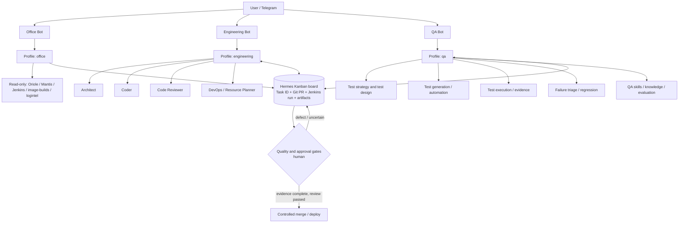
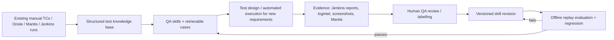
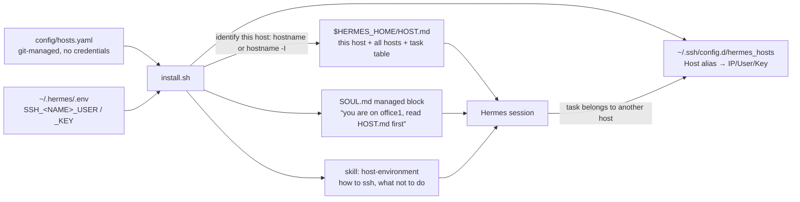

# Hermes Multi-Agent Platform Architecture and Implementation Plan (v2.1 · independent QA edition)

> **Document type:** architecture design / implementation baseline
> **Status:** Phase 0/1 were implemented on the workstation office1 on 2026-10-27 (table at the end of §1, §10). The fosqa VM, the three new Telegram bots, Jenkins and the internal systems were not touched. The VM commands in §6.2 are still **future steps**.
> **What changed from v2.0:** the plan is grounded in **what actually exists on this machine and the VM** (the Hermes version split, the existing `office_automation` profile, the 66 QA skills and 4 MCP servers already here, Hermes' native Kanban); assumptions that do not match the environment were dropped (Selenium/ReportPortal/Allure, multiplex on v0.16.0); and the docs standard is met (frontmatter, History, review appendix).
> **The goal is unchanged:** automate the repetitive part of manual QA step by step, with traceability, evidence and security boundaries; never replace test evidence with unverified AI output.

## 0. Executive summary and settled decisions

Still **three long-lived Hermes profiles / three separate Telegram bots**:

| Profile | Entry point | Core role | Ownership boundary |
|---|---|---|---|
| `office` | Office Bot | Read-only retrieval over internal systems (Oriole test cases/coverage, Mantis, Jenkins, image server), reports and office automation | Gathers and organises information; has no release authority |
| `engineering` | Engineering Bot | Architecture, coding, code review, DevOps/resource planning | Implementation and change proposals; does not certify its own code quality |
| **`qa`** | **QA Bot** | **Requirement analysis, test design, manual-to-automated conversion, controlled execution, failure triage, regression, quality evaluation** | **Independent test standards, execution evidence and quality verdicts** |

### 0.1 Changes from v2.0

| # | Change | Where |
|---|---|---|
| 1 | Added "Current state": the default gateway already running here, the existing `office_automation` profile (bot token duplicated from default), the v0.16.0 vs v0.21.4 split | §1 |
| 2 | Gateway topology split by version: v0.16.0 runs **one gateway process per profile** and has no `multiplex_profiles`; single-host multiplex is the default only from v0.21.x. v2.0 presented the latter as "the current official way", which holds for the VM, not for the workstation | §6 |
| 3 | Cross-profile collaboration v1 uses **Hermes' native Kanban** (shared SQLite board, routing by profile description, `kanban_*` tools, Swarm) instead of a home-made YAML contract plus a future queue; the contract fields survive as the task-body template | §5 |
| 4 | QA/Office skills: instead of "write nine new `qa-*` skills", **map onto existing assets first**: the 66 skills in `SKILL_Processed/` (`triage-mantis`, `fos-mantis-missing`, `oriole-testdata`, `fos-testscript-dsl`, `cm-builds`, …) and the jenkins / mantis-tools / logintel / image-builds MCP servers in `config/config.yaml`; build only what is really missing | §3.3, §9 |
| 5 | Test automation stack is the one this team uses: **fortistack / autotest.py / the FortiOS test DSL**; Selenium POM, ReportPortal and Allure are downgraded to "confirm they exist" | §3.3, §9, §12 |
| 6 | Hermes' own learning loop (background review, `write_approval: false` writing skills directly, curator) is covered: every profile must switch it off or take it over per v0.2 §4.3, otherwise `qa` writes its own skills | §7.3 |
| 7 | The permission model names Hermes' **concrete mechanisms** (`terminal.home_mode: profile`, `terminal.backend: docker` + `docker_forward_env`, MCP `include` lists + `mcp-ask-first`, Telegram allowlist) and corrects "a Reviewer subagent can be P0 read-only": subagents inherit the parent's API key and credential pool and are not security principals | §2, §7 |
| 8 | ECC verified: `install.sh --target hermes` writes into `~/.hermes/` (the default profile), `--profile minimal` and `--dry-run` exist, the three candidate skills exist but are written for Claude Code; per-profile install and commit pinning described | §8 |
| 9 | `install.sh` honours `HERMES_HOME`, so the measured model chain, MCP curation and plugins can be reused per profile; listed as a concrete Phase 1 task | §6.3 |
| 10 | Evaluation-set size aligned with v0.2 §8.5: 30–50 cases only detect differences of 10–15 percentage points or more; Phase 2's "20+ samples" becomes "≥30 cases with an expert verdict" | §4, §10 |
| 11 | Data policy narrowed to the facts: the whole model chain goes through internal gateways (fos-ai, releaseqa-aiserver), so "sending data to a third-party model" is not the issue; the real risk is Hermes session logs written to disk unredacted | §7.2 |
| 12 | Frontmatter, History and a review appendix added; the "v1.0" v2.0 refers to does not exist in this folder and is marked as a verbal draft | whole doc, Appendix A |
| 13 | Multi-host working environment added: git-managed `config/hosts.yaml` (7 hosts, 7 host-exclusive tasks, three networks), SSH credential naming in `.env`, the rendering design (`HOST.md` + managed `SOUL.md` block + ssh aliases + `host-environment` skill), the `install.sh` change list | §13 |

### 0.2 Recommended architecture



**Important:** the three profiles **share no chat history, memory or skills** (official docs: a profile is a separate `HERMES_HOME`). The only handoff medium between them is the Kanban board plus Git PR / Jenkins run / artifact links. Kanban is single-host with a "trusted local user" threat model (workers run under the same uid): it solves **collaboration and audit**, not **permission isolation**; isolation is §7.

---

## 1. Current state (2026-10-27, facts)

Before designing, look at what is on the machine. Everything below was checked, not assumed.

| Item | Workstation (this machine) | fosqa VM |
|---|---|---|
| Hermes version | v0.16.0 (2026.6.5, upstream c6e99ab3); source and local docs in `~/.hermes/hermes-agent/` | v0.21.4 (`docs/guides/fosqa-vm-llm-chain.md`); its CLI was not checked from here |
| Gateway | `hermes-gateway.service` running (default profile, Telegram bot, PID 2568) | the `configure_gateway` path of `install.sh` has not been run on the VM (`docs/guides/telegram.md`) |
| Existing profiles | `default` (`~/.hermes`) and `office_automation` (created 2026-10-23, description "documents, spreadsheets, email/OWA triage, internal portals, reporting", gateway not running) | default only |
| **Known problem** | `office_automation/.env` is a copy of default's `.env`, **including the same `TELEGRAM_BOT_TOKEN`**. Starting its gateway would mean two pollers on one bot token; v0.16.0 refuses the second start, but by accident, not by design | — |
| MCP servers | `config/config.yaml`: jenkins (10 tools), mantis-tools (8), logintel (26 read-only), image-builds (14 read-only), microsoft365 (untested) | same |
| Plugins | `mcp-ask-first` (Mantis create/note, email, Jenkins trigger ask first), `chain-adapt` (re-measures the chain when a model is refused) | same |
| Model chain | all internal gateways: fos-ai (deepseek-v4.1-flash → glm-5.3) → releaseqa-aiserver (qwen3.6-35b-a3b → qwen3.5-122b-a10b-awq), re-measured every 15 minutes | same |
| QA skills | `SKILL_Processed/`: 66, from the QA Assistant skill store (rainxiao and others), including `triage-mantis`, `triage-my-team-mantis`, `fos-mantis-missing`, `oriole-testdata`, `fos-testscript-dsl`, `cm-builds`, `fos-troubleshoot`, `fos-cli-reference`, `create-skill`… | `install.sh` decides whether to ship them (currently it does not) |
| Learning loop | `~/.hermes/config.yaml`: `skills.write_approval: false`, `memory.write_approval: false`, curator on by default → the agent writes skills and memory directly (v0.2 §4.1) | same (defaults) |
| Cross-profile primitive | Hermes Kanban exists (`~/.hermes/kanban.db`; `hermes kanban` has 40+ subcommands including `swarm` and `decompose`); the dispatcher runs inside the gateway by default | same (differences in v0.21.4 to confirm) |
| Test automation stack | fortistack / `autotest.py` / autolibv3 test DSL (`fos-testscript-dsl` skill); Jenkins `releaseqa-stackjenkins` (BATCH_TESTS_AUTO6 → fortistack_master_provision_runtest → fortistackRunTests) | same |
| Related design | `Agent_Asset_Learning_Platform_Architecture_v0.2*.md` in this folder: asset platform, evaluation gates, takeover of Hermes' learning loop | — |

**Workstation state after Phase 1, afternoon of 2026-10-27 (checked with `hermes profile list` / `./install.sh --check`):**

| Item | State |
|---|---|
| Profiles | `default` (gateway running, Telegram bot), `office` (renamed from `office_automation`, duplicate bot token commented out), `engineering`, `qa` (created with `--no-skills`); none of the three new profiles has a gateway installed or a bot token in `.env` |
| Per-profile config | written by `./install.sh --profile <name>`: measured model chain, 4 MCP servers (all Connected), the two plugins, `config/profiles/<name>/overlay.yaml` (`skills.write_approval: true`, `memory.write_approval: true`, `guard_agent_created: true`, `creation_nudge_interval: 0`, `curator.enabled: false`, `terminal.home_mode: profile`, extended mantis-tools `include`), `SOUL.md`, local skills |
| Host identity | all four homes have `HOST.md`, the managed `SOUL.md` block, `HERMES_HOST=office1` in `.env` and the `host-environment` skill; `~/.ssh/config.d/hermes_hosts` holds 7 aliases and `~/.ssh/config` has the `Include` |
| Acceptance | each of the three profiles answered one `hermes -z` turn: "on office1 / 172.19.136.41", its own role, "a Log Intelligence migration needs `ssh log_intel_server`"; no new files in `skills/` or `memories/` afterwards |
| ssh reachability | key login OK: `log_intel_server`, `fgt1`; no key: `cdn`, `guiauto1` (key not authorised), `office2`, `office3` (Windows, OpenSSH not enabled) |
| Corrected facts | the mantis-tools server exposes 110 tools (`hermes mcp test`), the `skill_*` tools exist; this workstation does not allow user crontabs (`/etc/cron.allow`), so `--cron` does nothing here and refused models are handled by the `chain-adapt` plugin |

**Conclusion:** this is not a blank sheet. `office` already had a prototype (`office_automation`), QA domain knowledge exists as 66 skills, system integration exists as 4 MCP servers and an approval plugin. v2.1's job is to **organise and govern those assets**, not to design from zero.

## 2. Boundaries of the Hermes primitives

| Primitive | What it gives you | What it does not give you (stated in the official docs) |
|---|---|---|
| **Profile** | A separate `HERMES_HOME`: `config.yaml`, `.env`, `SOUL.md`, skills, memories, sessions, cron, `state.db`, gateway PID and logs; `hermes -p <name>` or the wrapper `<name> chat` | "Profiles do not sandbox the agent." On the local backend the agent has your whole account's file system; tool subprocesses use the real `$HOME` (external CLI credentials are shared across profiles) unless `terminal.home_mode: profile` |
| **Subagent** (`delegate_task`) | Fresh context, narrowed `toolsets`, own terminal session; 3 concurrent and 50 iterations by default; leaves cannot use `delegation` / `clarify` / `memory` / `send_message` / `code_execution` | **Inherits the parent's API key, provider config and credential pool**; not a security principal. "A Reviewer subagent is read-only" does not hold |
| **Kanban worker** | The dispatcher starts a full OS process **as a named profile** in its own workspace (scratch / worktree / dir); tasks, comments and events are durable SQLite rows; humans can comment / block / unblock at any time | Single host, same uid; `dir:<path>` is fully trusted; not tenant isolation. The dispatcher runs inside the gateway, so nothing is dispatched while the gateway is down |
| **Skill** | `SKILL.md` plus material/scripts, loaded on demand; frontmatter can declare `requires_tools` and env passthrough | Adds no API permission; is not model training. A same-name local skill shadows the version in `external_dirs` (v0.2 R-10) |
| **MCP `include` + `mcp-ask-first`** | The model sees only allow-listed tools; write tools ask first | Not a sandbox: with a terminal and `.env` the agent can bypass MCP and call the API directly (happened 2026-09-23, v0.2 §1.1) |
| **`terminal.backend: docker`** | Commands run in a container; with `docker_forward_env: []` secrets stay out | Dangerous-command checks are **skipped** inside the container (the container is the boundary); MCP calls are not inside it |

## 3. Responsibilities of the three profiles

### 3.1 `office`

**First decision (done 2026-10-27):** reuse `office_automation`. Its description (documents, spreadsheets, email/OWA, internal portals, reporting) overlaps v2.0's `office` almost entirely. It was renamed with `hermes profile rename office_automation office`, **the duplicate bot token was commented out**, the bundled skills were removed, and the config was reapplied with `install.sh --profile office` (§6.3); a new office bot token is still to be filled in.

**Input:** natural-language queries, QAID, Mantis ID, release/patch, build, platform, date.

**Skill mapping (use what exists first):**

| Skill v2.0 imagined | What is actually used | Note |
|---|---|---|
| `testcase-lookup-readonly` | `oriole-testdata` (Oriole: test-case catalog, execution results, coverage, per-build rollups, per-tester activity, GA platform/label/VM-deployment checks) | exists, read-only, `approval: deny` |
| `eco-search-readonly` | mantis-tools `cli_change_eco_validator`, skill `fortios-proxy-build-eco-analyzer` | this is "the ECO system"; whether a separate ECO store exists is open (§12) |
| `jenkins-summary-readonly` | jenkins MCP `getJob/getBuild/getTestResults/searchBuildLog`; skill `cm-builds`; image-builds MCP (which build is synced, GA build) | exists |
| `report-summarizer` | `team-bug-note-stats`, `triage-my-team-mantis` (QA manager's twice-daily batch triage), logintel MCP | exists; a weekly-report template is still to write |
| `knowledge-navigation` | `fos-troubleshoot`, `fos-cli-reference`, `fos-platform`, `fos-upgrade*` | exists |

**Permissions:** P0 read-only. No writes to Mantis, no Jenkins job changes, no broadcast of sensitive content; `mcp-ask-first` remains the backstop.
**Output format:** `source`, `query`, `retrieved_at`, `result`, `uncertainty`, and a link the reader can open.

### 3.2 `engineering`

Four working modes: **Architect** (requirement refinement, interfaces, data model, trade-offs, ADR), **Coder** (Python, CLI/REST tools, fortistack test scripts, bug fixes, refactors; only on an isolated branch or worktree), **Code Reviewer** (static checks, boundaries, complexity, security; BLOCKER/MAJOR/MINOR evidence list; a review does not replace QA testing), **DevOps / Resource Planner** (Jenkins pipelines, containers, node resource inventory, capacity planning, failure diagnosis, rollback design; read-only by default).

**These are four prompts/subagents of one profile and share one set of credentials and permissions.** If a role needs different permissions (the Reviewer must be read-only on the PR, DevOps must use another Jenkins account), it has to be a **separate profile** dispatched as a Kanban worker, not a subagent. v1 does not split; the permission table in §7 is written as "same permissions, different prompts".

**First skills:** ECC's `tdd-workflow`, `verification-loop`, `security-review` after the review in §8; home-grown `architecture-review`, `jenkins-readonly`, `resource-inventory`; reused `code-simplification`, `create-skill`, `fos-testscript-dsl`.

**Output:** ADRs, task plans, Git branches/PRs (with SHA), real build and test evidence, review verdicts. **Engineering never does the acceptance sign-off.**

### 3.3 `qa` (strategic focus)

QA must own: a separate profile and QA bot; its own `SOUL.md`, test knowledge base, skills and sessions; traceable test assets (test plan, test cases, data sets, environment topology, execution logs, screenshots/recordings, Jenkins reports, Mantis bugs); read-only access to requirement/design documents; controlled execution rights in an isolated test environment; objective evaluation and human feedback.

**Responsibility and capability matrix (first-phase automation level):**

| QA capability | Task | Standard output | First phase | What it uses |
|---|---|---|---|---|
| Requirement analysis | acceptance criteria, dependencies, boundaries, risks | requirement→test traceability table | auto-drafted, human-reviewed | new skill `qa-test-design` |
| Test design | functional, error, negative, state transition, compatibility, upgrade | test plan + cases + risk | auto-designed, sample-reviewed | `qa-test-design`, `fos-upgrade*`, `fos-platform` |
| Existing TC intelligence | QAID lookup, dedup, coverage gaps, links to bugs/releases | coverage matrix and gaps | read-only automation | `oriole-testdata`, `npi-coverage-analysis`, `search_bugs` |
| Manual QA assistant | manual steps → reproducible actions and expectations | step-by-step + evidence | human-agent | `fos-cli-reference`, `fos-cli-validation` |
| Test automation | fortistack test scripts (autolibv3 DSL), fixtures | reviewable PR | sandbox generation + review | `fos-testscript-dsl` (includes QA evaluation) |
| Test execution | pick Jenkins job, release/build, node, parallelism | run ID, build, environment, report | controlled execution in the test environment | jenkins MCP `triggerBuild` (asks first), `cm-builds`, image-builds |
| Failure triage | logs, build diff, Mantis dedup | product defect / script / environment / flaky + evidence | AI first pass, human sampling | logintel MCP, `triage-mantis`, `search_crash_duplication`, label set of v0.2 §9.2 |
| Regression strategy | risk-driven case selection, impact analysis | priority / selected cases / rationale | recommendation first | `find_regression_bugs_by_root_cause`, Oriole coverage |
| Release readiness | coverage, failures, risk → quality verdict | go/no-go **recommendation** | human approval | new skill `qa-release-risk` |
| QA capability evaluation | skill accuracy, misses, false alarms | benchmarks + trend | on every change | v0.2 evaluation assets and gates (§4) |

**Skills that really have to be built (priority order):** `qa-test-design`, `qa-environment-readiness` (node/device/image/licence/log-source preconditions; `fortistack-pipeline-debug` covers part), `qa-report-evidence` (collects Jenkins/logintel/Mantis links and screenshots into one report format), `qa-release-risk`, `qa-evaluator` (the QA-side entry to the v0.2 evaluation gate). v2.0's `qa-testcase-intelligence`, `qa-triage`, `qa-selenium-pytest`, `qa-log-injection-validation` are covered by existing skills or depend on an unconfirmed tool stack; not built for now.

**QA `SOUL.md` conduct (kept from v2.0):**
> I am the independent QA expert. My job is to challenge assumptions, verify requirements, find defects and keep test evidence. "No failure found" is not "proven correct"; generated test code is not "executed and passed"; what I could not run is marked `NOT RUN`; uncertainty and missing environment are stated; reports carry release, build, commit SHA, QAID, actual/expected behaviour and evidence; a defect gets a minimal reproduction first; high-risk, irreversible changes need human approval.

**On "training QA":** phase one = skill version iteration + test knowledge retrieval + a reviewed case library + automatic evaluation with human feedback (that is the v0.2 asset platform). "We logged a few chats" is not fine-tuning. The model chain is entirely internal gateways, no external models; what has to be managed is session logs on disk and redaction of the asset store (§7.2).

## 4. The learning loop for QA capability



This loop **is** the v0.2 `Task → … → Measure → Revise` cycle instantiated on the QA profile. This document does not redefine asset types, state machine or evaluation gates; it refers to v0.2: asset types §2, Hermes takeover §4, lifecycle §6, train/eval split §7.3, evaluation §8, first scenario (regression-failure triage) §9.

**Quality metrics (pilot targets, not current values):** test design: risk-scenario recall, requirement→case traceability ratio, expert review pass rate; automation: runnable ratio, first-run success rate, flaky rate; triage labels: precision/recall and mean time to localise; correct `NOT RUN` labelling rate; unauthorised actions = 0 and executions after a refused approval = 0; human time per case that passes review.

**Evaluation set:** start with ≥30 redacted cases with an expert verdict, covering normal, negative, boundary, upgrade, environment failure, missing logs, flaky and permission-denied cases. Per v0.2 §8.5 that size only detects differences of 10–15 percentage points or more; proving "can replace manual QA" needs hundreds of historical cases (Jenkins failures plus the disposition at the time are a ready source, v0.2 §9.3).

## 5. Cross-profile collaboration: Hermes Kanban

**v1 uses Hermes' native Kanban directly**, no home-made contract format or queue:

| Need | What Kanban provides |
|---|---|
| Task ID, assignment to a profile | a task row with `assignee` = profile name; the dispatcher starts a worker as that profile |
| State machine | `triage → todo → ready → running → blocked → done → archived`; `block/unblock`, `reclaim`, auto-block after repeated failures |
| Handoff record and audit | comments, events and `runs` persist in SQLite; a human can `comment`, `block`, `unblock` at any time |
| Dependencies | `link` (parent→child); `swarm` (parallel workers → verifier → synthesizer) maps naturally onto Coder → Reviewer → QA |
| Routing | automatic decomposition by the `hermes profile describe` descriptions (`auto_decompose`), or manual cards |
| Workspaces | `worktree:` for the Coder; `dir:<abs path>` for QA pointing at the test-asset directory; scratch is deleted on completion |

**The v2.0 YAML contract survives as the task-body template** (`hermes kanban create --body`), same fields: `task_id`, `requester`, `assignee`, `work_type`, `repo`, `branch`, `commit_sha`, `release`, `build`, `requirement_refs`, `testcase_refs` (QAID), `environment`, `constraints` (`can_write_product_repo` / `can_trigger_jenkins_job` / `can_touch_production`), `acceptance_criteria`, `expected_outputs`. `NEEDS_INFO` and `REVIEW_REQUIRED` are expressed as `blocked` plus a comment with the reason.

**Standard handoff order (unchanged):** the Architect produces requirement analysis / ADR / acceptance criteria → the Coder submits a PR on an isolated branch (SHA) → the Reviewer reviews that same SHA → **`qa` designs tests from the original requirement, not the Coder's description, and schedules a controlled run** → QA records `PASS/FAIL/BLOCKED/NOT RUN` per case with evidence and returns defects and release risk → Engineering fixes and produces a new SHA, QA runs targeted regression → the human gate decides on PR, CI and QA results together.

**Kanban's limits (part of the design):** single host; every worker runs as the same OS user; `dir:` paths are fully trusted; the dispatcher runs inside the gateway (`kanban.dispatch_in_gateway: true`), so a stopped gateway dispatches nothing; the Kanban subcommands may differ between v0.16.0 and v0.21.4, to be checked in Phase 0. Kanban is therefore the collaboration layer, **not** the permission layer.

**Explicitly avoided:** relaying all context through one Telegram conversation; sharing API keys across profiles; pretending the Reviewer/QA has permission isolation because the parent's prompt says so; using the implementation's own output as the only oracle.

## 6. Multiple Telegram bots / gateway topology

### 6.1 Two versions, two models

| | Workstation v0.16.0 (source checked) | VM v0.21.4 (online docs, 2026-10-27) |
|---|---|---|
| Model | **one gateway process per profile**: `hermes -p <name> gateway install/start`, unit `hermes-gateway-<name>.service`, logs in `profiles/<name>/logs/` | **single-host multiplex on by default** (`gateway.multiplex_profiles: true`): one gateway process serves every profile; one gateway per profile is a "temporary compatibility shim" needing `gateway.standalone: true` or `--force` |
| `multiplex_profiles` key | does not exist (no `multiplex` in `hermes_cli/`) | exists |
| `hermes gateway migrate --multiplex` | does not exist (only `migrate-legacy`) | exists, with `--dry-run` |
| Token conflict | a second gateway with the same bot token refuses to start and names the conflicting profile | the duplicate credential is "parked" instead of starting a second poller |
| Security preconditions | each profile's own `.env` (600) | also: `/p/<profile>/` API needs that profile's own `API_SERVER_KEY`; secondary profiles must not enable `api_server`/`webhook` themselves; authorisation is read per profile |

**Conclusion:** on the workstation, one gateway per profile; on the VM, multiplex. The commands differ, so docs and `install.sh` must branch by version. Do not treat the workstation as a rehearsal for the VM.

### 6.2 Commands (by version; the workstation part was executed on 2026-10-27, gateway install waits for bot tokens)

```bash
# Phase 0: read-only inventory (both versions)
hermes --version
hermes profile list                 # profiles + model + gateway state
hermes gateway list
grep -H 'TELEGRAM_BOT_TOKEN' ~/.hermes/.env ~/.hermes/profiles/*/.env   # find duplicate tokens

# Phase 1 (workstation v0.16.0)
hermes profile rename office_automation office          # or delete and recreate
hermes profile create engineering --no-skills \
  --description 'Engineering: architecture, coding, code review, DevOps planning'
hermes profile create qa --no-skills \
  --description 'Independent QA: test design, automation, controlled execution, triage, release risk'
# each profile's .env gets its own TELEGRAM_BOT_TOKEN (three different bots from BotFather)
hermes -p office gateway install && hermes -p office gateway start
hermes -p engineering gateway install && hermes -p engineering gateway start
hermes -p qa gateway install && hermes -p qa gateway start

# Phase 1 (VM v0.21.4): create the profiles as above; the host (default) gateway multiplexes
hermes gateway migrate --multiplex --dry-run
hermes gateway restart && hermes gateway status
```

`--no-skills` is deliberate: do not let v0.16.0's 28 bundled skill directories (apple, gaming, smart-home…, see what `office_automation/skills/` contained) into the QA/Engineering prompt space; copy the bundled skills you need individually.

### 6.3 Reusing the config per profile with `install.sh`

`install.sh` works on `$HERMES_HOME` (line 49: `export HERMES_HOME="${HERMES_HOME:-$HOME/.hermes}"`), so:

```bash
HERMES_HOME=~/.hermes/profiles/qa ./install.sh --no-gateway
```

**Implemented as `./install.sh --profile <name>`** (2026-10-27): `HERMES_HOME=~/.hermes/profiles/<name>`, implies `--no-install --no-vscode`; writes the shared config first, then layers `config/profiles/<name>/overlay.yaml` with `scripts/apply_profile.py` (mappings deep-merge, lists are unioned), `SOUL.md` and `local_skills` (copied from `SKILL_Processed/`), and finally renders the host context. The three doubts resolved: the cron line now replaces only the entry of the same `HERMES_HOME` (fixed); gateway commands use `hermes -p <name> gateway …` (fixed); backup files live per home (never clashed). Also fixed `find_hermes_python`: a profile has no `hermes-agent/`, so it falls back to `~/.hermes/hermes-agent/venv`.

### 6.4 Migration strategy

1. Handle `office_automation`'s duplicate token first: create an office bot in BotFather and put its token in that profile's `.env`; default's bot stays the maintenance entry point.
2. After `engineering` and `qa` are created and verified, decide whether default keeps the "general assistant" role (recommended: keep default for maintenance and as Kanban orchestrator, daily work through the three dedicated bots).
3. Any create/restart in a maintenance window, after backing up `~/.hermes` (without bundling `.env` into anything public).

### 6.5 Profile directories (logical)

```text
~/.hermes/                          # default: maintenance entry + Kanban orchestrator
├── config.yaml  .env  SOUL.md  kanban.db
└── profiles/
    ├── office/        config.yaml  .env(office bot)  SOUL.md  skills/  memories/  logs/
    ├── engineering/   config.yaml  .env(eng bot)     SOUL.md  skills/  memories/  logs/
    └── qa/            config.yaml  .env(qa bot, restricted test credentials)  SOUL.md  skills/  memories/  logs/
```

## 7. Permission model and approvals

### 7.1 Tiers (unchanged)

**P0 read-only** · **P1 isolated writes** (sandbox / feature branch / worktree) · **P2 explicitly approved execution** (Jenkins jobs that change the shared test environment, environment resets, test-data changes, CI changes, PR merges) · **P3 high-risk / production** (production deployment, bulk container deletion, permission or key changes, destructive actions; never granted to any Telegram bot).

| Profile / role | Default capability | Not allowed directly |
|---|---|---|
| `office` | P0 | changing Mantis / test-case records, sending sensitive reports outward |
| `engineering` (Architect/Coder/Reviewer/DevOps as four prompts, **same permissions**) | P0 + P1 inside a worktree | pushing a protected branch, merging, bypassing review, production deployment, server admin actions |
| **`qa`** | **P0 + P1 inside the QA sandbox; P2 released by a human through `mcp-ask-first` (`triggerBuild`/`rebuildBuild`)** | **unapproved production changes, shared-environment resets, fabricated PASS** |

The Reviewer's "read-only on the PR during review" is guaranteed by process in v1 (review the same SHA, never self-approve), not by technical isolation; for technical isolation split it into its own profile (§3.2).

### 7.2 Concrete Hermes mechanisms (configured per profile)

| Goal | Mechanism | Note |
|---|---|---|
| Tool subprocesses do not share external CLI credentials under `~` | `terminal.home_mode: profile` | otherwise the three profiles share one set of `gh`/`ssh`/`kubectl` logins |
| Secrets stay out of the execution environment | `terminal.backend: docker` + `docker_forward_env: []`; needed credentials pass through via skill frontmatter | dangerous-command checks are skipped in the container; MCP calls stay outside it |
| The model sees only allow-listed tools | MCP `tools.include` (existing) + `mcp-ask-first` (existing) | not a sandbox, bypassable with `.env`; `qa`'s `.env` holds only QA's own restricted tokens |
| Bot access control | `TELEGRAM_ALLOWED_USERS` per profile; on v0.21.x default's open policy does not extend to secondary profiles | restrict high-risk slash commands |
| Credential separation | bot token, Git token, Jenkins token, internal API key per profile in `.env` (600); Jenkins service accounts with limited scope (one for QA, one for Engineering) | never in the repo, skills, reports or chat |
| Real OS-level isolation | the QA executor (nodes running fortistack) and the Engineering workspace use different OS accounts / containers / service identities | profiles cannot provide this layer |
| Audit | Kanban events + gateway logs + Jenkins audit; record Task ID, profile, user, tool, action, target, result, approval | Hermes session logs `logs/session_*.json` are always written **unredacted** (v0.2 §12); include them in the retention policy |

### 7.3 Switch off or take over Hermes' built-in learning loop

For all three profiles (v0.2 §4.1, §4.3): `skills.write_approval: true`, `memory.write_approval: true`, `skills.guard_agent_created: true`, `skills.creation_nudge_interval: 0`, `curator.enabled: false` (lifecycle belongs to the asset platform). Otherwise after a few runs `qa` writes its own skills into `~/.hermes/profiles/qa/skills/` and the QA standard is rewritten by the agent. Key names were verified on v0.16.0; re-check on v0.21.4.

## 8. ECC and Hermes integration (verified)

- Local clone `~/git/ECC` (2026-10-26, PR #3736). `install.sh --target hermes` writes `rules/ecc/`, `skills/ecc/`, `commands/`, `AGENTS.md` into **`~/.hermes/`, the default profile**; it does not touch `config.yaml`/`.env`. `--profile minimal`, `--dry-run`, `--skills <id,…>`, `--no-hooks` all exist.
- The candidates `tdd-workflow`, `verification-loop`, `security-review` exist but are **written for Claude Code** (`verification-loop` describes itself as "verification of a Claude Code session's work", six phases of build/lint/test). Whether they work in Hermes has to be tried; do not count them as ready capability.
- **Per-profile install:** first `HERMES_HOME=~/.hermes/profiles/engineering bash ./install.sh --target hermes --profile minimal --dry-run` to see whether it honours `HERMES_HOME`; if not, install with `--skills` into default and copy by hand into `engineering/skills/`. Pin the ECC commit and record it in History.
- **Do not install into `qa`.** QA's skills come from `SKILL_Processed/` and home-grown ones; if an ECC skill is useful for QA, copy it as a separately maintained version so that upstream sync cannot change QA behaviour.
- Skill intake process unchanged: upstream source and commit → source/security scan (hooks, scripts, network calls, automatic Git actions) → sandbox trial → benchmark evaluation → human sign-off → profile install → rollback version recorded. Star counts are not trust.

## 9. QA system integration checklist (interfaces that actually exist)

| Resource | Purpose | Existing access | Constraint |
|---|---|---|---|
| Oriole QA portal | test-case catalog, execution results, coverage, GA checks | skill `oriole-testdata` (`oriole_query`, read-only) | user-bound session; source and patch traceable |
| Mantis | defects, dedup, triage, ECO validation | mantis-tools MCP (8 tools, writes ask first) + skills `triage-*`, `fos-mantis-missing`, … | write identity bound to the API token |
| Jenkins (releaseqa-stackjenkins) | builds, logs, test results, triggers | jenkins MCP (10 tools, `triggerBuild`/`rebuildBuild` ask first) | RBAC, job scope, quotas; no gateway on shared nodes |
| Log Intelligence | failures clustered by root cause, log patterns | logintel MCP (26 read-only) | keep original evidence |
| Image server | build sync status, image path, GA/latest build | image-builds MCP (14 read-only), `cm-builds` | read-only key |
| Git repositories | test scripts, config, diffs | terminal + each profile's own token | pinned SHA; QA test code goes through PRs |
| fortistack nodes / FortiGate | execution, environment health, logs, crashlog | SSH (`fortistack-pipeline-debug` already has the procedure) | isolated test environment; never inject into production devices |
| Artifact store | screenshots, videos, logs, reports | **missing**: scattered across Jenkins artifacts / nodes / chat | Phase 2 defines one place with Task ID and lifecycle |
| ReportPortal / Allure / Selenium POM | — | **not found**; v0.2 already excluded ReportPortal from the MVP | add when they exist |

## 10. Phased roadmap and acceptance

### Phase 0 — inventory and fixing existing problems (done 2026-10-27, workstation)
- [x] Recorded workstation `hermes --version` (v0.16.0), `profile list`, `gateway list`, `kanban --help`; VM v0.21.4 still rests on online docs only.
- [x] **`office_automation`'s duplicate bot token commented out**, profile renamed `office`, description set.
- [ ] Back up `~/.hermes` (`install.sh` leaves `config.yaml.bak-*` / `.env.bak-*` before each change; a full-directory backup is still to do).
- [ ] Confirm the service accounts QA and Engineering can each use on Oriole / Mantis / Jenkins / Git (today all three profiles share my personal tokens).
- [ ] Names, owners and allowlists of the three bots (office / engineering / qa bots to create in BotFather).

**Acceptance:** no duplicate token ✔; live permissions unchanged ✔; rollback = delete `~/.hermes/profiles/{engineering,qa}` and restore `office`'s `.env`.

### Phase 1 — three profiles / three bots (read-only pilot; configuration done 2026-10-27)
- [x] Created `engineering` and `qa` (`--no-skills` + `--description`); stripped the bundled skills from `office` and added `.no-bundled-skills`.
- [x] `./install.sh --profile <name>` applied per profile (§6.3).
- [x] Per profile: `SOUL.md` (`config/profiles/<name>/SOUL.md`), `terminal.home_mode: profile` from §7.2, the learning-loop settings of §7.3; the allowlist is filled together with the bot token.
- [x] Skills: `qa` local `fos-testscript-dsl`, `cm-builds`, `npi-coverage-analysis`, `find_regression_bugs_by_root_cause` + 18 read-only MCP tools (`skill_oriole_testdata`, `skill_triage_mantis`, `skill_fos_*`, …); `office` local `cm-builds` + 8 read-only tools; `engineering` local `create-skill`, `fos-testscript-dsl`, `code-simplification` + 7.
- [x] Verified: each profile answers in its own role and names its host; no new files in `skills/` or `memories/` after a turn; the three new profiles have no gateway and no bot token, so they cannot cross-talk.
- [x] `install.sh` implements §13.7 (host resolution, `HOST.md`, `SOUL.md` block, `.env`, ssh aliases, `host-environment` skill, "Check: hosts" in `--check`); key login to `log_intel_server` and `fgt1` verified.
- [ ] Three Telegram bots: create in BotFather → `TELEGRAM_BOT_TOKEN` / `TELEGRAM_ALLOWED_USERS` in each profile's `.env` → `./install.sh --profile <name>` (without `--no-gateway`) → `hermes -p <name> gateway status`.
- [ ] Authorise this machine's public key on `cdn` and `guiauto1` (`ssh-copy-id`); decide whether `office2`/`office3` get OpenSSH Server.
- [ ] After several sessions, review `pending/` (the staging area of `write_approval: true`) for candidates and run them through the v0.2 approval flow.

**Acceptance:** bots do not cross profiles (config level ✔, bot level pending tokens); every query states source, time and permission boundary (required by SOUL, spot checks pending); `qa` produces no unapproved new files after 10 turns (1 turn ✔, 10 pending).

### Phase 2 — QA minimal loop (priority)
- [ ] Collect reviewed test-design standards and **≥30 cases with an expert verdict** from the QA group.
- [ ] Build versioned skills `qa-test-design`, `qa-environment-readiness`, `qa-report-evidence`, `qa-evaluator` (Git).
- [ ] `qa` takes one FortiOS feature requirement: test plan, positive/negative/boundary cases, data and environment prerequisites.
- [ ] Generate fortistack test scripts in the sandbox, run them in the test environment after review (`triggerBuild` released by a human).
- [ ] Report real `PASS/FAIL/BLOCKED/NOT RUN`, Jenkins run, logintel cluster, Mantis link, reproduction steps.
- [ ] Run one baseline on the evaluation set and record the metrics.

**Acceptance:** at least one auditable "requirement → cases → execution → triage → report" loop; a task without an execution record is never judged PASS.

### Phase 3 — Engineering + independent QA through Kanban
- [ ] Kanban task template (§5 fields); `kanban-worker` skill in `engineering` and `qa`; `kanban-orchestrator` in default or a dedicated orchestrator profile.
- [ ] Architect→Coder→Reviewer produce ADR/PR per task ID; `qa` designs tests from the original requirement and SHA, verifies, returns issues.
- [ ] Reviewed ECC skills into `engineering`.
- [ ] One full defect → fix → re-verification iteration.

**Acceptance:** PR, review, Jenkins run and QA report of one task ID are traceable both ways in Kanban; QA can independently judge FAIL.

### Phase 4 — controlled DevOps scheduling and continuous QA improvement
- [ ] Read-only collection of Jenkins queue, node CPU/RAM/disk, historical durations and failure rates; capacity and execution recommendations.
- [ ] Restricted test-environment pipelines triggered only after approval; nothing runs after a refused approval.
- [ ] QA evaluates skills weekly / per release with the v0.2 gates, recording false alarms, misses and regressions.
- [ ] Audit, cost, rollback, on-call notifications.

**Acceptance:** every change fully audited; QA metrics improve measurably.

## 11. Three first acceptance scenarios

**A. Office Bot:** "List the QAIDs, priority, automation status and coverage gaps of a feature in 7.4.13, plus the latest build's CI result; read-only, with sources and a note on missing data." (Oriole + jenkins + logintel)

**B. Engineering Bot:** "Add a generic CLI output parser to a fortistack test library. ADR and compatibility analysis first, feature branch after approval, then a code review; no direct merge to the main branch."

**C. QA Bot (core):** "For the commit SHA of that PR, redesign positive, error, boundary and regression tests from the requirement, generate fortistack test scripts and run them on an approved test node; output the real Jenkins run, environment and evidence; for each FAIL go `prepare_mantis` → human confirmation → `create_mantis` with reproduction steps; never auto-declare release-ready."

## 12. Information still to confirm (does not block the architecture)

- Whether VM v0.21.4's Kanban, `write_approval`, `curator` and `terminal.home_mode` keys behave as on v0.16.0.
- Whether ECC's `install.sh --target hermes` honours `HERMES_HOME`.
- Whether a separate ECO system / ReportPortal exists; the GUI automation host `guiauto1` exists (§13), its framework (Selenium or other) to be confirmed on that host.
- Whether QA and Engineering can each get a restricted Jenkins service account and Git token.
- Where the artifact store lives (§9).
- Whether default stays the Kanban orchestrator (`office_automation` is now `office`).
- Whether Hermes' terminal subprocesses see `.env` variables (decides `sshpass -e` vs `ssh-copy-id` for password hosts, §13.4).

## 13. Multi-host working environment: `config/hosts.yaml`

### 13.1 Requirement

The same `hermes_installer` is installed on several hosts (the workstation, two laptops, servers on fortistackrobot, the lab's GUI automation host, and a FortiGate as the device under test). Before starting work, the Hermes on each host must know **which host it is on**, that host's folder layout and capabilities, which tasks may only be done on which host, and how to ssh over for tasks that belong elsewhere. The host list must be git-managed and easy to extend; every ssh credential lives only in `.env`.

### 13.2 Design



**The host identity is configured, not guessed.** Resolution order (first hit wins): `install.sh --host <name>` → `HERMES_HOST` in `tokens.env` / `~/.hermes/.env` → auto-detection (`hostname` equals a host's `hostname`, or an address from `hostname -I` equals a host's `ip`). A configured value that disagrees with detection is used, with a warning (typical cause: a `tokens.env` copied from another machine); if nothing resolves, it fails and lists the known hosts. Implemented in `scripts/render_host_context.py` (`--check` prints only the resolution; `--dry-run` prints what would be written).

**One file, four products:**

| Product | Source | Purpose | Hermes mechanism |
|---|---|---|---|
| `$HERMES_HOME/HOST.md` | rendered from `hosts.yaml` by `scripts/render_host_context.py` (implemented, written into all four homes) | this host's identity, folders, capabilities, reachable hosts, host-exclusive task table | a plain file; the SOUL block tells the agent to read it before multi-host work |
| Managed block in `SOUL.md` | the same script maintains the 3 lines between `<!-- hermes_installer:host begin/end -->`; text outside is untouched; reruns do not duplicate | the minimal identity statement that applies on every message | `SOUL.md` is the only global context file under `HERMES_HOME` loaded every time (official Context Files doc) |
| `HERMES_HOST=<name>` in `.env` | written by the same script (implemented) | the host name is in the Hermes process environment; agent and plugins can read `$HERMES_HOST` | `.env` is loaded into the process environment by Hermes |
| `~/.ssh/config.d/hermes_hosts` | `hosts.yaml` + `.env` | `ssh cdn`, `ssh log_intel_server` just work | terminal tool; `Include config.d/*` at the top of `~/.ssh/config` |
| Skill `host-environment` | `config/skills/` in this repo | teaches the agent: check `tasks` in HOST.md first, run `ssh <alias> '<cmd>'` when the task is not local, never copy credentials or data back, say on which host each command ran | on-demand skill; `install.sh` copies it into every profile |

**Why not only `SOUL.md`:** SOUL goes into the prompt on every message; a full host table would bloat it and break the prompt cache. SOUL therefore holds only "who you are, where to read", the detail is in `HOST.md`. **Why not `AGENTS.md`:** it is discovered per working directory and is lost after a `cd`.

### 13.3 `hosts.yaml` structure (created: `config/hosts.yaml`)

```yaml
schema_version: 1
networks:   { office: {cidr: 172.19.136.0/24}, fortistackrobot: {cidr: 10.96.234.0/24}, lab: {cidr: 172.18.0.0/16} }
hosts:
  <name>:                      # lower-case; used as the ssh alias and the .env prefix
    description: ...
    ip: ...
    hostname: ...              # optional; this host is detected by hostname or an ip from `hostname -I`
    network: office | fortistackrobot | lab
    kind: workstation | laptop | server | fortigate
    hermes: { installed, version, profiles, gateway }
    folders: { git: ~/git, hermes_home: ~/.hermes, ... }   # folder conventions on that host
    capabilities: [internet, fos-ai-gateway, jenkins-mcp, docker, gui-automation, fortios-cli, ...]
    reaches: [<name>, ...]     # who this host can ssh to
tasks:                         # things that may only be done on one host
  <task_id>: { host: <name>, why: ... }
```

The first 7 hosts and 7 host-exclusive tasks:

| name | description | IP | network | kind | exclusive tasks |
|---|---|---|---|---|---|
| `office1` | this workstation (VAN-903614-PC6), repo development and release, Telegram gateway | 172.19.136.41 | office | workstation | `telegram_gateway`, `hermes_installer_release` |
| `office2` | laptop (Windows) | 172.19.136.141 | office | laptop | — |
| `office3` | new laptop (Windows) | 172.19.136.147 | office | laptop | — |
| `cdn` | fortistackrobot server | 10.96.234.39 | fortistackrobot | server | — |
| `log_intel_server` | fortistackrobot, Log Intelligence (docker compose, postgres) | 10.96.234.80 | fortistackrobot | server | `logintel_db_migration`, `logintel_redeploy`, `logintel_db_query` |
| `guiauto1` | lab GUI automation host | 172.18.57.7 | lab | server | `gui_regression_run` |
| `fgt1` | lab FortiGate under test (FortiOS CLI, no Hermes) | 172.18.62.232 | lab | fortigate | `fortigate_cli` |

Folders and capabilities of `cdn` and `guiauto1` are marked "to confirm"; the existence of `guiauto1` means a GUI automation framework does exist (the Selenium doubt in §12 becomes "confirm the framework on guiauto1").

### 13.4 Credentials: only in `.env`

`tokens.env.example` gained `SSH_<NAME>_USER` / `SSH_<NAME>_KEY` (preferred) / `SSH_<NAME>_PASSWORD` (only for devices that cannot take a key, such as a FortiGate) / `SSH_<NAME>_PORT`, plus `RDP_<NAME>_USER/_PASSWORD/_DOMAIN/_PORT` for the Windows laptops. `install.sh` merges them into `~/.hermes/.env` (600) and then renders the ssh aliases; `hosts.yaml` never holds a user name or key. Different people log into the same host with different accounts, which is why the user name is in `.env` and not in `hosts.yaml`. Password hosts are used through `sshpass -e` (reads `SSHPASS`); Phase 1 still has to confirm that Hermes' terminal subprocesses see `.env` variables, otherwise `install.sh` does a one-time `ssh-copy-id` instead.

### 13.5 Rendered `HOST.md` example (office1)

```markdown
# This host: office1 — the main workstation (VAN-903614-PC6, 172.19.136.41, network office)
Hermes v0.16.0, profiles default/office/engineering/qa, Telegram gateway runs HERE.
Folders: git ~/git · hermes ~/.hermes · shared skills ~/git/cc_skills · scratch ~/tmp
Capabilities: internet, fos-ai-gateway, local-qwen-gateway, jenkins/mantis/logintel/image-builds MCP, git-push, docker, vscode

## Tasks that must run elsewhere (ssh <alias> '<command>'; do not copy credentials or data here)
| task | host | why |
| logintel_db_migration | log_intel_server | alembic against the postgres container |
| logintel_redeploy     | log_intel_server | docker compose for the services |
| gui_regression_run    | guiauto1         | browser and lab network |
| fortigate_cli         | fgt1             | the device itself; read-only unless the task says otherwise |

## Other hosts you can reach from here
| alias | ip | kind | folders | capabilities |
| log_intel_server | 10.96.234.80 | server | /home/fosqa/ai_practice/log-intelligence … | docker, postgres, alembic, logintel-server |
| cdn | 10.96.234.39 | server | /home/fosqa (to confirm) | docker (to confirm) |
| guiauto1 | 172.18.57.7 | server | /home/fosqa (to confirm) | gui-automation, browser |
| fgt1 | 172.18.62.232 | fortigate | — | fortios-cli, fortios-gui, fortios-rest |
```

Managed block in `SOUL.md`:
```markdown
<!-- hermes_installer:host begin -->
You run on host **office1** (workstation, 172.19.136.41). Before any task that touches another
machine, a database, a lab device or a GUI run, read ~/.hermes/HOST.md: it lists which tasks must
run on which host and the ssh alias to use. Say in your answer on which host each command ran.
<!-- hermes_installer:host end -->
```

### 13.6 Agent conduct (encoded in the `host-environment` skill)

1. Confirm where you are first: `$HERMES_HOST` and the first line of `HOST.md`; if `HOST.md` is missing or `$HERMES_HOST` is empty, stop and report (`install.sh` has not run on this machine, or `HERMES_HOST` is not set in `tokens.env`).
2. Look up `tasks`: if the task's `host` is not this host → `ssh <alias> '<command>'`, with no password and no `-i` path in the command (the alias has them).
3. Never copy the remote `.env`, keys or database dumps back; return a summary and the remote path.
4. For `kind: fortigate` hosts: read-only `diagnose`/`get`/`show` by default; `config` commands go through P2 human approval of §7.
5. Shared test nodes (nodeNN) are not in the list on purpose; do not ssh there to install anything (the needrestart lesson in the README).
6. State in the answer on which host each command ran.

### 13.7 `install.sh` changes (implemented 2026-10-27 unless noted)

| Step | Content |
|---|---|
| Read + render | calls `scripts/render_host_context.py --hermes-home "$HERMES_HOME" [--host <name>]` (**implemented**): resolves this host (§13.2 order), writes `HOST.md`, the `SOUL.md` block and `HERMES_HOST` in `.env`; `install.sh --host <name>` passes through |
| tokens | the merge script passes `HERMES_HOST`, `SSH_*`, `RDP_*`, `FGT*_GUI_URL/_REST_TOKEN` through to `.env` by name pattern — implemented (`PASSTHROUGH_TOKEN`) |
| ssh | `~/.ssh/config.d/hermes_hosts` (`Host <name>` / `HostName` / `User` / `Port` / `IdentityFile` + `IdentitiesOnly`; password hosts get a comment only), `Include config.d/*` at the top of `~/.ssh/config` (idempotent) — implemented, `render_host_context.py --write-ssh-config` |
| Skill | copy `config/skills/host-environment/` to `$HERMES_HOME/skills/` — implemented |
| Check | "Check: hosts" in `--check`: resolution result, `HOST.md` and skill present; `ssh -o BatchMode=yes -o ConnectTimeout=5 <alias> true` for every alias in `hermes_hosts` except this host — implemented |
| Multi-profile | `./install.sh --profile qa` (§6.3) — implemented |
| Extension | new host = one block in `hosts.yaml` + a few lines in `tokens.env` + optional `tasks` entry → commit → `git pull && ./install.sh` on every host; new role = `config/profiles/<name>/{SOUL.md,overlay.yaml}` + `hermes profile create` + `./install.sh --profile <name>` |

### 13.8 Relation to profiles and Kanban

`hosts.yaml` is **geography**, a profile is a **role**, Kanban is **collaboration**. The three are orthogonal: the `qa` profile lives on office1 and, when a GUI regression is needed, follows `tasks.gui_regression_run` over ssh to guiauto1; `engineering` redeploys Log Intelligence over ssh to log_intel_server. Kanban is single-host (§5), so cross-host work is still done by a profile on one host over ssh, not by running a set of profiles and gateways on every host (the Telegram gateway is only on office1, `tasks.telegram_gateway`).

## 14. References and fact boundary

Accessed / verified 2026-10-27. Hermes moves fast; before executing, trust the installed version's `--help` and the current official docs.

1. Profiles: https://hermes-agent.nousresearch.com/docs/user-guide/profiles ("Profiles do not sandbox the agent"; `terminal.home_mode`)
2. Multi-Profile Gateways: https://hermes-agent.nousresearch.com/docs/user-guide/multi-profile-gateways (online: multiplex default; local v0.16.0 copy: one gateway per profile, `~/.hermes/hermes-agent/website/docs/user-guide/multi-profile-gateways.md`)
3. Kanban: https://hermes-agent.nousresearch.com/docs/user-guide/features/kanban (local copy at the same path under `features/kanban.md`)
4. Delegation: https://hermes-agent.nousresearch.com/docs/user-guide/features/delegation (subagents inherit the parent's credentials; blocked toolsets)
5. Security: https://hermes-agent.nousresearch.com/docs/user-guide/security (docker backend, `docker_forward_env`, MCP credential filtering)
6. Skills: https://hermes-agent.nousresearch.com/docs/user-guide/features/skills
7. ECC: https://github.com/affaan-m/ECC (local `~/git/ECC`, 25278e7d; `.hermes/README.md`)
8. This repo: `config/config.yaml`, `config/plugins/`, `install.sh`, `docs/guides/telegram.md`, `docs/guides/fosqa-vm-llm-chain.md` §7, `SKILL_Processed/_INDEX.md`
9. Same folder: `Agent_Asset_Learning_Platform_Architecture_v0.2.md` (asset platform, evaluation gates, takeover of Hermes' learning loop)
10. Chinese version of this document: `hermes_multi_agent_architecture_v2.1_qa.zh-CN.md`

**Fact boundary:** §1, §2, §6.1 and §8 are verified facts; §3–§5, §7, §9–§11 are design and recommendations; metrics and phases are planning values. v0.16.0 was verified from this machine's source and local docs; v0.21.4 only from the online docs, and no command was run on the VM.

---

## Conclusion

The three-pillar architecture (Office + Engineering + independent QA) stands. The real change in v2.1 is **from "design a platform" to "organise what is already on the machine and add governance"**: reuse `office_automation`, the 66 QA skills, the 4 MCP servers, the approval plugin and the measured model chain; collaborate through Hermes' native Kanban; enforce permissions with Hermes' concrete mechanisms plus OS-level account separation; hand the learning loop to the v0.2 asset platform. Final approval of software quality remains with authorised people and the organisation's process.

---

## Appendix A: review of v2.0

Severity: **High** = executing the text as written fails or introduces risk; **Medium** = rework during implementation; **Low** = wording or document quality.

| ID | Severity | v2.0 section | Issue | v2.1 resolution |
|---|---|---|---|---|
| R-01 | High | §6 | Treats multiplex (`gateway.multiplex_profiles`, `hermes gateway migrate --multiplex`) as the current official way. This workstation's v0.16.0 source has neither the key nor the command, only one gateway per profile; multiplex-by-default is the online docs (v0.21.x) | §6.1 split by version, §6.2 two command sets |
| R-02 | High | whole doc | Unaware that an `office_automation` profile exists on the machine and that its `.env` shares default's `TELEGRAM_BOT_TOKEN` | §1, §3.1, §6.4, Phase 0 |
| R-03 | High | §5 | Home-made YAML task contract plus "queue/API in v2", while Hermes already has cross-profile Kanban (durable board, routing by profile, `swarm`, human intervention, audit rows) | §5 uses Kanban; contract fields become the body template |
| R-04 | High | §3.1, §3.3, §9 | Almost every proposed Office/QA skill and integration already exists (Oriole, Mantis triage, cm-builds, jenkins/logintel/image-builds MCP, mcp-ask-first), yet was planned as new | §1, §3.1, §3.3, §9 mapped onto existing assets |
| R-05 | High | §3.3, §7.3 | No mention that Hermes defaults to `write_approval: false`, that background review writes skills directly, and that the curator rewrites/archives them: `qa`'s independent standard would be rewritten by the agent | §7.3, referencing v0.2 §4 |
| R-06 | High | §3.3, §5, §9, §11 | Test stack assumed to be Selenium POM / pytest / ReportPortal / Allure / `internal/gui-autotest`; the environment is fortistack / autotest.py / the FortiOS test DSL; v0.2 had already excluded ReportPortal | §3.3, §9, §11 use the real stack; Selenium and friends listed as to-confirm |
| R-07 | Medium | §2, §7 | Says subagents are not security principals, then gives the Reviewer "P0 (by execution environment/credentials)". Official docs: subagents inherit the parent's API key and credential pool and cannot be restricted separately | §2 table, §3.2, §7.1 corrected to "same permissions, different prompts; split into a profile for isolation" |
| R-08 | Medium | §7 | Lists goals without Hermes mechanisms; misses that tool subprocesses share the real `$HOME` (`terminal.home_mode`), `docker_forward_env`, and unredacted session logs on disk | §7.2 |
| R-09 | Medium | §8 | ECC unverified: the hermes target writes into the default profile; the three skills target Claude Code; no pinned commit | §8 |
| R-10 | Medium | §6 | Does not say whether `install.sh` can be reused per profile (it honours `HERMES_HOME`); hand-configuring each profile leaves `chain-adapt`/cron uncovered | §6.3, Phase 1 |
| R-11 | Medium | §4 vs §10 | Evaluation set "30–50" contradicts Phase 2's "20+ samples", and the statistical-power result of v0.2 is not cited | §4 and Phase 2 unified at ≥30 with the detection limit stated |
| R-12 | Medium | whole doc | Does not reference the v0.2 asset-platform design in the same folder; §4's loop and `qa-evaluator` duplicate it | §4 references the v0.2 sections directly |
| R-13 | Medium | end of §3.3 | "Internal data must comply with policy before reaching an external model" is generic; the model chain here is entirely internal gateways | §3.3, §7.2 changed to session-log and asset-store redaction |
| R-14 | Medium | §6 | `hermes profile create` without `--no-skills`; v0.16.0 would drag 28 unrelated bundled skill directories into QA | §6.2 |
| R-15 | Low | §10 | Phases have no measurable exit conditions (e.g. "no unapproved new skill after N turns") | concrete acceptance per phase |
| R-16 | Low | header | Refers to "v1.0" which does not exist in the folder; missing frontmatter, History, verified_against; format differs from the other docs in the folder | this document's frontmatter and History |
| R-17 | Low | §0 diagram | The bidirectional-arrow note is fair, but the `X` handoff layer had no substance; now it does (Kanban) | §0.2 diagram |
| R-18 | Low | §13 | References do not say which content matches which version; the online-vs-installed difference is exactly the source of R-01 | §14 states the source version per entry |

Kept from v2.0: the three pillars and their ownership boundaries, the design principles, the QA capability matrix and `SOUL.md` conduct, the P0–P3 tiers, the handoff order, the three acceptance scenarios, and the stance "evidence, not claims".

## History

| Date | Version | Change |
|---|---|---|
| 2026-10-27 | v2.0 | First draft (`hermes_multi_agent_architecture_v2_qa.md`, Chinese): QA promoted from an Engineering subagent to an independent profile; three bots; task contract; permission tiers; ECC; phased roadmap. |
| 2026-10-27 | v2.1 | Reviewed v2.0 (Appendix A, 18 items); added the current-state inventory (v0.16.0 vs v0.21.4, `office_automation` duplicate token, existing skills/MCP/plugins); gateway topology split by version; collaboration moved to Hermes Kanban; skills mapped onto existing assets; test stack changed to fortistack; learning-loop takeover, Hermes permission mechanisms, ECC verification, per-profile `install.sh` reuse added; evaluation set aligned with v0.2; frontmatter and History. |
| 2026-10-27 | v2.1 (2) | Added §13 multi-host working environment (`config/hosts.yaml`, SSH credentials only in `.env`, `HOST.md` / `SOUL.md` managed block / ssh aliases / skill, `install.sh` change list); created `config/hosts.yaml` and the SSH section of `tokens.env.example`; former §13 references became §14. |
| 2026-10-27 | v2.1 (3) | Configurable host identity: `HERMES_HOST` in `tokens.env` (resolution `--host` → `HERMES_HOST` → auto-detect); implemented `scripts/render_host_context.py` (HOST.md, SOUL.md block, `HERMES_HOST` in `.env`), verified on a throwaway `HERMES_HOME`; SSH/RDP login entries in `tokens.env` (office1–3 share one AD login on FORTINET-US.COM, office2/3 are Windows, cdn/log_intel_server have no domain). |
| 2026-10-27 | v2.1 (4) | Phase 0/1 implemented on office1: `install.sh --profile/--host`, `scripts/apply_profile.py`, `config/profiles/{office,engineering,qa}/`, `config/skills/host-environment/`, ssh alias rendering, token pass-through, three fixes (cron, gateway, venv); `office_automation` → `office` (duplicate token removed); `engineering` and `qa` created and verified; post-implementation state added to §1; §6.3, §10, §13.7 updated. Status set to current. |
| 2026-10-27 | v2.1 (5) | English version (this file); the Chinese file renamed to `.zh-CN.md`; header status, §3.1, §6.2, §12, §13.2 and §13.7 updated from "future steps / to verify" to the implemented state. |
