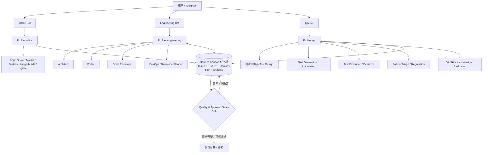
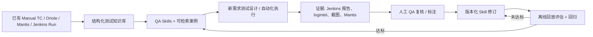
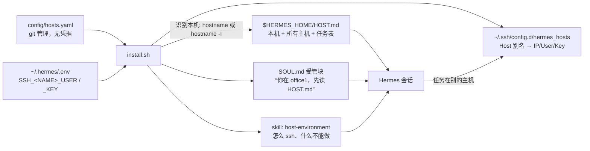

# Hermes 多 Agent 平台架构与实施方案（v2.1 · QA 独立版）

> **文档类型：** 架构设计 / 实施基线
> **状态：** Phase 0/1 已于 2026-10-27 在工作站 office1 实施（§1 末表、§10）；fosqa VM、Telegram 三个新 Bot、Jenkins 与内部系统均未改动。§6.2 的 VM 命令仍是**未来步骤**。
> **相对 v2.0 的核心变化：** 把方案落到**本机和 VM 上实际存在的东西**（Hermes 版本差异、已有 `office_automation` Profile、已有 66 个 QA Skills 与 4 个 MCP Server、Hermes 原生 Kanban），删掉与环境不符的假设（Selenium/ReportPortal/Allure、multiplex 在 v0.16.0 上可用），并补齐文档规范（frontmatter、History、评审附录）。
> **优先目标不变：** 在可追溯、有证据、有安全边界的前提下，逐步自动化人工 QA 的重复性工作；不以未经验证的 AI 输出代替测试证据。

## 0. 执行摘要与已确定决策

仍采用 **三个长期 Hermes Profiles / 三个独立 Telegram Bots**：

| Profile | 对外入口 | 核心定位 | 所有权边界 |
|---|---|---|---|
| `office` | Office Bot | 内部系统只读检索（Oriole 用例/覆盖、Mantis、Jenkins、镜像服务器）、报表与办公自动化 | 信息获取与整理，不拥有测试放行权 |
| `engineering` | Engineering Bot | 架构、编码、代码审查、DevOps/资源规划 | 实现与变更建议，不自证其代码质量 |
| **`qa`** | **QA Bot** | **需求分析、用例设计、手动测试转自动化、受控执行、故障分诊、回归、质量评估** | **独立测试标准、执行证据与质量结论** |

### 0.1 相对 v2.0 的变化

| # | 变化 | 位置 |
|---|---|---|
| 1 | 增加"现状盘点"：本机已运行的 default 网关、已存在的 `office_automation` Profile（Bot Token 与 default 重复）、v0.16.0 与 v0.21.4 的差异 | §1 |
| 2 | 网关拓扑按版本分叉：v0.16.0 是**每 Profile 一个网关进程**，没有 `multiplex_profiles`；v0.21.x 才是单主机 multiplex 默认开启。v2.0 把后者当成"当前官方方案"是对 VM 成立、对工作站不成立 | §6 |
| 3 | 跨 Profile 协作 v1 改用 **Hermes 原生 Kanban**（共享 SQLite 任务板、按 Profile 描述路由、`kanban_*` 工具、Swarm），不再自造 YAML 契约 + 未来队列；契约字段保留为任务正文模板 | §5 |
| 4 | QA/Office 的 Skills 从"全部新建 9 个 `qa-*`"改为**先映射到已有资产**：`SKILL_Processed/` 的 66 个 Skills（`triage-mantis`、`fos-mantis-missing`、`oriole-testdata`、`fos-testscript-dsl`、`cm-builds`…）和 `config/config.yaml` 的 jenkins / mantis-tools / logintel / image-builds MCP；只新建真正缺的 | §3.3、§9 |
| 5 | 测试自动化栈改为本环境实际使用的 **fortistack / autotest.py / FortiOS 测试 DSL**；Selenium POM、ReportPortal、Allure 降为"待确认是否存在" | §3.3、§9、§12 |
| 6 | 补上 Hermes 自带的学习闭环（background review、`write_approval: false` 默认直写 skills、curator）：每个 Profile 必须按 v0.2 §4.3 关掉或接管，否则 `qa` 会自己给自己写 Skill | §7.3 |
| 7 | 权限模型给出 Hermes 的**具体机制**（`terminal.home_mode: profile`、`terminal.backend: docker` + `docker_forward_env`、MCP `include` 列表 + `mcp-ask-first`、Telegram allowlist），并修正"Reviewer 作为 Subagent 可以 P0 只读"的说法：Subagent 继承父 Agent 的 API Key 和凭据池，不是安全主体 | §2、§7 |
| 8 | ECC：核实 `install.sh --target hermes` 写入 `~/.hermes/`（即 default Profile）、`--profile minimal` 与 `--dry-run` 存在、三个候选 Skill 存在但面向 Claude Code；给出按 Profile 安装与固定 commit 的做法 | §8 |
| 9 | `install.sh` 已支持 `HERMES_HOME`，可以逐 Profile 复用同一套测量模型链、MCP 裁剪和插件；列为 Phase 1 的具体任务 | §6.3 |
| 10 | 评估集规模与 v0.2 §8.5 对齐：30–50 个案例只能检出 10–15 个百分点以上的差异；Phase 2 的"20+ 样本"改为"≥30 个带专家结论的案例" | §4、§10 |
| 11 | 数据政策按事实收窄：模型链全部走公司内部网关（fos-ai、releaseqa-aiserver），不存在"送第三方模型"的问题；真正的风险是 Hermes 会话日志落盘未脱敏 | §7.2 |
| 12 | 补 frontmatter、History、评审附录；v2.0 引用的"v1.0"在本目录不存在，标注为口头讨论稿 | 全文、附录 A |
| 13 | 新增多主机工作环境：git 管理的 `config/hosts.yaml`（7 台主机、7 项专属任务、三个网段）、`.env` 内的 SSH 凭据命名、`HOST.md` + `SOUL.md` 受管块 + ssh 别名 + `host-environment` Skill 的渲染设计、`install.sh` 改动清单 | §13 |

### 0.2 最终推荐架构



**重要：** 三个 Profile **不共享聊天历史、Memory 和 Skills**（官方文档：Profile 是独立的 `HERMES_HOME`）。它们之间唯一的交接媒介是 Kanban 任务板加上 Git PR / Jenkins Run / 产物链接。Kanban 是单主机、"信任本地用户"的威胁模型（worker 以同一 uid 运行），它解决的是**协作与审计**，不解决**权限隔离**；权限隔离见 §7。

---

## 1. 现状盘点（2026-10-27，事实）

写方案前先看机器上有什么。下面都是查到的，不是假设。

| 项 | 工作站（本机） | fosqa VM |
|---|---|---|
| Hermes 版本 | v0.16.0（2026.6.5，upstream c6e99ab3），源码与本地文档在 `~/.hermes/hermes-agent/` | v0.21.4（`docs/guides/fosqa-vm-llm-chain.md`），未在本机核实其 CLI |
| 网关 | `hermes-gateway.service` 运行中（default Profile，Telegram bot，PID 2568） | `install.sh` 的 `configure_gateway` 路径尚未在 VM 上跑过（`docs/guides/telegram.md`） |
| 已有 Profile | `default`（`~/.hermes`）和 `office_automation`（2026-10-23 创建，描述"documents, spreadsheets, email/OWA triage, internal portals, reporting"，网关未运行） | 只有 default |
| **已知问题** | `office_automation/.env` 是 default `.env` 的副本，**`TELEGRAM_BOT_TOKEN` 与 default 相同**。一旦启动它的网关，就是同一个 Bot Token 两个轮询进程；v0.16.0 会拒绝第二个启动，但这不是设计，是巧合 | — |
| MCP Server | `config/config.yaml`：jenkins（10 工具）、mantis-tools（8）、logintel（26 只读）、image-builds（14 只读）、microsoft365（未测） | 同 |
| 插件 | `mcp-ask-first`（建 Mantis/加 Note/发邮件/触发 Jenkins 先问）、`chain-adapt`（模型被拒时重测链） | 同 |
| 模型链 | 全部公司内部网关：fos-ai（deepseek-v4.1-flash → glm-5.3）→ releaseqa-aiserver（qwen3.6-35b-a3b → qwen3.5-122b-a10b-awq），每 15 分钟重测 | 同 |
| QA Skills | `SKILL_Processed/`：66 个，来自 QA Assistant skill store（rainxiao 等），含 `triage-mantis`、`triage-my-team-mantis`、`fos-mantis-missing`、`oriole-testdata`、`fos-testscript-dsl`、`cm-builds`、`fos-troubleshoot`、`fos-cli-reference`、`create-skill`… | 由 `install.sh` 决定是否分发（目前不分发） |
| 学习闭环 | `~/.hermes/config.yaml`：`skills.write_approval: false`、`memory.write_approval: false`，curator 默认开 → Agent 会自己直写 Skills/Memory（v0.2 §4.1） | 同（默认值） |
| 跨 Profile 原语 | Hermes Kanban 存在（`~/.hermes/kanban.db`，`hermes kanban` 有 40 余个子命令，含 `swarm`、`decompose`），dispatcher 默认跑在网关内 | 同（需核实 v0.21.4 的差异） |
| 测试自动化栈 | fortistack / `autotest.py` / autolibv3 测试 DSL（`fos-testscript-dsl` Skill）；Jenkins `releaseqa-stackjenkins`（BATCH_TESTS_AUTO6 → fortistack_master_provision_runtest → fortistackRunTests） | 同 |
| 相关设计 | 同目录 `Agent_Asset_Learning_Platform_Architecture_v0.2*.md`：资产平台、评估门禁、Hermes 学习闭环接管 | — |

**2026-10-27 下午，Phase 1 实施后的工作站状态（`hermes profile list` / `./install.sh --check` 核实）：**

| 项 | 状态 |
|---|---|
| Profiles | `default`（网关运行中，Telegram bot）、`office`（由 `office_automation` 改名，重复的 Bot Token 已注释掉）、`engineering`、`qa`（`--no-skills` 新建）；三个新 Profile 的网关均未安装，`.env` 中无 Bot Token |
| 每 Profile 配置 | `./install.sh --profile <name>` 写入：测量模型链、4 个 MCP Server（全部 Connected）、两个插件、`config/profiles/<name>/overlay.yaml`（`skills.write_approval: true`、`memory.write_approval: true`、`guard_agent_created: true`、`creation_nudge_interval: 0`、`curator.enabled: false`、`terminal.home_mode: profile`、mantis-tools 的 `include` 扩展）、`SOUL.md`、本地 Skills |
| 主机身份 | 四个 home 都有 `HOST.md`、`SOUL.md` 受管块、`.env` 的 `HERMES_HOST=office1`、Skill `host-environment`；`~/.ssh/config.d/hermes_hosts` 有 7 个别名，`~/.ssh/config` 已加 `Include` |
| 验收 | 三个 Profile 用 `hermes -z` 各答一轮："在 office1 / 172.19.136.41"、各自角色正确、"Log Intelligence 迁移要 `ssh log_intel_server`"；一轮后 `skills/`、`memories/` 无新文件 |
| ssh 可达 | key 登录 OK：`log_intel_server`、`fgt1`；无 key：`cdn`、`guiauto1`（key 未授权）、`office2`、`office3`（Windows，未开 OpenSSH） |
| 事实修正 | mantis-tools 服务端共暴露 110 个工具（`hermes mcp test`），`skill_*` 工具存在；本工作站不允许用户 crontab（`/etc/cron.allow`），`--cron` 在此无效，模型被拒时靠 `chain-adapt` 插件 |

**结论：** 这不是一张白纸。`office` 已经有雏形（`office_automation`），QA 的领域知识已有 66 个 Skills，系统集成已有 4 个 MCP Server 和审批插件。v2.1 的工作是**组织和治理这些资产**，而不是从零设计。

## 2. Hermes 原语的边界

| 原语 | 它给你什么 | 它不给你什么（官方文档明说的） |
|---|---|---|
| **Profile** | 独立 `HERMES_HOME`：`config.yaml`、`.env`、`SOUL.md`、skills、memories、sessions、cron、`state.db`、网关 PID 与日志；`hermes -p <name>` 或包装脚本 `<name> chat` | "Profiles do not sandbox the agent"。local 后端下 Agent 拥有你整个账户的文件系统；工具子进程默认用真实 `$HOME`（外部 CLI 凭据跨 Profile 共享），除非 `terminal.home_mode: profile` |
| **Subagent**（`delegate_task`） | 全新上下文、可收窄 `toolsets`、独立终端会话；默认最多 3 并发、50 轮；leaf 不能用 `delegation` / `clarify` / `memory` / `send_message` / `code_execution` | **继承父 Agent 的 API Key、provider 配置和凭据池**；不是安全主体。"Reviewer 作为 Subagent 就只读"不成立 |
| **Kanban worker** | dispatcher 以**命名 Profile** 的身份、在独立 workspace（scratch / worktree / dir）里起一个完整 OS 进程执行任务；任务、评论、事件是 SQLite 里的持久行；人可随时评论/阻塞/解阻 | 单主机、同一 uid；`dir:<path>` 完全信任；不是租户隔离。dispatcher 在网关里跑，网关不跑任务就不派发 |
| **Skill** | `SKILL.md` + 资料/脚本，按需加载；frontmatter 可声明 `requires_tools`、env 透传 | 不增加 API 权限；不是模型训练。同名本地 Skill 会遮蔽 `external_dirs` 里的版本（v0.2 R-10） |
| **MCP `include` + `mcp-ask-first`** | 模型只看到白名单工具；写类工具先问 | 不是沙箱：Agent 有终端和 `.env` 时可以绕过 MCP 直接调 API（2026-09-23 已发生，v0.2 §1.1） |
| **`terminal.backend: docker`** | 命令在容器里跑，`docker_forward_env: []` 时秘密不进容器 | 容器里**跳过**危险命令检查（容器即边界）；MCP 调用不在容器里 |

## 3. 三个 Profile 的职责

### 3.1 `office`

**第一个决定（已执行 2026-10-27）：** 复用 `office_automation`：它的描述（文档、表格、邮件/OWA、内部门户、报表）和 v2.0 的 `office` 基本重合。已 `hermes profile rename office_automation office`，**重复的 Bot Token 已注释掉**，捆绑 Skill 已清除，并按 §6.3 用 `install.sh --profile office` 重刷配置；新的 office bot token 待填。

**输入：** 自然语言查询、QAID、Mantis ID、Release/patch、Build、平台、日期。

**技能映射（先用已有的）：**

| v2.0 设想的 Skill | 实际用什么 | 备注 |
|---|---|---|
| `testcase-lookup-readonly` | `oriole-testdata`（Oriole：用例目录、执行结果、覆盖、按 Build 汇总、按测试员活动、GA 平台/标签/VM 部署检查） | 已有，只读，`approval: deny` |
| `eco-search-readonly` | mantis-tools 的 `cli_change_eco_validator`、Skill `fortios-proxy-build-eco-analyzer` | "ECO 系统"就是这些；是否有独立 ECO 库待确认（§12） |
| `jenkins-summary-readonly` | jenkins MCP 的 `getJob/getBuild/getTestResults/searchBuildLog`；Skill `cm-builds`、image-builds MCP（哪个 Build 已同步、GA Build） | 已有 |
| `report-summarizer` | `team-bug-note-stats`、`triage-my-team-mantis`（QA 经理每日两次批量分诊）、logintel MCP | 已有；周报模板需新写 |
| `knowledge-navigation` | `fos-troubleshoot`、`fos-cli-reference`、`fos-platform`、`fos-upgrade*` | 已有 |

**权限：** P0 只读。禁止自行写 Mantis、改 Jenkins job、群发含敏感内容的消息；`mcp-ask-first` 继续兜底。
**输出格式：** `source`、`query`、`retrieved_at`、`result`、`uncertainty`、可访问的源链接。

### 3.2 `engineering`

四种工作模式：**Architect**（需求细化、接口、数据模型、权衡、ADR）、**Coder**（Python、CLI/REST 工具、fortistack 测试脚本、bug fix、重构；只写隔离分支/worktree）、**Code Reviewer**（静态检查、边界、复杂度、安全；输出 BLOCKER/MAJOR/MINOR 证据清单；审查不替代 QA 测试）、**DevOps / Resource Planner**（Jenkins Pipeline、容器、节点资源盘点、容量规划、故障诊断、回滚设计；默认只读）。

**它们是同一个 Profile 的四种提示/Subagent，共享同一套凭据和权限。** 如果某个角色的权限必须不同（例如 Reviewer 必须对 PR 只读、DevOps 必须用另一个 Jenkins 账号），它就必须是**独立 Profile**（作为 Kanban worker 被派发），而不是 Subagent。v1 先不拆；§7 的权限表按"同一权限、不同提示"写。

**首批 Skills：** ECC 的 `tdd-workflow`、`verification-loop`、`security-review` 经 §8 审查后放入 `engineering`；自建 `architecture-review`、`jenkins-readonly`、`resource-inventory`；复用 `code-simplification`、`create-skill`、`fos-testscript-dsl`。

**输出：** ADR、任务计划、Git 分支/PR（带 SHA）、真实构建与测试证据、Review 结论。**Engineering 不做 Acceptance Sign-off。**

### 3.3 `qa`（战略重点）

QA 必须拥有：独立 Profile 与 QA Bot；独立 `SOUL.md`、测试知识库、Skills、会话；可追溯的测试资产（Test Plan、Test Case、数据集、环境拓扑、执行日志、截图/录像、Jenkins 报告、Mantis Bug）；需求/设计文档只读接口；隔离测试环境的受控执行权限；客观评估与人工反馈机制。

**职责与能力矩阵（首期自动化程度）：**

| QA 能力 | 具体任务 | 标准输出 | 首期 | 用什么 |
|---|---|---|---|---|
| Requirement Analysis | 验收条件、依赖、边界、风险 | Requirement→Test 可追溯表 | 自动起草，人工审核 | 新 Skill `qa-test-design` |
| Test Design | 功能、异常、负面、状态迁移、兼容、升级 | Test Plan + Cases + Risk | 自动设计，抽样审查 | `qa-test-design`、`fos-upgrade*`、`fos-platform` |
| Existing TC Intelligence | QAID 检索、去重、覆盖缺口、关联 Bug/Release | 覆盖矩阵与缺口 | 只读自动化 | `oriole-testdata`、`npi-coverage-analysis`、`search_bugs` |
| Manual QA Assistant | 人工步骤转可复现动作与期望 | Step-by-step + Evidence | 人机协同 | `fos-cli-reference`、`fos-cli-validation` |
| Test Automation | 生成 fortistack 测试脚本（autolibv3 DSL）、fixture | 可审查 PR | 沙箱生成 + Review | `fos-testscript-dsl`（含 QA 评估能力） |
| Test Execution | 选 Jenkins Job、Release/Build、节点、并行度 | Run ID、Build、环境、报告 | 测试环境受控执行 | jenkins MCP `triggerBuild`（先问）、`cm-builds`、image-builds |
| Failure Triage | 日志、Build 差异、Mantis 去重 | 产品缺陷 / 脚本 / 环境 / Flaky + 证据 | AI 初判，人工抽查 | logintel MCP、`triage-mantis`、`search_crash_duplication`、v0.2 §9.2 标签集 |
| Regression Strategy | 风险驱动选例、影响分析 | 优先级 / 选例 / 理由 | 建议先行 | `find_regression_bugs_by_root_cause`、Oriole 覆盖 |
| Release Readiness | 覆盖、故障、风险 → 质量结论 | Go/No-Go **建议** | 人审批 | 新 Skill `qa-release-risk` |
| QA Capability Evaluation | Skill 准确率、漏检、误报 | Benchmarks + Trend | 每次变更必跑 | v0.2 的评估资产与门禁（§4） |

**真正需要新建的 Skills（优先级）：** `qa-test-design`、`qa-environment-readiness`（节点/设备/镜像/许可/日志源前置检查，`fortistack-pipeline-debug` 已有部分）、`qa-report-evidence`（汇总 Jenkins/logintel/Mantis 链接与截图，统一报告格式）、`qa-release-risk`、`qa-evaluator`（= v0.2 评估门禁的 QA 侧入口）。v2.0 列的 `qa-testcase-intelligence`、`qa-triage`、`qa-selenium-pytest`、`qa-log-injection-validation` 分别由已有 Skill 覆盖、或依赖待确认的工具栈，先不建。

**QA `SOUL.md` 行为规范（保留 v2.0）：**
> 我是独立 QA 专家。我的职责是挑战假设、验证需求、发现缺陷、维护测试证据。不得把"没有发现失败"等同"证明正确"；不得把生成的测试代码视为已执行通过；无法执行时标记 `NOT RUN`；对不确定和环境缺失明确披露；报告必须关联 Release、Build、Commit SHA、QAID、实际/预期结果和证据；发现缺陷先构建最小复现；对高风险、不可逆变更申请人工审批。

**关于"训练 QA"：** 第一阶段 = Skill 版本迭代 + 测试知识检索 + 经审查的案例库 + 自动评估与人工反馈（即 v0.2 的资产平台）。不把"记录了几次聊天"称为微调。模型链全部是内部网关，不涉及外部模型；真正要管的是会话日志落盘与资产库的脱敏（§7.2）。

## 4. QA 能力建设的学习闭环



这条闭环**就是** v0.2 文档的 `Task → … → Measure → Revise` 循环在 QA Profile 上的实例。本文不再重复定义资产类型、状态机、评估门禁，直接引用 v0.2：资产类型 §2，Hermes 接管 §4，生命周期 §6，训练/评估划分 §7.3，评估 §8，首个场景（回归失败分诊）§9。

**质量指标（试点目标，不是现值）：** 测试设计的风险场景召回率、需求→用例可追溯比例、专家复核通过率；自动化的可运行比例、首次运行成功率、Flaky 率；分诊标签的 Precision/Recall 与平均定位时间；`NOT RUN` 正确标注率；未授权操作计数 = 0、审批拒绝后执行计数 = 0；每个通过复核的用例所需人工时间。

**评估集：** ≥30 个带专家结论的脱敏案例起步，覆盖正常、负面、边界、升级、环境失败、日志缺失、Flaky、权限拒绝。按 v0.2 §8.5，这个规模只能检出 10–15 个百分点以上的差异；要证明"可替代人工 QA"需要数百个历史案例（Jenkins 失败 + 当时的处置是现成来源，v0.2 §9.3）。

## 5. 跨 Profile 协作：用 Hermes Kanban

**v1 直接用 Hermes 原生 Kanban**，不自造契约格式和队列：

| 需求 | Kanban 提供 |
|---|---|
| 任务 ID、指派给某 Profile | 任务行，`assignee` = Profile 名；dispatcher 以该 Profile 身份起 worker |
| 状态机 | `triage → todo → ready → running → blocked → done → archived`；`block/unblock`、`reclaim`、失败计数自动阻塞 |
| 交接记录与审计 | 评论、事件、`runs` 持久在 SQLite；人可随时 `comment`、`block`、`unblock` |
| 依赖 | `link`（parent→child）；`swarm`（并行 worker → verifier → synthesizer）天然对应 Coder → Reviewer → QA |
| 路由 | 按 `hermes profile describe` 的描述自动分解（`auto_decompose`），或 Manual 模式人工建卡 |
| 工作区 | `worktree:` 给 Coder；`dir:<abs path>` 给 QA 指向测试资产目录；scratch 完成即删 |

**v2.0 的 YAML 契约保留为任务正文模板**（`hermes kanban create --body`），字段不变：`task_id`、`requester`、`assignee`、`work_type`、`repo`、`branch`、`commit_sha`、`release`、`build`、`requirement_refs`、`testcase_refs`（QAID）、`environment`、`constraints`（`can_write_product_repo` / `can_trigger_jenkins_job` / `can_touch_production`）、`acceptance_criteria`、`expected_outputs`。`NEEDS_INFO` 和 `REVIEW_REQUIRED` 用 `blocked` + 评论原因表达。

**标准交接顺序（不变）：** Architect 产出需求分析/ADR/验收条件 → Coder 在隔离分支提交 PR（SHA） → Reviewer 审同一 SHA → **`qa` 依据原始需求而非 Coder 自述设计测试，安排受控运行** → QA 记录每条用例 `PASS/FAIL/BLOCKED/NOT RUN` + 证据，回传缺陷与 Release Risk → Engineering 修复出新 SHA，QA 定向回归 → 人工门禁综合 PR、CI、QA 结果做最终决定。

**Kanban 的限制（必须写进设计）：** 单主机；所有 worker 以同一 OS 用户运行；`dir:` 路径完全信任；dispatcher 跑在网关里（`kanban.dispatch_in_gateway: true`），网关停了就不派发；v0.16.0 与 v0.21.4 的 Kanban 子命令可能有差异，Phase 0 核实。因此 Kanban 是协作层，**不是**权限层。

**明确避免：** 靠 Telegram 单一会话转述所有上下文；跨 Profile 共用 API Key；凭父 Agent 的提示词假装 Reviewer/QA 有权限隔离；用待测实现自身的输出做唯一 Oracle。

## 6. 多 Telegram Bot / 网关运行拓扑

### 6.1 两个版本，两种模型

| | 工作站 v0.16.0（已核实源码） | VM v0.21.4（在线文档，2026-10-27） |
|---|---|---|
| 模型 | **每 Profile 一个网关进程**：`hermes -p <name> gateway install/start`，单元名 `hermes-gateway-<name>.service`，日志在 `profiles/<name>/logs/` | **单主机 multiplex 默认开启**（`gateway.multiplex_profiles: true`）：一个网关进程服务所有 Profile；每 Profile 一个网关是"临时兼容垫片"，需 `gateway.standalone: true` 或 `--force` |
| `multiplex_profiles` 键 | 不存在（源码 `hermes_cli/` 无 `multiplex`） | 存在 |
| `hermes gateway migrate --multiplex` | 不存在（只有 `migrate-legacy`） | 存在，有 `--dry-run` |
| Token 冲突 | 第二个使用相同 Bot Token 的网关拒绝启动，并指出冲突 Profile | 重复凭据被"停放"而不是起第二个轮询 |
| 安全前置 | 每 Profile 自己的 `.env`（600） | 另加：`/p/<profile>/` API 要该 Profile 自己的 `API_SERVER_KEY`；次级 Profile 不要自己开 `api_server`/`webhook`；授权按 Profile 各自读取 |

**结论：** 工作站上先按"每 Profile 一个网关"落地；VM 上按 multiplex 落地。两边命令不同，文档和 `install.sh` 都要分版本。不要把工作站当 VM 的预演。

### 6.2 命令（按版本；工作站部分已于 2026-10-27 执行，网关安装待 Bot Token）

```bash
# Phase 0：只读盘点（两版本通用）
hermes --version
hermes profile list                 # profiles + model + gateway state
hermes gateway list
grep -H 'TELEGRAM_BOT_TOKEN' ~/.hermes/.env ~/.hermes/profiles/*/.env   # 找重复 token

# Phase 1（工作站 v0.16.0）
hermes profile rename office_automation office          # 或 delete 后重建
hermes profile create engineering --no-skills \
  --description 'Engineering: architecture, coding, code review, DevOps planning'
hermes profile create qa --no-skills \
  --description 'Independent QA: test design, automation, controlled execution, triage, release risk'
# 每个 profile 的 .env 填各自的 TELEGRAM_BOT_TOKEN（BotFather 三个不同 bot）
hermes -p office gateway install && hermes -p office gateway start
hermes -p engineering gateway install && hermes -p engineering gateway start
hermes -p qa gateway install && hermes -p qa gateway start

# Phase 1（VM v0.21.4）：创建 profile 同上；网关由 host（default）multiplex
hermes gateway migrate --multiplex --dry-run
hermes gateway restart && hermes gateway status
```

`--no-skills` 是有意的：不要让 v0.16.0 的 28 个捆绑 Skill 目录（apple、gaming、smart-home…，见 `office_automation/skills/`）进入 QA/Engineering 的提示空间；需要的捆绑 Skill 单独拷。

### 6.3 用 `install.sh` 逐 Profile 复用配置

`install.sh` 对 `$HERMES_HOME` 工作（第 49 行 `export HERMES_HOME="${HERMES_HOME:-$HOME/.hermes}"`），所以：

```bash
HERMES_HOME=~/.hermes/profiles/qa ./install.sh --no-gateway
```

**已实现为 `./install.sh --profile <name>`**（2026-10-27）：`HERMES_HOME=~/.hermes/profiles/<name>`，隐含 `--no-install --no-vscode`；先写共享配置，再用 `scripts/apply_profile.py` 叠加 `config/profiles/<name>/overlay.yaml`（映射深合并、列表取并集）、`SOUL.md`、`local_skills`（从 `SKILL_Processed/` 拷贝），最后渲染主机上下文。三个疑点的结论：cron 行只替换同一 `HERMES_HOME` 的那一行（已修）；网关命令改为 `hermes -p <name> gateway …`（已修）；备份文件按 home 各自存放（本来就不冲突）。另修了 `find_hermes_python`：Profile 下没有 `hermes-agent/`，回退到 `~/.hermes/hermes-agent/venv`。

### 6.4 迁移策略

1. 先处理 `office_automation` 的重复 Token：在 BotFather 为 office 新建 bot，写入其 `.env`；default 的 bot 保留为维护入口。
2. 新建 `engineering`、`qa` 并各自验证后，再决定 default 是否继续承担"全能助手"角色（建议保留 default 做维护与 Kanban orchestrator，日常工作走三个专用 bot）。
3. 任何创建/重启在维护窗口做，先备份 `~/.hermes`（不含 `.env` 的公开打包）。

### 6.5 Profile 目录（逻辑）

```text
~/.hermes/                          # default：维护入口 + Kanban orchestrator
├── config.yaml  .env  SOUL.md  kanban.db
└── profiles/
    ├── office/        config.yaml  .env(office bot)  SOUL.md  skills/  memories/  logs/
    ├── engineering/   config.yaml  .env(eng bot)     SOUL.md  skills/  memories/  logs/
    └── qa/            config.yaml  .env(qa bot, 受限测试凭据)  SOUL.md  skills/  memories/  logs/
```

## 7. 权限模型与审批

### 7.1 分级（不变）

**P0 只读** · **P1 隔离写入**（沙箱/feature branch/worktree） · **P2 明确审批执行**（触发改共享测试环境的 Jenkins Job、环境重置、改测试数据、改 CI、合并 PR） · **P3 高危/生产**（生产部署、批量删容器、改权限/密钥、破坏性操作；不授予任何 Telegram Bot）。

| Profile / 角色 | 默认能力 | 不允许直接执行 |
|---|---|---|
| `office` | P0 | 改 Mantis/用例记录、对外发送敏感报告 |
| `engineering`（含 Architect/Coder/Reviewer/DevOps 四种提示，**同一权限**） | P0 + worktree 内 P1 | Push protected branch、合并、绕过 review、生产部署、服务器管理员操作 |
| **`qa`** | **P0 + QA Sandbox 内 P1；P2 经 `mcp-ask-first` 人工放行（`triggerBuild`/`rebuildBuild`）** | **未经审批改生产、共享环境重置、伪造 PASS** |

Reviewer 的"审查时对 PR 只读"在 v1 靠流程（审同一 SHA、不自批）保证，不靠技术隔离；要技术隔离就拆成独立 Profile（§3.2）。

### 7.2 Hermes 具体机制（按 Profile 配置）

| 目标 | 机制 | 备注 |
|---|---|---|
| 工具子进程不共享 `~` 下的外部 CLI 凭据 | `terminal.home_mode: profile` | 否则三个 Profile 的 `gh`/`ssh`/`kubectl` 凭据是同一份 |
| 秘密不进执行环境 | `terminal.backend: docker` + `docker_forward_env: []`；需要的凭据由 Skill frontmatter 按需透传 | 容器内跳过危险命令检查；MCP 调用仍在容器外 |
| 模型只看到白名单工具 | MCP `tools.include`（现有） + `mcp-ask-first`（现有） | 不是沙箱，Agent 有 `.env` 时可绕过；`qa` 的 `.env` 只放 QA 自己的受限 token |
| Bot 访问控制 | `TELEGRAM_ALLOWED_USERS` 按 Profile 各自设置；v0.21.x 下 default 的开放策略不扩散到次级 Profile | 高风险 slash 命令限制 |
| 凭据分离 | Bot token、Git token、Jenkins token、内部 API Key 分 Profile 存 `.env`（600）；Jenkins 用有限 scope 的 service account（QA 一个、Engineering 一个） | 绝不写进仓库、Skill、报告、聊天 |
| 真正的 OS 级隔离 | QA 执行器（跑 fortistack 的节点）与 Engineering 工作区用不同 OS 账户 / 容器 / 服务身份 | Profile 做不到这一层 |
| 审计 | Kanban 事件 + 网关日志 + Jenkins 审计；记录 Task ID、Profile、User、Tool、Action、Target、Result、Approval | Hermes 会话日志 `logs/session_*.json` 总是落盘且**未脱敏**（v0.2 §12）；纳入保留策略 |

### 7.3 关掉或接管 Hermes 自带的学习闭环

三个 Profile 都要（v0.2 §4.1、§4.3）：`skills.write_approval: true`、`memory.write_approval: true`、`skills.guard_agent_created: true`、`skills.creation_nudge_interval: 0`、`curator.enabled: false`（生命周期交给资产平台）。否则 `qa` 跑几次就会自己写 `~/.hermes/profiles/qa/skills/` 里的 Skill，QA 标准被 Agent 自己改掉。键名在 v0.16.0 核实过，v0.21.4 要再核。

## 8. ECC 与 Hermes 的集成（已核实）

- 本地克隆 `~/git/ECC`（2026-10-26，PR #3736）。`install.sh --target hermes` 把 `rules/ecc/`、`skills/ecc/`、`commands/`、`AGENTS.md` 写进 **`~/.hermes/`，即 default Profile**；不碰 `config.yaml`/`.env`。`--profile minimal`、`--dry-run`、`--skills <id,…>`、`--no-hooks` 都存在。
- 候选 `tdd-workflow`、`verification-loop`、`security-review` 存在，但是**为 Claude Code 写的**（`verification-loop` 自述"verification of a Claude Code session's work"，含 build/lint/test 六阶段）。在 Hermes 里是否有效要试，不要当成现成能力。
- **按 Profile 安装：** 先 `HERMES_HOME=~/.hermes/profiles/engineering bash ./install.sh --target hermes --profile minimal --dry-run` 看它是否尊重 `HERMES_HOME`；不尊重就用 `--skills` 装到 default 后手工拷到 `engineering/skills/`。固定 ECC commit，记录在 History。
- **不要装到 `qa`**。QA 的 Skills 来自 `SKILL_Processed/` 与自建；若某个 ECC Skill 对 QA 有用，复制成独立版本维护，避免上游同步造成 QA 行为突变。
- Skill 接入流程不变：上游来源与 commit → 源码/安全扫描（hooks、脚本、网络调用、自动 Git 操作）→ 沙箱试运行 → 基准评估 → 人工签核 → Profile 安装 → 记录回滚版本。Star 数不是信任依据。

## 9. QA 系统集成清单（按实际存在的接口）

| 资源 | 用途 | 现有接入 | 约束 |
|---|---|---|---|
| Oriole QA 门户 | 用例目录、执行结果、覆盖、GA 检查 | Skill `oriole-testdata`（`oriole_query`，只读） | 用户绑定会话；来源与 patch 可追溯 |
| Mantis | 缺陷、去重、分诊、ECO 校验 | mantis-tools MCP（8 个工具，写类先问）+ `triage-*`、`fos-mantis-missing` 等 Skills | 写身份绑定 API token |
| Jenkins（releaseqa-stackjenkins） | Build、日志、测试结果、触发 | jenkins MCP（10 个工具，`triggerBuild`/`rebuildBuild` 先问） | RBAC、job 范围、配额；共享节点上禁止装网关 |
| Log Intelligence | 失败按根因聚类、日志模式 | logintel MCP（26 只读） | 保留原证据 |
| 镜像服务器 | Build 是否同步、镜像路径、GA/最新 Build | image-builds MCP（14 只读）、`cm-builds` | 只读 key |
| Git 仓库 | 测试脚本、配置、差异 | 终端 + 各 Profile 自己的 token | SHA 固定；QA 测试代码走 PR |
| fortistack 节点 / FortiGate | 执行、环境健康、日志、crashlog | SSH（`fortistack-pipeline-debug` 已有流程） | 隔离测试环境；不向生产设备注入 |
| 产物库 | 截图、视频、日志、报告 | **缺**：目前散在 Jenkins artifacts / 节点 / 聊天 | Phase 2 定一个带 Task ID 与生命周期的位置 |
| ReportPortal / Allure / Selenium POM | — | **未发现**；v0.2 已把 ReportPortal 排除出 MVP | 存在再加 |

## 10. 阶段性实施路线与验收

### Phase 0 — 盘点与修复既有问题（完成 2026-10-27，工作站）
- [x] 记录工作站 `hermes --version`（v0.16.0）、`profile list`、`gateway list`、`kanban --help`；VM v0.21.4 仍只有在线文档依据。
- [x] **`office_automation` 的重复 Bot Token 已注释掉**，Profile 改名为 `office`，描述已设。
- [ ] 备份 `~/.hermes`（`install.sh` 每次改动前自动留 `config.yaml.bak-*` / `.env.bak-*`；整目录备份仍待做）。
- [ ] 核实 Oriole / Mantis / Jenkins / Git 的 QA 与 Engineering 各自可用的 service account（目前三个 Profile 共用本人的 token）。
- [ ] 三个 Bot 的命名、负责人、allowlist（需在 BotFather 建 office / engineering / qa 三个 bot）。

**验收：** 无重复 token ✔；现网权限未变 ✔；回滚 = 删除 `~/.hermes/profiles/{engineering,qa}`、恢复 `office` 的 `.env`。

### Phase 1 — 三 Profile / 三 Bot（只读试点；配置部分完成 2026-10-27）
- [x] 创建 `engineering`、`qa`（`--no-skills` + `--description`）；`office` 清掉 Hermes 捆绑 Skill，加 `.no-bundled-skills`。
- [x] `./install.sh --profile <name>` 逐 Profile 刷配置（§6.3）。
- [x] 每 Profile：`SOUL.md`（`config/profiles/<name>/SOUL.md`）、§7.2 的 `terminal.home_mode: profile`、§7.3 学习闭环设置；allowlist 随 Bot Token 一起待填。
- [x] Skills：`qa` 本地 `fos-testscript-dsl`、`cm-builds`、`npi-coverage-analysis`、`find_regression_bugs_by_root_cause` + MCP `skill_oriole_testdata`/`skill_triage_mantis`/`skill_fos_*` 等 18 个只读工具；`office` 本地 `cm-builds` + 8 个只读工具；`engineering` 本地 `create-skill`、`fos-testscript-dsl`、`code-simplification` + 7 个。
- [x] 验证：三个 Profile 各答各的角色与主机，`skills/`、`memories/` 一轮后无新文件；三个新 Profile 无网关、无 Bot Token，不会串。
- [x] `install.sh` 实现 §13.7（主机解析、`HOST.md`、`SOUL.md` 块、`.env`、ssh 别名、`host-environment` Skill、`--check` 的 "Check: hosts"）；`log_intel_server` 与 `fgt1` key 登录验证通过。
- [ ] 三个 Telegram bot：BotFather 建 bot → 各 Profile `.env` 填 `TELEGRAM_BOT_TOKEN` / `TELEGRAM_ALLOWED_USERS` → `./install.sh --profile <name>`（去掉 `--no-gateway`）→ `hermes -p <name> gateway status`。
- [ ] `cdn`、`guiauto1` 授权本机公钥（`ssh-copy-id`）；`office2`/`office3` 决定是否开 OpenSSH Server。
- [ ] 多轮使用后复查 `pending/`（`write_approval: true` 的暂存区）是否有候选，走 v0.2 的审批流程。

**验收：** 不同 Bot 不串 Profile（配置层面 ✔，Bot 层面待 token）；每项查询注明来源、时间、权限边界（SOUL 已要求，待抽查）；`qa` 跑 10 轮后无未经审批的新文件（1 轮 ✔，10 轮待跑）。

### Phase 2 — QA 最小闭环（优先）
- [ ] 从 QA 组整理经审核的测试设计标准、**≥30 个带专家结论的案例**。
- [ ] 建 `qa-test-design`、`qa-environment-readiness`、`qa-report-evidence`、`qa-evaluator` 的版本化 Skills（Git）。
- [ ] `qa` 接一个 FortiOS 功能需求：输出 Test Plan、正/负/边界用例、数据与环境前提。
- [ ] 在沙箱生成 fortistack 测试脚本，Review 后在测试环境执行（`triggerBuild` 经人工放行）。
- [ ] 报告真实 `PASS/FAIL/BLOCKED/NOT RUN`、Jenkins Run、logintel 聚类、Mantis 链接、复现步骤。
- [ ] 用评估集跑一次基线，记录指标。

**验收：** 至少一个可审计的"需求→用例→执行→分诊→报告"闭环；无执行记录的任务不得判 PASS。

### Phase 3 — Engineering + 独立 QA 经 Kanban 协作
- [ ] Kanban 任务模板（§5 字段）；`engineering`、`qa` 装 `kanban-worker` Skill；default 或专用 orchestrator Profile 装 `kanban-orchestrator`。
- [ ] Architect→Coder→Reviewer 按任务 ID 产出 ADR/PR；`qa` 从原始需求和 SHA 设计测试、验证、回传 Issue。
- [ ] 引入审查过的 ECC Skills 到 `engineering`。
- [ ] 完成缺陷→修复→再验证的一次迭代。

**验收：** 同一 Task ID 的 PR、Review、Jenkins Run、QA 报告在 Kanban 里可双向追踪；QA 可独立判 FAIL。

### Phase 4 — DevOps 受控调度与持续优化
- [ ] 只读采集 Jenkins 队列、节点 CPU/RAM/Disk、历史耗时与失败率；生成容量与执行建议。
- [ ] 审批后才触发受限测试环境 Pipeline；审批拒绝后系统不执行。
- [ ] QA 每周/每版本按 v0.2 评估门禁评估 Skills，记录误报、漏报、退化。
- [ ] 审计、成本、回滚、值班通知。

**验收：** 变更有完整审计；QA 指标可量化改善。

## 11. 三个首批验收场景

**A. Office Bot：** "列出 7.4.13 中某功能的用例 QAID、优先级、自动化状态、覆盖缺口，以及最近一轮 Build 的 CI 结果；只读，附来源与缺失说明。"（Oriole + jenkins + logintel）

**B. Engineering Bot：** "为某 fortistack 测试库增加一个通用的 CLI 输出解析器。先给 ADR 与兼容性分析，审批后提交 feature branch，再完成 Code Review；禁止直接合并主分支。"

**C. QA Bot（核心）：** "针对上述 PR 的 Commit SHA，根据需求重新设计正向、异常、边界与回归测试，生成 fortistack 测试脚本并在批准的测试节点运行；输出真实 Jenkins Run、环境与证据；对 FAIL 走 `prepare_mantis` → 人工确认后 `create_mantis`，附复现步骤；不得自动判定上线通过。"

## 12. 尚需确认的信息（不阻碍架构定稿）

- VM v0.21.4 的 Kanban、`write_approval`、`curator`、`terminal.home_mode` 键名与行为是否与 v0.16.0 一致。
- ECC `install.sh --target hermes` 是否尊重 `HERMES_HOME`。
- 是否存在独立的 ECO 系统 / ReportPortal；GUI 自动化主机 `guiauto1` 存在（§13），其框架（Selenium 或其他）在该主机上确认。
- QA 与 Engineering 能否各拿一个受限的 Jenkins service account 与 Git token。
- 产物库放哪里（§9）。
- default 是否保留为 Kanban orchestrator（`office_automation` 已改名为 `office`）。
- Hermes 的终端子进程是否能看到 `.env` 变量（决定密码主机走 `sshpass -e` 还是 `ssh-copy-id`，§13.4）。

## 13. 多主机工作环境：`config/hosts.yaml`

### 13.1 需求

同一套 `hermes_installer` 要装到多台主机上（工作站、两台笔记本、fortistackrobot 的服务器、实验室的 GUI 自动化主机，还有作为被测设备的 FortiGate）。每台主机上的 Hermes 必须在开工前知道：**我在哪台主机上**、这台主机的目录结构和能力是什么、哪些任务只能在哪台主机做、要做别处的任务时怎么 ssh 过去。主机清单要 git 管理、容易扩展；所有 ssh 凭据只放 `.env`。

### 13.2 设计



**本机身份是配置出来的，不是猜出来的。** 解析顺序（先命中先用）：`install.sh --host <name>` → `tokens.env` / `~/.hermes/.env` 里的 `HERMES_HOST` → 自动识别（`hostname` 等于某主机的 `hostname`，或 `hostname -I` 的某个地址等于某主机的 `ip`）。配置值与自动识别不一致时照用配置值但打警告（典型原因：从别的机器拷来的 `tokens.env`）；都解析不到就报错并列出已知主机。已实现：`scripts/render_host_context.py`（`--check` 只打印解析结果；`--dry-run` 只打印将写入的内容）。

**一个文件，四个产物：**

| 产物 | 来源 | 作用 | Hermes 机制 |
|---|---|---|---|
| `$HERMES_HOME/HOST.md` | `scripts/render_host_context.py` 从 `hosts.yaml` 渲染（已实现，四个 home 均已写入） | 本机身份、目录、能力、可达主机、专属任务表 | 普通文件；SOUL 受管块指引 Agent 在多主机任务前先读它 |
| `SOUL.md` 受管块 | 同一脚本维护 `<!-- hermes_installer:host begin/end -->` 之间的 3 行，块外内容不动，重复运行不重复追加 | 每条消息都生效的最小身份声明 | `SOUL.md` 是 `HERMES_HOME` 下唯一每次都加载的全局上下文文件（官方 Context Files 文档） |
| `.env` 里的 `HERMES_HOST=<name>` | 同一脚本写入（已实现） | Hermes 进程环境里有主机名，Agent 和插件可读 `$HERMES_HOST` | `.env` 由 Hermes 加载进进程环境 |
| `~/.ssh/config.d/hermes_hosts` | `hosts.yaml` + `.env` | `ssh cdn`、`ssh log_intel_server` 直接可用 | 终端工具；`~/.ssh/config` 顶部加 `Include config.d/*` |
| Skill `host-environment` | 本仓库 `config/skills/` | 教 Agent：先查 HOST.md 的 `tasks`，任务不在本机就 `ssh <alias> '<cmd>'`，不复制凭据与数据到本机，输出里注明在哪台主机执行 | 按需加载的 Skill；`install.sh` 拷进每个 Profile |

**为什么不只写进 `SOUL.md`：** SOUL 每条消息都进提示词，放完整主机表会把提示词撑大并破坏缓存；所以 SOUL 只放"你是谁、去哪读"，细节在 `HOST.md`。**为什么不用 `AGENTS.md`：** 它按工作目录发现，换目录就丢。

### 13.3 `hosts.yaml` 结构（已创建：`config/hosts.yaml`）

```yaml
schema_version: 1
networks:   { office: {cidr: 172.19.136.0/24}, fortistackrobot: {cidr: 10.96.234.0/24}, lab: {cidr: 172.18.0.0/16} }
hosts:
  <name>:                      # 小写，作为 ssh 别名和 .env 前缀
    description: ...
    ip: ...
    hostname: ...              # 可选；识别本机用 hostname 或 `hostname -I` 命中 ip
    network: office | fortistackrobot | lab
    kind: workstation | laptop | server | fortigate
    hermes: { installed, version, profiles, gateway }
    folders: { git: ~/git, hermes_home: ~/.hermes, ... }   # 该主机的目录约定
    capabilities: [internet, fos-ai-gateway, jenkins-mcp, docker, gui-automation, fortios-cli, ...]
    reaches: [<name>, ...]     # 从这台主机能 ssh 到谁
tasks:                         # 只能在某台主机做的事
  <task_id>: { host: <name>, why: ... }
```

首批 7 台主机与 7 项专属任务：

| name | 描述 | IP | 网络 | 类型 | 专属任务 |
|---|---|---|---|---|---|
| `office1` | 本机工作站（VAN-903614-PC6），仓库开发与发布，Telegram 网关 | 172.19.136.41 | office | workstation | `telegram_gateway`、`hermes_installer_release` |
| `office2` | 笔记本 | 172.19.136.141 | office | laptop | — |
| `office3` | 新笔记本 | 172.19.136.147 | office | laptop | — |
| `cdn` | fortistackrobot 服务器 | 10.96.234.39 | fortistackrobot | server | — |
| `log_intel_server` | fortistackrobot，Log Intelligence（docker compose、postgres） | 10.96.234.80 | fortistackrobot | server | `logintel_db_migration`、`logintel_redeploy`、`logintel_db_query` |
| `guiauto1` | 实验室 GUI 自动化主机 | 172.18.57.7 | lab | server | `gui_regression_run` |
| `fgt1` | 实验室 FortiGate 被测设备（FortiOS CLI，不装 Hermes） | 172.18.62.232 | lab | fortigate | `fortigate_cli` |

`cdn`、`guiauto1` 的目录与能力标了"to confirm"；`guiauto1` 的存在意味着 GUI 自动化框架确实有（§12 的 Selenium 疑问转为"在 guiauto1 上确认框架"）。

### 13.4 凭据：只在 `.env`

`tokens.env.example` 已加 `SSH_<NAME>_USER` / `SSH_<NAME>_KEY`（首选）/ `SSH_<NAME>_PASSWORD`（只给不能用 key 的设备，如 FortiGate）/ `SSH_<NAME>_PORT`，以及给 Windows 笔记本的 `RDP_<NAME>_USER/_PASSWORD/_DOMAIN/_PORT`。`install.sh` 把它们合并进 `~/.hermes/.env`（600），再渲染 ssh 别名；`hosts.yaml` 里永远没有用户名和密钥。同一台主机不同人用不同账号登录，所以用户名也放 `.env` 而不是 `hosts.yaml`。密码主机通过 `sshpass -e`（读 `SSHPASS`）使用，Phase 1 要核实 Hermes 的终端子进程能看到 `.env` 变量；看不到就改为由 `install.sh` 一次性 `ssh-copy-id`。

### 13.5 `HOST.md` 渲染示例（office1）

```markdown
# This host: office1 — the main workstation (VAN-903614-PC6, 172.19.136.41, network office)
Hermes v0.16.0, profiles default/office/engineering/qa, Telegram gateway runs HERE.
Folders: git ~/git · hermes ~/.hermes · shared skills ~/git/cc_skills · scratch ~/tmp
Capabilities: internet, fos-ai-gateway, local-qwen-gateway, jenkins/mantis/logintel/image-builds MCP, git-push, docker, vscode

## Tasks that must run elsewhere (ssh <alias> '<command>'; do not copy credentials or data here)
| task | host | why |
| logintel_db_migration | log_intel_server | alembic against the postgres container |
| logintel_redeploy     | log_intel_server | docker compose for the services |
| gui_regression_run    | guiauto1         | browser and lab network |
| fortigate_cli         | fgt1             | the device itself; read-only unless the task says otherwise |

## Other hosts you can reach from here
| alias | ip | kind | folders | capabilities |
| log_intel_server | 10.96.234.80 | server | /home/fosqa/ai_practice/log-intelligence … | docker, postgres, alembic, logintel-server |
| cdn | 10.96.234.39 | server | /home/fosqa (to confirm) | docker (to confirm) |
| guiauto1 | 172.18.57.7 | server | /home/fosqa (to confirm) | gui-automation, browser |
| fgt1 | 172.18.62.232 | fortigate | — | fortios-cli, fortios-gui, fortios-rest |
```

`SOUL.md` 受管块：
```markdown
<!-- hermes_installer:host begin -->
You run on host **office1** (workstation, 172.19.136.41). Before any task that touches another
machine, a database, a lab device or a GUI run, read ~/.hermes/HOST.md: it lists which tasks must
run on which host and the ssh alias to use. Say in your answer on which host each command ran.
<!-- hermes_installer:host end -->
```

### 13.6 Agent 的行为规则（写进 `host-environment` Skill）

1. 开工先确认本机：`$HERMES_HOST` 与 `HOST.md` 第一行；`HOST.md` 不存在或 `$HERMES_HOST` 为空就停下报告（`install.sh` 没在这台机器上跑过，或 `tokens.env` 没设 `HERMES_HOST`）。
2. 查 `tasks`：任务 id 对应的 `host` 不是本机 → `ssh <alias> '<command>'`，命令里不带密码、不带 `-i` 路径（别名已含）。
3. 不把远端的 `.env`、密钥、数据库导出复制回本机；结果以摘要和远端路径回传。
4. 对 `kind: fortigate` 的主机：默认只读 `diagnose`/`get`/`show`，`config` 类命令按 §7 的 P2 走人工审批。
5. 共享测试节点（nodeNN）不在清单里就不要 ssh 过去装东西（README 的 needrestart 教训）。
6. 回答中注明每条命令在哪台主机执行。

### 13.7 `install.sh` 的改动（已实现 2026-10-27，除注明者外）

| 步骤 | 内容 |
|---|---|
| 读取 + 渲染 | 调 `scripts/render_host_context.py --hermes-home "$HERMES_HOME" [--host <name>]`（**已实现**）：解析本机（§13.2 顺序）、写 `HOST.md`、`SOUL.md` 受管块、`.env` 的 `HERMES_HOST`。`install.sh` 加 `--host <name>` 透传 |
| tokens | 合并脚本按名字模式透传 `HERMES_HOST`、`SSH_*`、`RDP_*`、`FGT*_GUI_URL/_REST_TOKEN` 到 `.env`——已实现（`PASSTHROUGH_TOKEN`） |
| ssh | `~/.ssh/config.d/hermes_hosts`（`Host <name>` / `HostName` / `User` / `Port` / `IdentityFile` + `IdentitiesOnly`，密码主机只留注释），`~/.ssh/config` 顶部加 `Include config.d/*`（幂等）——已实现，`render_host_context.py --write-ssh-config` |
| Skill | 拷 `config/skills/host-environment/` 到 `$HERMES_HOME/skills/`——已实现 |
| 检查 | `--check` 的 "Check: hosts"：本机识别结果、`HOST.md`、Skill 存在；对 `hermes_hosts` 里除本机外的每个别名 `ssh -o BatchMode=yes -o ConnectTimeout=5 <alias> true`——已实现 |
| 多 Profile | `./install.sh --profile qa`（§6.3）——已实现 |
| 扩展 | 新主机 = `hosts.yaml` 一个块 + `tokens.env` 几行 + 可选 `tasks` 条目 → commit → 各主机 `git pull && ./install.sh`；新角色 = `config/profiles/<name>/{SOUL.md,overlay.yaml}` + `hermes profile create` + `./install.sh --profile <name>` |

### 13.8 与多 Profile / Kanban 的关系

`hosts.yaml` 是**地理**，Profile 是**角色**，Kanban 是**协作**。三者正交：`qa` Profile 在 office1 上，需要跑 GUI 回归时按 `tasks.gui_regression_run` ssh 到 guiauto1；`engineering` 要重部署 Log Intelligence 时 ssh 到 log_intel_server。Kanban 是单主机的（§5），所以跨主机的工作仍由一台主机上的 Profile 经 ssh 完成，而不是在每台主机都起一套 Profile 和网关（Telegram 网关只在 office1，`tasks.telegram_gateway`）。

## 14. 参考与事实边界

访问/核实日期 2026-10-27。Hermes 更新快，执行前以安装版本的 `--help` 与官方当前文档为准。

1. Profiles：https://hermes-agent.nousresearch.com/docs/user-guide/profiles （"Profiles do not sandbox the agent"；`terminal.home_mode`）
2. Multi-Profile Gateways：https://hermes-agent.nousresearch.com/docs/user-guide/multi-profile-gateways （在线版：multiplex 默认；本地 v0.16.0 版：每 Profile 一个网关，`~/.hermes/hermes-agent/website/docs/user-guide/multi-profile-gateways.md`）
3. Kanban：https://hermes-agent.nousresearch.com/docs/user-guide/features/kanban （本地同路径 `features/kanban.md`）
4. Delegation：https://hermes-agent.nousresearch.com/docs/user-guide/features/delegation （Subagent 继承父 Agent 凭据；阻止的 toolsets）
5. Security：https://hermes-agent.nousresearch.com/docs/user-guide/security （docker 后端、`docker_forward_env`、MCP 凭据过滤）
6. Skills：https://hermes-agent.nousresearch.com/docs/user-guide/features/skills
7. ECC：https://github.com/affaan-m/ECC （本地 `~/git/ECC`，25278e7d；`.hermes/README.md`）
8. 本仓库：`config/config.yaml`、`config/plugins/`、`install.sh`、`docs/guides/telegram.md`、`docs/guides/fosqa-vm-llm-chain.md` §7、`SKILL_Processed/_INDEX.md`
9. 同目录：`Agent_Asset_Learning_Platform_Architecture_v0.2.zh-CN.md`（资产平台、评估门禁、Hermes 学习闭环接管）
10. 本文英文版：`hermes_multi_agent_architecture_v2.1_qa.md`

**事实边界：** §1、§2、§6.1、§8 是核实过的事实；§3–§5、§7、§9–§11 是设计与建议；指标与阶段是规划值。v0.16.0 的核实来自本机源码与本地文档，v0.21.4 的核实只来自在线文档，未在 VM 上执行任何命令。

---

## 结论

三支柱架构（Office + Engineering + 独立 QA）不变。v2.1 的实质变化是**从"设计一个平台"改为"组织机器上已有的东西并补上治理"**：复用 `office_automation`、66 个 QA Skills、4 个 MCP Server、审批插件和测量模型链；协作用 Hermes 原生 Kanban；权限用 Hermes 的具体机制加 OS 级账户分离；学习闭环交给 v0.2 的资产平台。软件质量的最终批准仍由授权人员和组织流程负责。

---

## 附录 A：对 v2.0 的评审

严重度：**High** = 按原文执行会失败或引入风险；**Medium** = 实施时会返工；**Low** = 表述或文档质量。

| ID | 严重度 | v2.0 位置 | 问题 | v2.1 处理 |
|---|---|---|---|---|
| R-01 | High | §6 | 把 multiplex（`gateway.multiplex_profiles`、`hermes gateway migrate --multiplex`）当作当前官方方案。本工作站 v0.16.0 源码里没有这个键和命令，只有每 Profile 一个网关；在线文档（v0.21.x）才是 multiplex 默认 | §6.1 按版本分叉，§6.2 两套命令 |
| R-02 | High | 全文 | 不知道机器上已有 `office_automation` Profile，且其 `.env` 与 default 共用同一个 `TELEGRAM_BOT_TOKEN` | §1、§3.1、§6.4、Phase 0 |
| R-03 | High | §5 | 自造 YAML 任务契约 + "v2 再上队列/API"，而 Hermes 已有跨 Profile 的 Kanban（持久任务板、按 Profile 路由、`swarm`、人工介入、审计行） | §5 改用 Kanban，契约字段降为正文模板 |
| R-04 | High | §3.1、§3.3、§9 | 提出的 Office/QA Skills 与系统接入几乎全部已存在（Oriole、Mantis 分诊、cm-builds、jenkins/logintel/image-builds MCP、mcp-ask-first），却按新建规划 | §1、§3.1、§3.3、§9 全部映射到已有资产 |
| R-05 | High | §3.3、§7.3 | 没有提到 Hermes 默认 `write_approval: false`、background review 直写 Skills、curator 改写/归档——`qa` 的独立标准会被 Agent 自己改掉 | §7.3，引用 v0.2 §4 |
| R-06 | High | §3.3、§5、§9、§11 | 测试栈假设为 Selenium POM / pytest / ReportPortal / Allure / `internal/gui-autotest`，环境里是 fortistack / autotest.py / FortiOS 测试 DSL；v0.2 已把 ReportPortal 排除 | §3.3、§9、§11 改为实际栈；Selenium 等列入待确认 |
| R-07 | Medium | §2、§7 | 说 Subagent 不是安全主体，但 §7 又给 Reviewer "P0（靠执行环境/凭据限制）"。官方文档：Subagent 继承父 Agent 的 API Key 与凭据池，无法单独限权 | §2 表、§3.2、§7.1 修正为"同一权限，不同提示；要隔离就拆 Profile" |
| R-08 | Medium | §7 | 只列目标，没有 Hermes 对应机制；漏了工具子进程默认共享真实 `$HOME`（`terminal.home_mode`）、`docker_forward_env`、会话日志未脱敏落盘 | §7.2 |
| R-09 | Medium | §8 | ECC 未核实：hermes target 写入 default Profile；三个 Skill 面向 Claude Code；没有固定 commit | §8 |
| R-10 | Medium | §6 | 没有说明 `install.sh` 能否按 Profile 复用（它支持 `HERMES_HOME`），每个 Profile 手工配会让 `chain-adapt`/cron 覆盖不到 | §6.3、Phase 1 |
| R-11 | Medium | §4 vs §10 | 评估集"30–50"与 Phase 2 "20+ 样本"不一致，且未引用 v0.2 的统计功效结论 | §4、Phase 2 统一为 ≥30 并注明检出限 |
| R-12 | Medium | 全文 | 未引用同目录的 v0.2 资产平台设计，§4 学习闭环与 `qa-evaluator` 与之重复 | §4 直接引用 v0.2 章节 |
| R-13 | Medium | §3.3 末 | "内部数据进入外部模型前要符合政策"是通用话；本环境模型链全是内部网关 | §3.3、§7.2 改为会话日志与资产库脱敏 |
| R-14 | Medium | §6 | `hermes profile create` 未用 `--no-skills`，v0.16.0 会把 28 个无关捆绑 Skill 目录带进 QA | §6.2 |
| R-15 | Low | §10 | 阶段无可测的退出条件（例如"跑 N 轮后无未审批新 Skill"） | 各 Phase 验收补具体条件 |
| R-16 | Low | 头部 | 引用"v1.0"但目录中不存在；缺 frontmatter、History、verified_against；与同目录文档格式不一致 | 本文 frontmatter、History |
| R-17 | Low | §0 图 | 双向箭头解释合理，但 `X` 交接层没有实体；现在有了（Kanban） | §0.2 图 |
| R-18 | Low | §13 | 引用链接未注明哪些内容对应哪个版本；在线文档与本地安装版的差异正是 R-01 的来源 | §13 每条注明来源版本 |

v2.0 保留下来的内容：三支柱与所有权边界、设计原则、QA 能力矩阵与 `SOUL.md` 规范、P0–P3 分级、交接顺序、三个验收场景、"证据而非口头结论"的立场。

## History

| 日期 | 版本 | 变更 |
|---|---|---|
| 2026-10-27 | v2.0 | 初稿（`hermes_multi_agent_architecture_v2_qa.md`）：QA 从 Engineering 子 Agent 升级为独立 Profile；三 Bot；任务契约；权限分级；ECC；阶段路线。 |
| 2026-10-27 | v2.1 | 评审 v2.0（附录 A，18 项）；加入现状盘点（v0.16.0 vs v0.21.4、`office_automation` 重复 token、已有 Skills/MCP/插件）；网关拓扑按版本分叉；协作改用 Hermes Kanban；Skills 映射到已有资产；测试栈改为 fortistack；补学习闭环接管、Hermes 权限机制、ECC 核实、`install.sh` 按 Profile 复用；评估集与 v0.2 对齐；frontmatter 与 History。 |
| 2026-10-27 | v2.1 (2) | 新增 §13 多主机工作环境（`config/hosts.yaml`、SSH 凭据只在 `.env`、`HOST.md`/`SOUL.md` 受管块/ssh 别名/Skill、`install.sh` 改动清单）；创建 `config/hosts.yaml` 与 `tokens.env.example` 的 SSH 段；原 §13 参考改为 §14。 |
| 2026-10-27 | v2.1 (3) | 本机身份可配置：`tokens.env` 的 `HERMES_HOST`（解析顺序 `--host` → `HERMES_HOST` → 自动识别）；实现 `scripts/render_host_context.py`（HOST.md、SOUL.md 受管块、`.env` 的 `HERMES_HOST`），在临时 `HERMES_HOME` 上验证；`tokens.env` 增加 SSH/RDP 登录项（office1–3 同一 AD 登录 FORTINET-US.COM，office2/3 为 Windows，cdn/log_intel_server 无域）。 |
| 2026-10-27 | v2.1 (4) | Phase 0/1 在 office1 实施：`install.sh --profile/--host`、`scripts/apply_profile.py`、`config/profiles/{office,engineering,qa}/`、`config/skills/host-environment/`、ssh 别名渲染、token 透传、cron/网关/venv 三处修正；`office_automation` → `office`（重复 token 移除）；`engineering`、`qa` 创建并验证；§1 补实施后状态，§6.3、§10、§13.7 更新。状态改为 current。 |
| 2026-10-27 | v2.1 (5) | 英文版 `hermes_multi_agent_architecture_v2.1_qa.md`；本文改名为 `.zh-CN.md`；头部状态、§3.1、§6.2、§12、§13.2、§13.7 的"未来步骤/待验证"按已实施状态更新。 |
