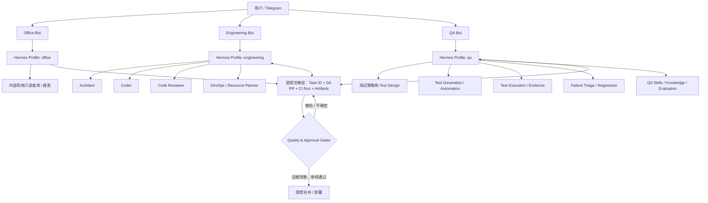
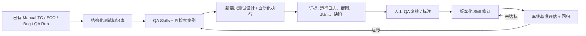

# Hermes 多 Agent 平台架构与实施方案（v2.0 · QA 独立版）

> **文档日期：** 2026-10-27  
> **状态：** 架构设计与实施基线；未连接、修改或部署用户的 Hermes、Telegram、Jenkins 或内部系统。  
> **相对 v1.0 的核心变化：** QA 从 Engineering 下属临时 Tester 升级为独立、长期运行的 `qa` Profile，拥有专属 Telegram Bot、Skills、Memory、测试资产、评估体系及安全边界。  
> **优先目标：** 在保证可追溯性、质量和安全性的条件下，逐步自动化传统人工 QA 的重复性工作；不以未经验证的 AI 输出代替测试证据。

## 0. 执行摘要与已确定决策

采用 **三个长期 Hermes Profiles / 三个独立 Telegram Bots**：

| 独立 Profile | 对外入口 | 核心定位 | 所有权边界 |
|---|---|---|---|
| `office` | Office Bot / 办公小助手 | 内部系统检索、Test Case/ECO 查询、报表与办公自动化 | 信息获取与整理，不拥有测试放行权 |
| `engineering` | Engineering Bot / 工程助手 | 软件架构、编码、代码审查、DevOps 规划与工程协同 | 产品/框架实现与变更建议，不自证其代码质量 |
| **`qa`** | **QA Bot / QA 专家** | **测试需求分析、用例设计、手动测试转自动化、执行、分析、回归和质量评估** | **独立测试标准、执行证据与质量结论，不隶属 Coder** |

工程 Profile 内暂设 **Architect、Coder、Code Reviewer、DevOps/Resource Planner** 四种专业工作模式/按需 Subagents。QA 不再是 Engineering 的一个临时 Tester；即使 QA 内部未来也会调用自己的子 Agent，**QA 的 Profile 仍是独立的长期能力中心**。

### 最终推荐架构



**重要：** 图中的双向箭头表示**设计目标**，不是声称 Hermes 不同 Profiles 之间已经原生共享上下文或可以直接相互委派。v1 先以 Git PR、任务清单、Jenkins 报告及规范化产物手动/受控交接；v2 才考虑引入队列、API 或有审计的外部 orchestrator。

---

## 1. 设计原则

1. **QA 独立性**：开发者不能同时作为其代码的唯一质量裁判。QA 使用独立 Profile、测试标准、记忆、凭据和结果记录。
2. **Production-grade，避免玩具实现**：强调可维护性、模块边界、兼容性、故障恢复、可观察性、测试覆盖、运行成本和迁移路径；不等于盲目引入微服务/Kubernetes。
3. **先只读、再沙箱写入、最后受控执行**：角色说明（`SOUL.md`）不是安全隔离；授权必须由 OS/容器/密钥/Jenkins RBAC/API 层强制落实。
4. **以证据而非口头结论为准**：无日志、无测试报告、无执行环境、无提交 SHA，不能宣称 PASS。
5. **Skills 可版本化、可审查、可回归测试**：第三方 ECC Skill 只作为起点，不直接视为可信可执行代码。
6. **任务上下文与知识长期资产分离**：Session 可以重置；需求、设计、用例、缺陷和已验证经验必须沉淀为 Git/知识库资产。
7. **质量可量化**：QA Agent 的能力增长用基准任务的效果衡量，而不是 Skills 数量或聊天效果。

## 2. Profiles、Subagents、Skills 的边界

**Profile**：长期 Agent 环境，有独立 `config.yaml`、`.env`、`SOUL.md`、skills、memory、session、定时任务与状态。`office`、`engineering`、`qa` 是三个 Profiles。

**Subagent**：短期、任务级辅助进程，通常由 Hermes `delegate_task` 产生；有独立上下文，但默认继承父 Agent 已启用的工具权限，**并不是独立的安全主体**。因此 Engineering 里让 Reviewer 作为 Subagent 并不能保证操作系统级只读；需要外部约束。

**Skill**：按需加载的领域操作规范，可能包含 `SKILL.md`、参考资料、脚本/模板。Skill 不自动增加 API 权限，也不代表专门训练过模型参数。

**Workspace**：终端操作的工作目录，和 Profile 目录不等价；同一 Linux 用户下，Profile 彼此之间通常不具备真正的文件系统隔离。对于 QA 的重要独立性，建议使用受限服务账户/容器/只读工作树及受控凭据。

## 3. 三个 Profile 的详细职责

### 3.1 Office Assistant：`office`

**输入**：自然语言查询、Test Case ID、ECO ID、版本、模块、日期、项目名。  
**核心技能**：
- `testcase-lookup-readonly`：根据 QAID、功能模块、Release、Priority、Automation 状态检索测试用例。
- `eco-search-readonly`：按 ECO 编号、状态、版本、关联问题查询；待确认 ECO 的具体系统及接口。
- `jenkins-summary-readonly`：最近 Build、构建趋势、失败率、报告链接。
- `report-summarizer`：生成包含数据来源、查询范围、采样时间和缺口说明的周报/日报。
- `knowledge-navigation`：在经过授权的文档范围内检索操作流程。

**权限**：默认只读，禁止自行写入 ECO/Test Case 系统、修改 Jenkins job 或发送含敏感内容的群发消息。  
**输出**：`source`、`query`、`retrieved_at`、`result`、`uncertainty` 和可访问的源链接。

### 3.2 Engineering Assistant：`engineering`

**角色一，Software Architect**：需求细化、接口设计、数据模型、架构权衡、容量估算、错误处理、兼容性、安全评估、ADR（Architecture Decision Record）。

**角色二，Coder**：Python、Selenium Page Object、pytest、CLI/REST 工具、bug fix、重构与必要的测试实现。默认只写独立的 feature branch / 隔离工作区。

**角色三，Code Reviewer**：静态检查、模块边界、代码复杂度、性能、安全、可维护性与设计一致性；输出 BLOCKER / MAJOR / MINOR 的证据清单。审查不替代 QA 的真实测试。

**角色四，DevOps / Resource Planner**：Jenkins Pipeline、Docker、容器和服务器资源（CPU/RAM/Disk/worker/queue）盘点、容量规划、日志与故障诊断、滚动升级和回滚设计。默认只读；生产执行需独立审批和执行身份。

**建议首批 Skills**：从 ECC 审核引入 `tdd-workflow`、`verification-loop`、`security-review`，并创建自有 `architecture-review`、`jenkins-readonly`、`resource-inventory`。

**输出**：ADR、任务计划、Git 分支/PR、真实构建与测试证据、Review 结论、资源变更建议。**Engineering 不自行替代独立 QA 的 Acceptance Sign-off**。

### 3.3 独立 QA Agent：`qa`（战略重点）

QA 必须拥有：
- 独立 Profile 与 Telegram QA Bot；
- 独立 `SOUL.md`、长期测试知识库、Skills 和会话；
- 可追溯的测试资产：Test Plan、Test Case、数据集、环境拓扑、执行日志、截图、录像、JUnit/XML/Allure/HTML 报告、Bug/Issue；
- 只读产品需求/设计文档接口；在隔离测试环境执行的受控权限；
- 客观评估和人工反馈机制。

**职责与能力矩阵**：

| QA 能力 | 具体任务 | 标准输出 | 首期自动化程度 |
|---|---|---|---|
| Requirement Analysis | 提取验收条件、依赖、边界值、风险 | Requirement→Test Traceability | 自动起草，人工审核 |
| Test Design | 功能、异常、负面、状态迁移、兼容性、升级路径 | Test Plan + Test Cases + Risk | 自动设计，抽样审查 |
| Existing TC Intelligence | QAID 检索、去重、关联 ECO/Bug/Release | 测试覆盖矩阵与缺口 | 只读自动化 |
| Manual QA Assistant | 将人工步骤转为可复现的动作与期望 | Step-by-step + Evidence | 人机协同 |
| Test Automation | 生成 pytest/Selenium/POM、API 测试、fixture | 可审查 PR、测试代码 | 沙箱生成+Review |
| Test Execution | 选择 Jenkins Job、版本、环境、并行度 | Run ID、SHA、环境、报告 | 测试环境受控执行 |
| Failure Triage | 结合 Logs、录像、Network、截图与 Build 差异定位 | Bug / Test Flake / Environment 分类 + 证据 | AI 初判，人工抽查 |
| Regression Strategy | 风险驱动测试选择、影响分析 | Priority/Selected Cases/理由 | 建议先行 |
| Release Readiness | 基于覆盖、故障和风险给出质量结论 | Go/No-Go 建议及未解决风险 | 有人审批的建议 |
| QA Capability Evaluation | 评价 Skills 的准确性、漏检率、误报率 | Benchmarks + Trend + 失败案例 | 每次变更必跑 |

**领域化技能建议（优先级顺序）**：
1. `qa-testcase-intelligence`：QAID、Release、Priority、覆盖矩阵、去重。
2. `qa-test-design`：等价类、边界值、状态转换、异常路径、风险优先级。
3. `qa-selenium-pytest`：与现有 Python POM、fixture、marker、ReportPortal/JUnit/Allure 契约相容。
4. `qa-environment-readiness`：测试环境健康检查、配置、许可、日志源、测试数据前置条件。
5. `qa-log-injection-validation`：在授权测试环境执行并核验注入日志与 FortiOS GUI 搜索/过滤行为。
6. `qa-triage`：区分产品缺陷、自动化脚本问题、Flaky、环境和数据缺失。
7. `qa-report-evidence`：汇总截图、视频、CLI/REST 输出、ReportPortal/Jenkins 链接。
8. `qa-release-risk`：需求覆盖、回归结果、阻塞缺陷、发布风险；**只能形成建议**。
9. `qa-evaluator`：对 QA Agent 本身做定期基准测试，驱动 Skill 迭代。

**QA SOUL.md 行为规范建议**：
> 我是独立 QA 专家。我的职责是挑战假设、验证需求、发现缺陷、维护测试证据。不得把“没有发现失败”等同“证明正确”；不得把生成的测试代码视为已执行通过；无法执行时标记 `NOT RUN`；对不确定和环境缺失明确披露；报告必须关联版本、commit SHA、Test Case、实际/预期结果和证据；发现缺陷时先构建最小复现；对高风险、不可逆变更申请人工审批。

**关于“训练 QA”**：第一阶段建议使用 *Skill 文档迭代 + 测试知识库检索（RAG）+ 经审查的案例库 + 自动评估与人工反馈*，不应把“记录了几次聊天”称为模型微调。以后若有足够标注数据、数据许可与算力，才评估真正的模型 Fine-tuning。内部代码、客户信息和日志进入外部模型前必须符合公司数据政策。

## 4. QA 能力建设的学习闭环



**推荐质量指标（作为试点目标，不是当前测量值）**：
- 测试设计：风险场景召回率、需求→用例可追溯比例、专家复核通过率。
- 自动化：可运行用例比例、首次运行成功率、Flaky Rate、维护成本。
- 缺陷分析：Bug/Env/Script 分类 Precision/Recall、误报与漏报、平均定位时间。
- 执行过程：可复现率、证据完整率、`NOT RUN` 正确标注率。
- 安全：未经授权操作计数应为零；审批拒绝后执行计数应为零。
- 效率：每个通过复核的测试用例所需人工时间，以及与基线人工 QA 的差异。

**推荐评估集**：先整理 30–50 个匿名或脱敏的典型测试任务，覆盖正常、负面、边界、升级、环境失败、日志缺失、Flaky 和权限拒绝。为每项任务准备专家期望、测试数据、证据和评分 Rubric。单纯跑几个 Demo 不足以证明可替代人工 QA。

## 5. 跨 Profile 协作协议（不共享聊天历史）

建议所有跨 Agent 任务统一 Task Contract。**第一版：使用 Git/Issue/Jenkins Artifact / 文档等受控媒介手动交接；第二版：封装为 API/Queue 事件。**

```yaml
# 示例：工作产品契约；不是 Hermes 原生配置格式
schema_version: '1.0'
task_id: ENG-2026-001
requester: engineering
assignee: qa
work_type: regression_validation
repo: internal/gui-autotest
branch: feature/example
commit_sha: '<exact-sha>'
release: '7.x'
requirement_refs:
  - 'REQ-001'
testcase_refs:
  - 'QAID-12345'
environment: 'staging-qa-01'
constraints:
  can_write_product_repo: false
  can_trigger_staging_job: false  # v1 首先只提交请求，不自行触发
  can_touch_production: false
acceptance_criteria:
  - '关键路径无 Blocker/Critical 失败'
  - '全部结果都关联可复现证据'
expected_outputs:
  - 'test-plan.md'
  - 'qa-results.json'
  - 'evidence-links.md'
  - 'release-risk.md'
status: 'REQUESTED'
```

**状态机建议**：`REQUESTED → ACCEPTED → IN_PROGRESS → NEEDS_INFO | BLOCKED | REVIEW_REQUIRED → COMPLETED / REJECTED`。每一步记录操作者、时间、版本、产物 URI 和审批记录。

**标准交接顺序**：
1. Engineering Architect 产出需求分析、ADR、Acceptance Criteria。
2. Coder 在隔离分支提交 PR，列出 commit SHA 和变更范围。
3. Code Reviewer 对同一个 SHA 审核；生成待修复缺陷。
4. **独立 QA Profile** 根据原始需求而非仅凭 Coder 自述设计测试，决定测试范围并安排受控运行。
5. QA 记录每条测试用例的 `PASS/FAIL/BLOCKED/NOT RUN`、实际行为与证据；回传缺陷与 Release Risk。
6. Engineering 修复后提交新 SHA；QA 执行定向与必要回归。
7. 质量与发布门禁综合 PR、CI、QA 结果，交由授权人员做最终决定。

**明确避免**：依赖 Telegram 的单一会话转述所有上下文；未经授权跨 Profile 共享 API Key；凭父 Agent 提示词假装 Reviewer/QA 有权限隔离；使用与待测实现相同的输出作为唯一正确性 Oracle。

## 6. 多 Telegram Bot / Gateway 运行拓扑

### 推荐方案（当前官方文档）：Host Multiplexing

在一台主机上保留三个不同 Telegram Bot Tokens，每个 Profile 的 `.env` 和配置独立；默认 Gateway 服务多个 Profile。官方的 Multi-Profile Gateway 文档目前说明在满足安全前置条件时 multiplex 默认可启用，并鼓励新安装使用单 Host Gateway。但 Hermes 不同版本/页面仍存在历史说明差异，因此务必先检查**安装版本和实际运行状态**，不能仅凭文档推定当前环境。不要同时为同一个 Bot Token 启动两个 Polling 进程。

```bash
# 只读环境盘点：先不要执行安装与重启
hermes --version
hermes profile list
hermes gateway status

# 后续在维护窗口、核实备份后按需创建新 Profiles
hermes profile create office --description 'Read-only office and internal-system assistant'
hermes profile create engineering --description 'Engineering orchestrator for architecture coding review and DevOps planning'
hermes profile create qa --description 'Independent QA automation testing and quality evaluation agent'

# 在每个 Profile 的 .env 配置独立的 TELEGRAM_BOT_TOKEN
# 保持原有 default Bot 的 Token 不变，避免重复轮询

# 核实安装版本支持之后，再由管理员决策是否启用 multiplex
hermes config set gateway.multiplex_profiles true
hermes gateway restart
hermes gateway status
```

> **重要迁移策略**：如果你现在 `default` 已接入 Telegram，不应直接迁移旧 token 到新 Profile。建议先备份配置与 Memory，新建 `office`、`engineering`、`qa` 三个 Bot 验证后，再确定是保留 default 作为维护入口，还是有计划地停用。若旧版已经有多个单独 Gateway，先评估官方 `hermes gateway migrate --multiplex` 的前置条件与回滚路径。上面的创建/重启命令是**未来步骤**，不是自动执行记录。

### 示例 Profile 目录（逻辑）

```text
~/.hermes/
├── config.yaml                  # default / host gateway
├── .env
├── profiles/
│   ├── office/
│   │   ├── config.yaml
│   │   ├── .env                 # Office 专用 Telegram Token / 查询凭据
│   │   ├── SOUL.md
│   │   ├── skills/
│   │   └── memories/
│   ├── engineering/
│   │   ├── config.yaml
│   │   ├── .env                 # Engineering Bot / Dev credentials
│   │   ├── SOUL.md
│   │   ├── skills/
│   │   └── memories/
│   └── qa/
│       ├── config.yaml
│       ├── .env                 # QA Bot / restricted testing credentials
│       ├── SOUL.md
│       ├── skills/
│       └── memories/
```

Hermes Profile 不等于 Sandbox。对于 QA 与 Engineering 真正独立权限的生产应用，可将测试执行器、代码工作区以及 CI 凭据进一步拆到不同 OS 账户/容器/服务身份。

## 7. 权限模型与审批

**P0 — 只读**：查询 Test Case/ECO、Git/PR、Jenkins job/status、主机资源清单。  
**P1 — 隔离写入**：在 Sandbox 内新增测试代码、临时数据和文档；feature branch 草稿。  
**P2 — 明确审批执行**：触发会修改共享测试环境的 Jenkins Job、环境重置、变更测试数据、修改 CI、合并 PR。  
**P3 — 高危/生产动作**：生产部署、删除大批 Docker 资源、修改权限或密钥、执行破坏性操作；必须由专门授权执行服务并人工审批，不授予通用 Telegram Bot。

| Profile / 角色 | 默认能力 | 不允许直接执行 |
|---|---|---|
| `office` | P0 | 更改 ECO/用例记录、对外发送敏感报告 |
| `engineering` 主协调者 | P0 + 任务编排；受控 P1 | Production deploy、任意服务器管理员操作 |
| Architect | P0 + ADR 文档 | 系统变更 |
| Coder | 独立工作树 P1 | Push protected branch、合并、绕过 review |
| Reviewer | P0（靠执行环境/凭据限制） | 修改被审查 PR 后自行批准 |
| **`qa`** | **P0 + QA Sandbox 中受控 P1** | **未经审批改生产、共享环境重置、伪造测试 PASS** |
| DevOps Planner | P0 + 变更计划 | 直接重启 Jenkins/删除容器/生产部署 |

**技术措施**：
- Telegram Bot 采用用户 allowlist 或配对授权；限制高风险 Slash Commands。
- Bot token、Git token、Jenkins token、内部 API Key 分开保存在受控秘密存储；绝不写到仓库、Skill 文档、测试报告和聊天正文。
- Jenkins 使用有限 Scope 的 Service Account；优先 job-level permission。
- `engineering` 代码工作区与 `qa` 执行器分离，QA 对候选软件可读，但不应有生产写权限。
- 高风险执行使用明确的审批单、审批人、目标范围、超时和可回滚步骤。
- 使用独立审计日志，记录 Task ID、Profile、User、Tool、Action、Target、Result、Approval ID。

## 8. ECC 与 Hermes 的集成策略

- ECC 官方仓库提供 Hermes 安装适配器；官方 `.hermes/README.md` 说明它主要提供 `rules/ecc/`、`skills/ecc/`、`commands/`、`AGENTS.md`，不会触碰 Hermes `config.yaml` 或 `.env`。
- **不要盲装到所有 Profiles**。ECC 偏工程编码技能，主要进入 `engineering`；QA 应以独立测试规范与领域知识为主。若某项通用 ECC Skill 适合 QA，则经过审查后以独立版本维护，避免自动同步造成 QA 行为突变。
- 推荐先测试：`tdd-workflow`、`verification-loop`、`security-review`；逐项检查 `SKILL.md` 中的 Claude Code hooks、命令、脚本依赖、网络调用、权限与自动 Git 操作。
- Skills 迭代必须遵循：上游来源与 Commit → 源码/安全扫描 → Sandbox 试运行 → 基准评估 → 人工签核 → Profile 安装 → 回滚版本记录。
- 基准性能差或 Prompt Injection 风险明显的 Skill 应拒绝接入，不能仅因为 Github Star 多就信任。

**可参考的 ECC 非破坏性预览命令**（以仓库当时版本帮助信息为准）：

```bash
git clone https://github.com/affaan-m/ECC.git
cd ECC
./install.sh --target hermes --profile minimal --dry-run
# 先检查将写入的位置，再决定是否执行实际安装
```

## 9. QA 系统集成清单

| 资源 | 主要用途 | 接入建议 | 重点约束 |
|---|---|---|---|
| Test Case / QAID 数据源 | 查询已有用例、覆盖、Priority | 只读 API/适配器 | 来源和版本可追溯 |
| ECO / Issue Tracking | 变更范围与缺陷关联 | 只读起步 | 不直接改关键记录 |
| Git 仓库 | POM、pytest、配置、变更差异 | Read-only；QA 测试代码走 PR | SHA 固定；敏感仓库授权 |
| Jenkins | Trigger/Read Run、Artifacts | 先只读，后受控 Trigger | RBAC、job 范围、配额 |
| Docker / Hosts | 执行容量、环境健康、日志 | 只读指标代理 | 不把 Docker Socket 直接暴露给 Agent |
| ReportPortal / Allure / JUnit | 测试历史与质量趋势 | 报表读取 | 错误归因时保留原证据 |
| FortiOS GUI/CLI/REST | 验证行为、读取状态 | 隔离实验/测试环境 | 不向生产设备注入测试数据 |
| Artifact Store | 截图、视频、日志、报告 | 带任务编号与生命周期管理 | 敏感日志脱敏与访问控制 |

## 10. 阶段性实施路线与验收

### Phase 0 — 盘点与备份（无生产变更）
- [ ] 记录 `hermes --version`、`hermes profile list`、`hermes gateway status`。
- [ ] 备份 Hermes 配置/非敏感状态；安全备份 Secrets，禁止打包公开。
- [ ] 核实当前 Telegram Bot token 所属 Profile，识别是否已有多 Gateway 或重复 Token。
- [ ] 核实 Test Case/ECO/Jenkins/Git/ReportPortal 的 API、可用账户、权限与审计要求。
- [ ] 拟定三 Bot 的命名、负责人和访问白名单。

**验收**：有可复现环境清单和回滚计划，尚未改变现网权限。

### Phase 1 — 三 Profile / 三 Bot（只读试点）
- [ ] 创建 `office`、`engineering`、`qa`；分配独立 Bot Tokens。
- [ ] 各自设置 `SOUL.md`、model、allowlist、最小权限和默认工作区。
- [ ] Office：查询 Test Case、ECO、Jenkins Build。
- [ ] Engineering：只读了解 Git/Build/资源清单，并能产出 ADR。
- [ ] QA：检索 QAID、分析测试需求、产出测试计划/覆盖矩阵，但先不执行有副作用操作。
- [ ] 验证三个 Profile 的 Session/Memory/Secrets 隔离及 Token 冲突处理。

**验收**：不同 Bot 返回正确角色、不会串 Profile；每项查询能注明来源、时间和权限边界。

### Phase 2 — QA 最小闭环（优先实现）
- [ ] 从 QA 组既有资料整理经审核的测试设计标准、20+ 样本用例、典型故障与分析结论。
- [ ] 建立 `qa-test-design`、`qa-testcase-intelligence`、`qa-evaluator` 的版本化 Skills。
- [ ] QA 接收一个 FortiOS 功能需求：输出 Test Plan、正/负/边界用例、数据与环境前提。
- [ ] QA 在测试 Sandbox 生成可运行的 pytest/Selenium/POM 用例，经过 Review 后执行。
- [ ] 报告真实 PASS/FAIL/BLOCKED/NOT RUN、失败日志、截图及重现步骤。
- [ ] 用基准任务检验测试设计、缺陷分类、可靠性、权限合规。

**验收**：至少完成一个可审计的“需求→用例→执行→故障分析→报告”闭环；不能把无执行记录的任务判 PASS。

### Phase 3 — Engineering + 独立 QA 协作
- [ ] Engineering：Architect→Coder→Reviewer 按任务 ID 产出 ADR/PR。
- [ ] QA 从独立需求和指定 Commit SHA 设计测试、验证产物，并反馈 Issues。
- [ ] 建立两边签署的 Artifact Contract，不直接共享个人 Session Memory。
- [ ] 引入必要的 ECC Skills 及代码质量检查。
- [ ] 完成缺陷反馈→代码修复→QA 再验证的迭代。

**验收**：同一 Task ID 的 PR、Review、Jenkins Run 和 QA 报告能够双向追踪；QA 可独立判定失败。

### Phase 4 — DevOps 受控调度与 QA 持续优化
- [ ] 只读采集 Jenkins 队列、测试容器 CPU/RAM/Disk、历史耗时与失败率。
- [ ] 生成容量计划和执行建议；审批后才触发受限的测试环境 Pipeline。
- [ ] QA 每周/每版本评估知识库和 Skills，记录误报、漏报和质量退化。
- [ ] 实施 CI/CD 安全、审计、成本、失败回滚与值班通知。

**验收**：审批拒绝后系统不执行，变更有完整审计；QA 指标可量化改善。

## 11. 三个首批验收场景

**A. Office Bot：信息检索**  
“检索指定功能在 7.x Release 的 Test Cases，列出 QAID、Priority、Automation 状态、关联 ECO、最近一轮 CI 结果；只读，附来源和缺失数据说明。”

**B. Engineering Bot：生产级开发**  
“为 Selenium Page Object Framework 增加一个元素定位策略。先给 ADR 和兼容性分析，经审批后提交 Feature Branch，再完成 Code Review；禁止直接合并主分支。”

**C. QA Bot：独立质量验证（核心）**  
“针对上述 PR 的 Commit SHA，根据需求重新设计正向、异常、边界和回归测试。生成用例并在批准的测试环境运行；输出真实执行报告、环境与证据；对 FAIL 建 Bug 并给出复现步骤，不得自动判定上线通过。”

## 12. 目前尚需确认的信息（不阻碍架构定稿）

- Hermes 当前版本、操作系统和部署方式（CLI/systemd、Docker、multiplex 或 standalone）。
- 已有 Telegram Bot 是否保留为 default 管理入口。
- ECO / Test Case 数据源的实际类型、API、认证方式、数据脱敏要求。
- QA 是否可以访问测试设备和 Jenkins 测试环境，是否有独立 Service Account。
- Git/CI 的真实仓库结构、默认分支规则、ReportPortal/Allure 版本。
- 是否允许把公司内部数据发送给选定的第三方模型；相关政策需先确认。

## 13. 官方参考与版本提示

访问时间：2026-10-27。Hermes 更新较快，执行前以安装版本的 CLI help 和官方当前文档为准：

1. Hermes Profiles：https://hermes-agent.nousresearch.com/docs/user-guide/profiles
2. Hermes Multi-Profile Gateway：https://hermes-agent.nousresearch.com/docs/user-guide/multi-profile-gateways
3. Hermes Subagent Delegation：https://hermes-agent.nousresearch.com/docs/user-guide/features/delegation
4. Hermes Skills：https://hermes-agent.nousresearch.com/docs/user-guide/features/skills
5. Hermes Security：https://hermes-agent.nousresearch.com/docs/user-guide/security
6. ECC GitHub：https://github.com/affaan-m/ECC
7. ECC Hermes Adapter：https://github.com/affaan-m/ECC/blob/main/.hermes/README.md

---

## 结论

本方案从旧版“Office + Engineering，其中 Tester 作为临时子 Agent”，正式升级为 **Office + Engineering + 独立 QA** 三支柱架构。**QA 是一个可持续进化的专业智能体体系，而不是 Engineering 的测试工具**。其成长路径是：只读测试知识 → 可审核的测试设计 → 沙箱自动执行 → 有证据的诊断与回归 → 可衡量的持续改进 → 经过审批的受控 CI 执行。软件质量的最终批准仍由经过授权的人员和组织流程负责。
